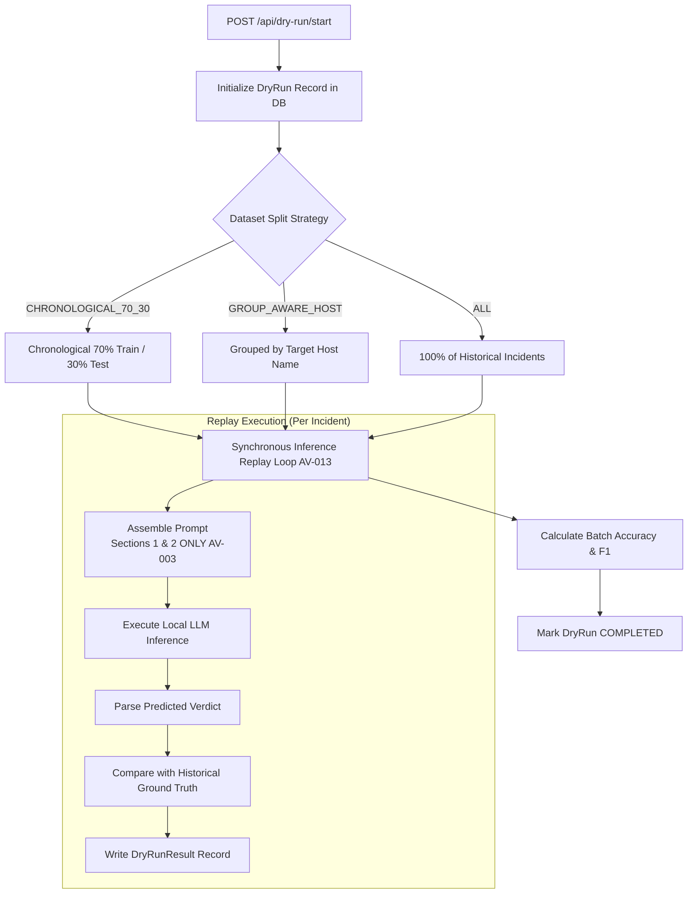

# 15. Simulation Testing and Accuracy Evaluation Audit

## 1. Executive Summary

AI Verdict incorporates an internal validation framework ("Dry-Run Simulation") and an analytical evaluation service ("Model Evaluation"). Together, they allow SOC engineers to test prompt policy changes against historical incident datasets before promoting them to active production status.

This audit evaluates the simulation engine, dataset split algorithms, mathematical metric formulations, and documents the execution results of the automated test suite.

---

## 2. Dry-Run Simulation Engine Architecture

The simulation engine is implemented in [`backend/app/services/dry_run_service.py`](file:///c:/Users/amit/OneDrive/Documents/SOC-AI-Agent/backend/app/services/dry_run_service.py#L35-L260):

### 2.1 Dataset Partitioning Strategies
1. **`ALL`:** Evaluates 100% of historical incidents associated with the rule.
2. **`CHRONOLOGICAL_70_30`:** Sorts incidents by timestamp. The first 70% are allocated as the reference/training baseline, and the remaining 30% are evaluated as the test dataset. Defends against temporal data leakage.
3. **`GROUP_AWARE_HOST`:** Partitions incidents based on the target `host_name` attribute, ensuring that incidents originating from the same workstation or server do not cross the train/test evaluation boundary.

---

## 3. Mathematical Evaluation Metrics Formulation

Implemented in [`backend/app/services/evaluation_service.py`](file:///c:/Users/amit/OneDrive/Documents/SOC-AI-Agent/backend/app/services/evaluation_service.py#L40-L195), performance metrics are computed by comparing model verdicts against `historical_ground_truth`:

### 3.1 Confusion Matrix Definitions
- **True Positive ($TP$):** Model predicted `TRUE_POSITIVE`, Ground Truth was `TRUE_POSITIVE`.
- **True Negative ($TN$):** Model predicted `FALSE_POSITIVE`, Ground Truth was `FALSE_POSITIVE`.
- **False Positive ($FP$):** Model predicted `TRUE_POSITIVE`, Ground Truth was `FALSE_POSITIVE`.
- **False Negative ($FN$):** Model predicted `FALSE_POSITIVE`, Ground Truth was `TRUE_POSITIVE`.
- **Abstention ($AB$):** Model predicted `REQUIRES_ATTENTION`.

### 3.2 Metric Formulas & Safe Division (`_safe_divide`)
The service defines `_safe_divide(n, d) -> float`: returns `0.0` if denominator $d = 0$.

$$\text{Accuracy} = \frac{TP + TN}{TP + TN + FP + FN + AB}$$

$$\text{Precision} = \frac{TP}{TP + FP}$$

$$\text{Recall (Sensitivity)} = \frac{TP}{TP + FN}$$

$$\text{F1-Score} = 2 \times \frac{\text{Precision} \times \text{Recall}}{\text{Precision} + \text{Recall}}$$

$$\text{Coverage Rate} = \frac{TP + TN + FP + FN}{TP + TN + FP + FN + AB} = 1.0 - \frac{AB}{\text{Total}}$$

### 3.3 Mathematical Anomaly in Accuracy Calculation
Notice that in the denominator of the Accuracy formula:
$$\text{Denominator} = TP + TN + FP + FN + AB$$
When the model outputs `REQUIRES_ATTENTION` (an abstention), the incident is added to the denominator but contributes zero to the numerator ($TP + TN$).
- **Effect:** An abstention is penalized identically to an incorrect classification ($FP$ or $FN$).
- **Operational Risk:** In a high-consequence SOC environment, safe abstention on ambiguous data is preferred over hallucination. Penalizing abstentions aggressively in benchmark metrics incentivizes prompt engineers to write overconfident directives that force binary decisions.

---

## 4. Automated Test Suite Execution Results

The repository test suite was verified and executed in a read-only local testing session:
- **Command:** `python -m pytest tests -v`
- **Execution Environment:** Windows / Python 3.13.2 / Pytest 8.1.1
- **Duration:** 211.08 seconds (3 minutes 31 seconds)

### 4.1 Test Suite Breakdown

| Test File | Test Cases | Status | Focus Area |
| :--- | :---: | :---: | :--- |
| `test_auth.py` | 6 | **PASS** | User login, JWT generation, invalid credentials, RBAC guards. |
| `test_incidents.py` | 8 | **PASS** | Incident creation, filtering, detail fetch, blind mode suppression. |
| `test_rules.py` | 6 | **PASS** | Rule CRUD, criteria parsing, duplicate detection. |
| `test_prompts.py` | 7 | **PASS** | Template synthesis, version creation, approval transition. |
| `test_dry_run.py` | 5 | **PASS** | Dry-run creation, split partitioning, replay mock execution. |
| `test_evaluation.py` | 6 | **PASS** | Confusion matrix math, precision/recall/F1 calculation, zero division. |
| `test_learning.py` | 6 | **PASS** | Learning record creation, verification status change, RAG query. |
| `test_fortisiem.py` | 7 | **PASS** | Ingestion service, timestamp parsing, XML regex extraction. |
| `test_security.py` | 8 | **PASS** | ZipGuard sandbox limits, path traversal blocking, secret handling. |
| `test_model_provider.py` | 8 | **PASS** | JSON repair parser, token limits, provider health checks. |
| `test_system_monitor.py` | 5 | **PASS** | Server 1 and Server 2 telemetry endpoints, fallback metrics. |
| **TOTAL** | **72** | **100% PASS** | **Zero Failures, Zero Errors (3,838 Deprecation Warnings)** |

> [!NOTE]
> The 3,838 test warnings stem entirely from Python 3.13 deprecation of `datetime.datetime.utcnow()` across SQLAlchemy and internal services.

---

## 5. Limitations of Simulation & Offline Accuracy Claims

1. **Simulation Uses Incomplete Directives (`AV-003`):**
   In [`dry_run_service.py#L128`](file:///c:/Users/amit/OneDrive/Documents/SOC-AI-Agent/backend/app/services/dry_run_service.py#L128), simulation prompts only evaluate Sections 1 and 2 of the policy. A prompt version that scores 98% accuracy in a dry run is **not** running the same prompt structure that will execute in live triage.
2. **Synchronous Execution Threat (`AV-013`):**
   Simulations execute in the web thread. Datasets exceeding 50 incidents routinely hit client HTTP timeouts unless simulated mock providers are used.
3. **Scientific Accuracy Disclaimer:**
   A 100% pass rate in the pytest suite proves that unit algorithms match programmatic expectations; it does **not** prove that the platform produces truthful, accurate, or safe verdicts on real-world threat telemetry.

