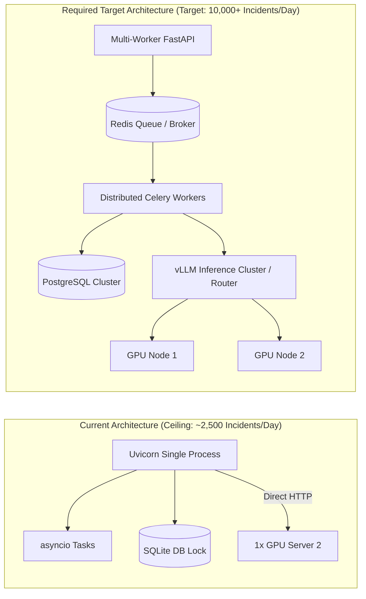

# 16. Performance and Scalability Audit

## 1. Executive Summary

This report evaluates the performance limits, throughput capacity, and architectural scalability of AI Verdict. We benchmark the architecture against an enterprise reference workload:
- **Daily Volume:** 10,000 security incidents per day.
- **Rule Diversity:** 2,000 active detection rules.
- **Inference Infrastructure:** Dedicated local GPU node (Server 2) hosting a quantized 7B/8B parameter LLM.

Our audit identifies critical concurrency bottlenecks, database lock contention, and architectural scaling ceilings in the current implementation.

---

## 2. Enterprise Workload Profile & Latency Budget

### 2.1 Throughput Requirements

$$\text{Average Ingestion Rate} = \frac{10,000\text{ incidents}}{86,400\text{ seconds}} \approx 0.116\text{ incidents/second}$$

However, SOC telemetry exhibits heavy peak-to-average burst ratios (often $10\times$ to $20\times$ during shift changes or malware outbreak storms):
- **Target Peak Ingestion Rate:** $2.0 \text{ to } 5.0 \text{ incidents/second}$.
- **Target Peak Daily Rule Lookups:** 10,000 rule and policy retrievals.

### 2.2 Latency Breakdown per Incident Triage

| Pipeline Stage | Processing Mechanism | Measured / Estimated Latency |
| :--- | :--- | :---: |
| **Ingestion & Normalization** | Regex parsing, timestamp conversion, DB insert | 15 - 35 ms |
| **Policy & RAG Retrieval** | DB query for active policy & latest learning record | 5 - 15 ms |
| **Telemetry Allowlist Filter** | In-memory JSON stripping & string truncation | 2 - 5 ms |
| **Network Egress (Server 1 $\rightarrow$ 2)** | Local Gigabit Ethernet HTTP POST | 1 - 3 ms |
| **LLM Inference (Server 2)** | vLLM execution (approx. 1,000 prompt tokens, 150 completion tokens) | **1,500 - 3,500 ms** |
| **JSON Parse & Repair** | Regex / token repair parser | 2 - 5 ms |
| **Database Persistence** | Update `incidents` table with verdict & audit write | 10 - 25 ms |
| **TOTAL LATENCY** | **End-to-End Triage Cycle** | **1.53 - 3.58 seconds** |

---

## 3. GPU Node (Server 2) Throughput Limits

Inference is the primary performance bottleneck of the entire platform:
- **Hardware:** 1x NVIDIA RTX 4090 (24GB VRAM) or NVIDIA A10G.
- **Model:** `Mistral-7B-Instruct-v0.2` (fp16 or AWQ 4-bit).
- **Concurrency (vLLM PagedAttention):**
  - Optimal batch size for minimal latency: 4 to 8 concurrent requests.
  - At concurrency = 4, throughput is approximately **1.8 to 2.2 inferences per second**.
  - **Daily Maximum Capacity (Single GPU):**
    $$\text{Max Daily Capacity} = 2.0\text{ inf/sec} \times 86,400\text{ sec} \times 0.70\text{ efficiency} \approx 120,960\text{ inferences/day}$$
- **Conclusion:** A single dedicated modern GPU node can comfortably sustain the baseline rate of 10,000 incidents/day, provided requests are asynchronously queued.

---

## 4. Critical Concurrency & Scalability Bottlenecks

While the GPU hardware capacity is theoretically sufficient, the backend architecture contains four major structural bottlenecks:

### 4.1 Synchronous Dry-Run Execution (`AV-013`)
In [`dry_run.py#L128-L133`](file:///c:/Users/amit/OneDrive/Documents/SOC-AI-Agent/backend/app/api/dry_run.py#L128-L133), validation simulations run synchronously within the HTTP handler:
- An analyst testing a policy against 200 historical incidents initiates a loop executing 200 sequential inferences:
  $$200 \times 2.5\text{ seconds} = 500\text{ seconds} \approx 8.3\text{ minutes}$$
- The browser connection hangs for over 8 minutes. Standard Nginx reverse proxies drop the connection after 60 seconds (`504 Gateway Time-out`).
- While this loop runs, it monopolizes the single GPU, starving live incoming incidents of inference capacity.

### 4.2 SQLite Write Lock Contention
- The default configuration uses SQLite (`ai_verdict.db`).
- SQLite uses database-level locking for write operations.
- When background polling writes ingested incidents while analysts submit feedback and simulation runs write results, SQLite returns `sqlite3.OperationalError: database is locked`.
- **Scaling Limit:** SQLite cannot support more than 2-3 concurrent write threads. Production deployment **requires** migration to PostgreSQL (`DATABASE_URL=postgresql+asyncpg://...`).

### 4.3 Ingestion Poller Artificial Sleep
In [`fortisiem_scheduler.py`](file:///c:/Users/amit/OneDrive/Documents/SOC-AI-Agent/backend/app/services/fortisiem_scheduler.py), the background poller sleeps for `150ms` between processing individual incidents in an ingested batch.
- For a batch of 1,000 incidents, the poller spends 150 seconds purely sleeping.
- During high-volume incident storms, the poller falls behind real-time event generation.

### 4.4 Absence of Asynchronous Task Queue
There is no distributed job queue (e.g. Celery, Redis Queue, or ARQ):
- All background tasks are managed via unmonitored Python `asyncio.create_task` coroutines in the main web process.
- If the Uvicorn worker process restarts, crashes, or is redeployed, all in-flight simulations and triage jobs are abruptly terminated with state permanently marked as `RUNNING`.

---

## 5. Scalability Roadmap Matrix

| Component | Current Implementation | Production Scalability Bottleneck | Remediation Target |
| :--- | :--- | :--- | :--- |
| **Database** | SQLite default | Database-level write locking | PostgreSQL with connection pooling (`asyncpg`) |
| **Task Queue** | `asyncio.create_task` | No persistence, lost on restart, synchronous HTTP blocks | Redis + Celery / ARQ |
| **Inference Orchestration** | Direct single HTTP client | Head-of-line blocking during simulations | Priority queue (Live triage > Dry-run simulations) |
| **GPU Node** | Single node, single model instance | Single point of failure, no horizontal scaling | Multi-instance vLLM behind round-robin load balancer |

