# 17. End-to-End System Workflows Audit

## 1. Executive Summary

This report maps the end-to-end operational execution paths of AI Verdict. We provide comprehensive Mermaid sequence diagrams and source-code traceability for the **14 core workflows** governing the application lifecycle, from rule ingestion to model inference, analyst feedback, and system rollback.

---

## 2. Workflow Index & Sequence Diagrams

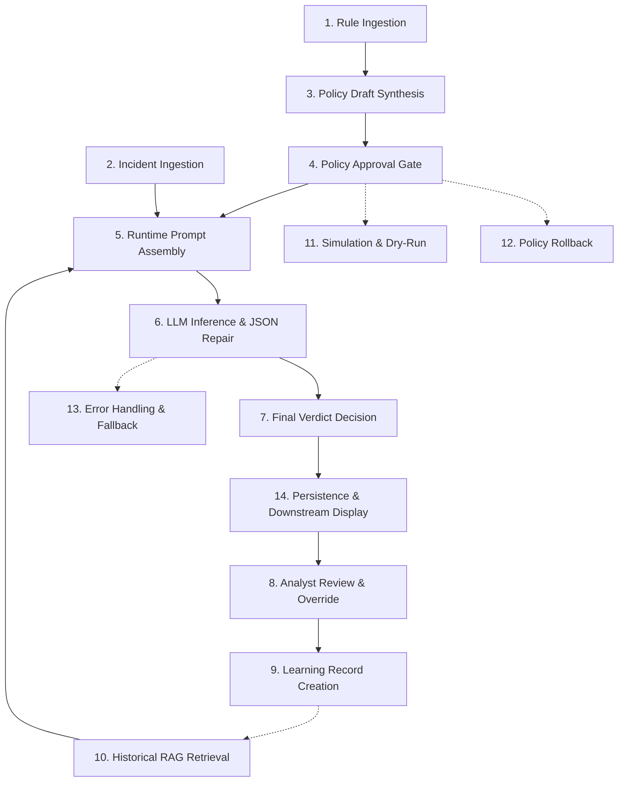

---

### Workflow 1: Detection Rule Ingestion & Synchronization
- **Trigger:** Scheduled sync or `POST /api/fortisiem/sync-rules`
- **Source:** [`backend/app/services/fortisiem_service.py#L180-L240`](file:///c:/Users/amit/OneDrive/Documents/SOC-AI-Agent/backend/app/services/fortisiem_service.py#L180-L240)

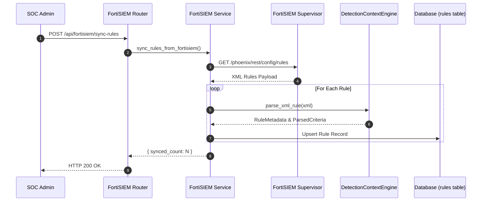

---

### Workflow 2: Incident Ingestion (Continuous Polling & Archive Upload)
- **Trigger:** 180s scheduler tick or `POST /api/incidents/upload`
- **Source:** [`ingestion_service.py`](file:///c:/Users/amit/OneDrive/Documents/SOC-AI-Agent/backend/app/services/ingestion_service.py) & [`fortisiem_scheduler.py`](file:///c:/Users/amit/OneDrive/Documents/SOC-AI-Agent/backend/app/services/fortisiem_scheduler.py)

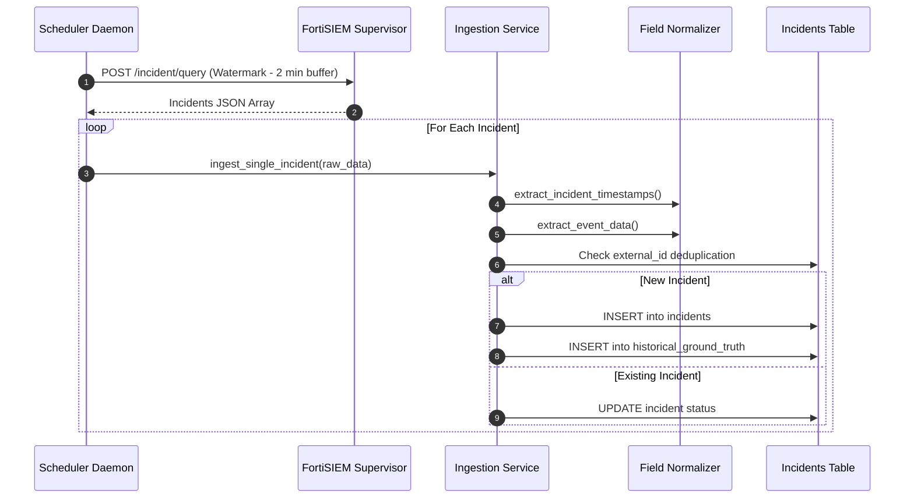

---

### Workflow 3: Policy Draft Synthesis
- **Trigger:** Rule creation or `POST /api/prompts/synthesize/{rule_id}`
- **Source:** [`prompt_studio_service.py#L45-L160`](file:///c:/Users/amit/OneDrive/Documents/SOC-AI-Agent/backend/app/services/prompt_studio_service.py#L45-L160)

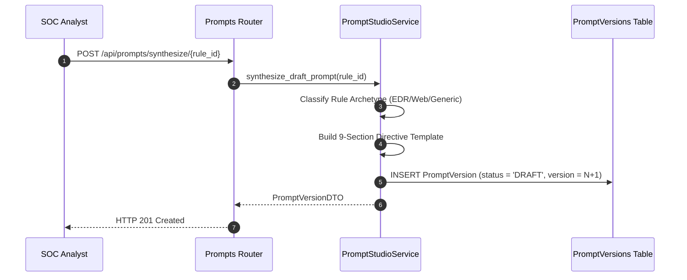

---

### Workflow 4: Policy Approval Gate & Activation
- **Trigger:** `POST /api/prompts/{prompt_id}/approve/{version_id}`
- **Source:** [`prompt_studio_service.py#L180-L220`](file:///c:/Users/amit/OneDrive/Documents/SOC-AI-Agent/backend/app/services/prompt_studio_service.py#L180-L220)

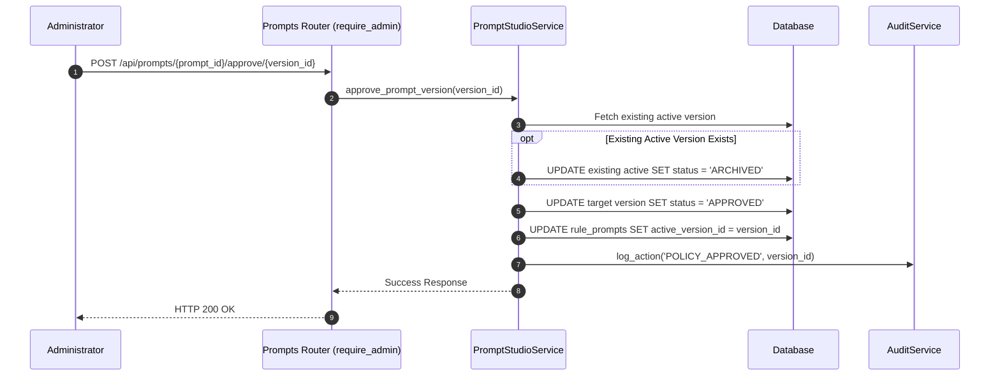

---

### Workflow 5: Runtime Prompt Assembly & Ground-Truth Stripping
- **Trigger:** Internal call prior to model execution
- **Source:** [`ai_verdict_service.py#L130-L185`](file:///c:/Users/amit/OneDrive/Documents/SOC-AI-Agent/backend/app/services/ai_verdict_service.py#L130-L185) & [`model_payload_allowlist.py`](file:///c:/Users/amit/OneDrive/Documents/SOC-AI-Agent/backend/app/llm/model_payload_allowlist.py)

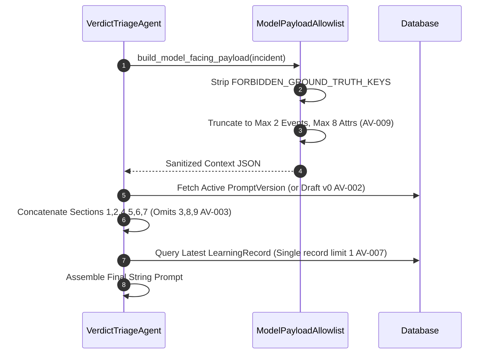

---

### Workflow 6: LLM Inference Call & JSON Repair
- **Trigger:** Assembled prompt execution
- **Source:** [`openai_compatible.py#L140-L390`](file:///c:/Users/amit/OneDrive/Documents/SOC-AI-Agent/backend/app/llm/openai_compatible.py#L140-L390)

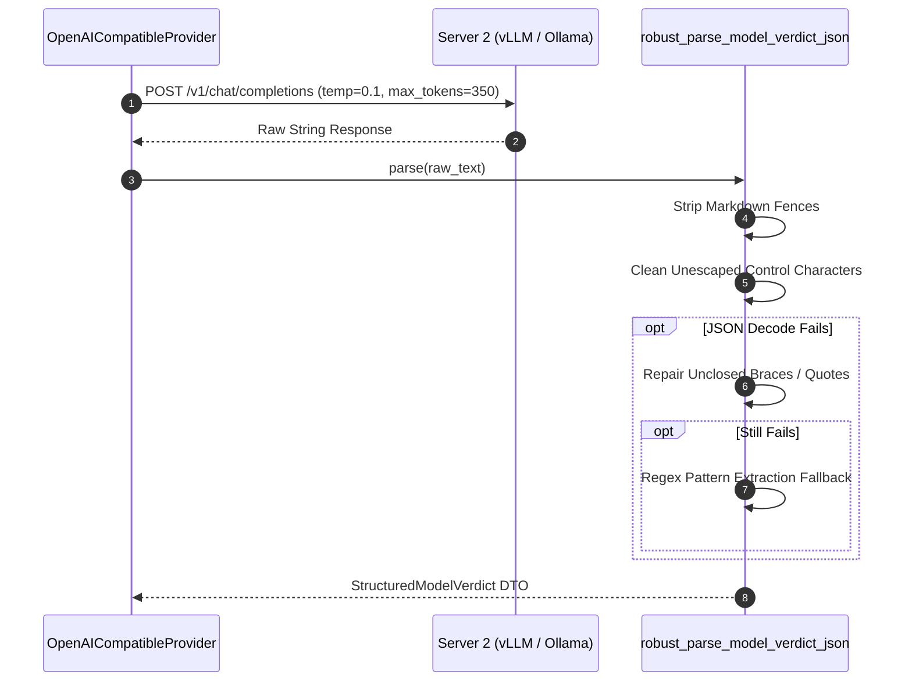

---

### Workflow 7: Final Verdict Decision & Verification Acceptance
- **Trigger:** Receipt of parsed model response
- **Source:** [`ai_verdict_service.py#L260-L290`](file:///c:/Users/amit/OneDrive/Documents/SOC-AI-Agent/backend/app/services/ai_verdict_service.py#L260-L290)

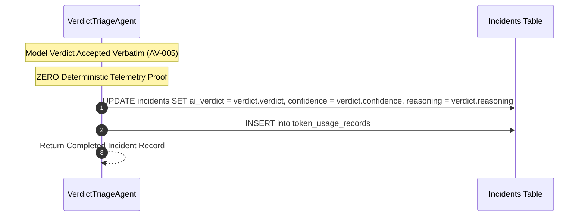

---

### Workflow 8: Analyst Review & Override
- **Trigger:** Analyst submits feedback in Investigation Console
- **Source:** [`investigation_service.py#L303-L355`](file:///c:/Users/amit/OneDrive/Documents/SOC-AI-Agent/backend/app/services/investigation_service.py#L303-L355)

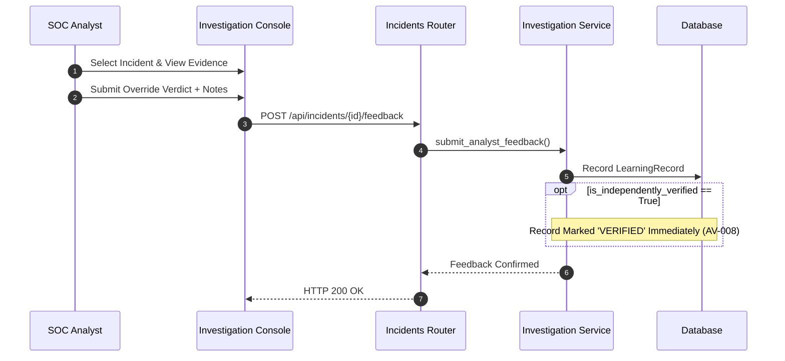

---

### Workflow 9: Learning Record Creation & State Transition
- **Trigger:** Internal persistence of feedback
- **Source:** [`learning_service.py`](file:///c:/Users/amit/OneDrive/Documents/SOC-AI-Agent/backend/app/services/learning_service.py)

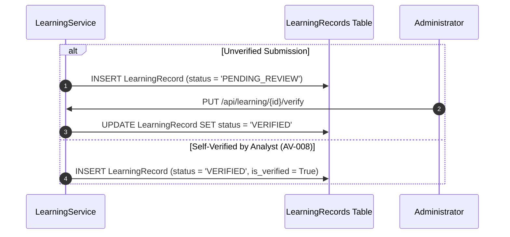

---

### Workflow 10: Historical RAG Retrieval
- **Trigger:** Incident triage few-shot lookup
- **Source:** [`ai_verdict_service.py#L149-L180`](file:///c:/Users/amit/OneDrive/Documents/SOC-AI-Agent/backend/app/services/ai_verdict_service.py#L149-L180)

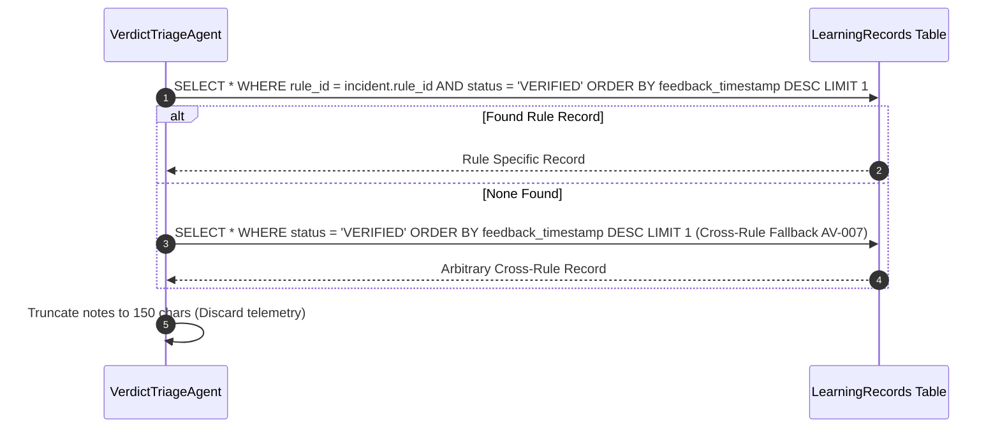

---

### Workflow 11: Simulation & Dry-Run Evaluation
- **Trigger:** `POST /api/dry-run/start`
- **Source:** [`dry_run_service.py#L75-L220`](file:///c:/Users/amit/OneDrive/Documents/SOC-AI-Agent/backend/app/services/dry_run_service.py#L75-L220)

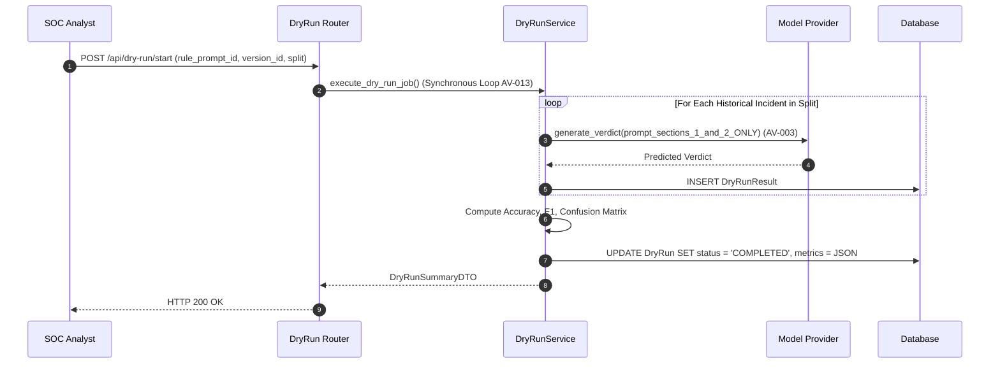

---

### Workflow 12: Policy Rollback
- **Trigger:** `POST /api/prompts/{prompt_id}/rollback/{target_version_id}`
- **Source:** [`prompt_studio_service.py#L225-L260`](file:///c:/Users/amit/OneDrive/Documents/SOC-AI-Agent/backend/app/services/prompt_studio_service.py#L225-L260)

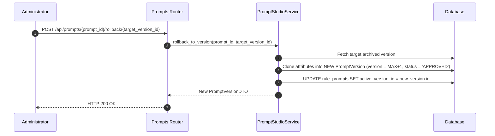

---

### Workflow 13: Error Handling & Mock Fallback
- **Trigger:** Model inference failure or timeout
- **Source:** [`ai_verdict_service.py#L225-L235`](file:///c:/Users/amit/OneDrive/Documents/SOC-AI-Agent/backend/app/services/ai_verdict_service.py#L225-L235)

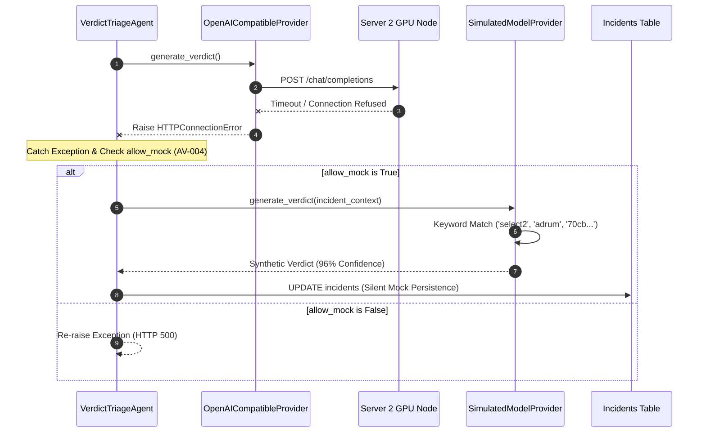

---

### Workflow 14: Incident Persistence & Downstream Actions
- **Trigger:** Successful verdict formation
- **Source:** [`incidents.py`](file:///c:/Users/amit/OneDrive/Documents/SOC-AI-Agent/backend/app/api/incidents.py) & [`fortisiem_service.py`](file:///c:/Users/amit/OneDrive/Documents/SOC-AI-Agent/backend/app/services/fortisiem_service.py)

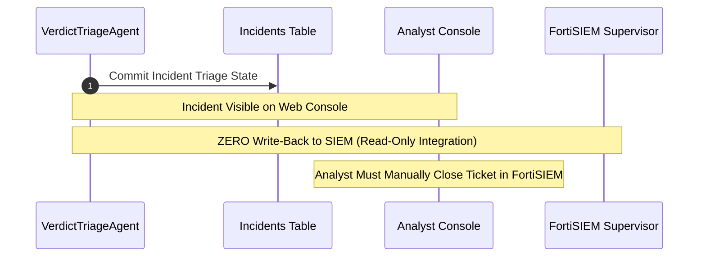

