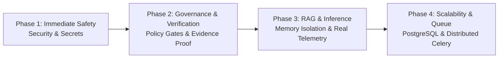

# 20. Recommendations for Future Review and Roadmap

## 1. Executive Summary

This report outlines prioritized, strategic architectural recommendations resulting from the AI Verdict technical audit. In strict accordance with the non-destructive audit mandate, **no code has been modified during this engagement**.

The recommendations below are organized into logical implementation phases based on operational risk, safety, and architectural necessity. Each item specifies the underlying problem, supporting finding IDs, affected components, required evidence, and consequences of inaction.

---

## 2. Priority Phase 1: Immediate Safety & Security Hardening

### REC-01: Remove Hardcoded Secrets and Implement Secret Vaulting
- **Underlying Problem:** Default fallback secret key permits JWT forgery; FortiSIEM password is saved in cleartext `.env`.
- **Supporting Finding ID:** **AV-014**
- **Affected Components:** [`backend/app/config.py`](file:///c:/Users/amit/OneDrive/Documents/SOC-AI-Agent/backend/app/config.py), [`fortisiem_service.py`](file:///c:/Users/amit/OneDrive/Documents/SOC-AI-Agent/backend/app/services/fortisiem_service.py)
- **Required Verification:** Server must refuse to boot if `SECRET_KEY` is not provided in the environment. Credentials must be encrypted at rest or injected via a secure secret store (e.g. HashiCorp Vault, AWS Secrets Manager, or systemd-creds).
- **Consequence of Inaction:** Complete administrative account takeover by any entity with codebase access.

### REC-02: Disable Silent Simulated Mock Fallback in Production
- **Underlying Problem:** Local LLM timeout/error triggers silent fallback to `SimulatedModelProvider`, outputting synthetic verdicts based on fixture keywords.
- **Supporting Finding ID:** **AV-004**
- **Affected Components:** [`backend/app/services/ai_verdict_service.py`](file:///c:/Users/amit/OneDrive/Documents/SOC-AI-Agent/backend/app/services/ai_verdict_service.py), `backend/.env`
- **Required Verification:** Set `LOCAL_LLM_ALLOW_MOCK_FALLBACK=false`. When inference fails, system must fail loudly, log an infrastructure error, and triage the incident as `REQUIRES_ATTENTION`.
- **Consequence of Inaction:** Outages of Server 2 remain undetected while the system generates fictional verdicts.

### REC-03: Strip Historical Ground Truth from Blind Review Payloads
- **Underlying Problem:** The backend passes `raw_payload` unredacted in blind review mode, leaking historical resolutions to analysts.
- **Supporting Finding ID:** **AV-006**
- **Affected Components:** [`backend/app/services/incident_service.py`](file:///c:/Users/amit/OneDrive/Documents/SOC-AI-Agent/backend/app/services/incident_service.py), [`incidents.py`](file:///c:/Users/amit/OneDrive/Documents/SOC-AI-Agent/backend/app/api/incidents.py)
- **Required Verification:** Filter `raw_payload` in `incident_service.py` to remove `clearedReason`, `resolution`, `clearedUser`, and closing comments before returning JSON to the client.
- **Consequence of Inaction:** Compromises scientific objectivity of human benchmark studies.

---

## 3. Priority Phase 2: Policy Governance & Evidence Grounding

### REC-04: Enforce Mandatory Administrative Approval for All Policies
- **Underlying Problem:** Ingestion service automatically activates heuristic draft prompts without human approval.
- **Supporting Finding ID:** **AV-001**, **AV-002**
- **Affected Components:** [`ingestion_service.py`](file:///c:/Users/amit/OneDrive/Documents/SOC-AI-Agent/backend/app/services/ingestion_service.py), [`fortisiem_service.py`](file:///c:/Users/amit/OneDrive/Documents/SOC-AI-Agent/backend/app/services/fortisiem_service.py), [`ai_verdict_service.py`](file:///c:/Users/amit/OneDrive/Documents/SOC-AI-Agent/backend/app/services/ai_verdict_service.py)
- **Required Verification:** Remove auto-assignment `rp.active_version_id = draft.id`. If a rule has no approved version, the decision engine must abstain (`REQUIRES_ATTENTION`) until approved by an Administrator.
- **Consequence of Inaction:** Unreviewed heuristic prompts make live triage decisions in production.

### REC-05: Implement Deterministic Evidence Verification Engine
- **Underlying Problem:** Model verdicts and cited evidence are accepted verbatim without independent verification.
- **Supporting Finding ID:** **AV-005**
- **Affected Components:** [`ai_verdict_service.py`](file:///c:/Users/amit/OneDrive/Documents/SOC-AI-Agent/backend/app/services/ai_verdict_service.py), [`incident_service.py`](file:///c:/Users/amit/OneDrive/Documents/SOC-AI-Agent/backend/app/services/incident_service.py)
- **Required Verification:** Build an independent verification layer that validates whether items in `key_evidence` exist in raw incident telemetry. If citations fail verification, downgrade confidence or flag for manual review.
- **Consequence of Inaction:** Hallucinated indicators of compromise are accepted as verified facts.

### REC-06: Unify 9-Section Policy Assembly Between Live Triage and Dry-Runs
- **Underlying Problem:** Live triage omits sections 3, 8, 9; dry-runs assemble only sections 1 and 2.
- **Supporting Finding ID:** **AV-003**
- **Affected Components:** [`ai_verdict_service.py`](file:///c:/Users/amit/OneDrive/Documents/SOC-AI-Agent/backend/app/services/ai_verdict_service.py), [`dry_run_service.py`](file:///c:/Users/amit/OneDrive/Documents/SOC-AI-Agent/backend/app/services/dry_run_service.py)
- **Required Verification:** Create a shared prompt assembly module that injects all 9 sections identically in both live triage and dry-run simulation modes.
- **Consequence of Inaction:** Escalation triggers configured in the UI are ignored by the model; dry-run benchmarks do not reflect live production behavior.

---

## 4. Priority Phase 3: RAG Memory Isolation & Telemetry Integrity

### REC-07: Implement Similarity-Based, Rule-Isolated RAG Retrieval
- **Underlying Problem:** Single newest record retrieved without similarity check; falls back to arbitrary cross-rule records.
- **Supporting Finding ID:** **AV-007**
- **Affected Components:** [`ai_verdict_service.py`](file:///c:/Users/amit/OneDrive/Documents/SOC-AI-Agent/backend/app/services/ai_verdict_service.py), [`learning_service.py`](file:///c:/Users/amit/OneDrive/Documents/SOC-AI-Agent/backend/app/services/learning_service.py)
- **Required Verification:** Integrate `AgentMemoryEngine.find_similar_cases` into live triage; enforce strict rule-scoping (never inject precedents from different detection rules).
- **Consequence of Inaction:** Cross-domain precedent contamination leads to erroneous model reasoning.

### REC-08: Introduce Secondary Supervisor Gate for Learning Records
- **Underlying Problem:** Analyst self-verification immediately promotes feedback to active few-shot prompt.
- **Supporting Finding ID:** **AV-008**
- **Affected Components:** [`investigation_service.py`](file:///c:/Users/amit/OneDrive/Documents/SOC-AI-Agent/backend/app/services/investigation_service.py), [`learning.py`](file:///c:/Users/amit/OneDrive/Documents/SOC-AI-Agent/backend/app/api/learning.py)
- **Required Verification:** Require an explicit administrative action (`PUT /api/learning/{id}/verify`) before feedback status transitions to `VERIFIED`.
- **Consequence of Inaction:** A single analyst mistake immediately poisons few-shot prompt guidance.

### REC-09: Replace Static Telemetry Slicing with Dynamic Token Budgeting
- **Underlying Problem:** Slicing alerts to 2 events, 8 attributes, 180 chars discards critical attack context.
- **Supporting Finding ID:** **AV-009**
- **Affected Components:** [`backend/app/llm/model_payload_allowlist.py`](file:///c:/Users/amit/OneDrive/Documents/SOC-AI-Agent/backend/app/llm/model_payload_allowlist.py)
- **Required Verification:** Replace hardcoded slice limits with a dynamic token-aware budget packer that prioritizes high-entropy strings (e.g. encoded commands) and retains multi-event attack chains.
- **Consequence of Inaction:** Inability to detect complex multi-stage attacks and encoded command-line techniques.

---

## 5. Priority Phase 4: Scalability, Database & Infrastructure

### REC-10: Migrate Alembic Raw Lifespan DDL to Proper Migrations
- **Underlying Problem:** Startup lifespan creates tables and adds columns via raw SQL outside Alembic.
- **Supporting Finding ID:** **AV-012**
- **Affected Components:** [`backend/app/main.py`](file:///c:/Users/amit/OneDrive/Documents/SOC-AI-Agent/backend/app/main.py), `backend/alembic/versions/`
- **Required Verification:** Consolidate missing tables and columns into a versioned Alembic migration script (`004_consolidate_schema.py`) and remove raw DDL from `main.py`.
- **Consequence of Inaction:** Database schema drift and deployment failures in production CI/CD pipelines.

### REC-11: Implement Distributed Asynchronous Task Queue
- **Underlying Problem:** Simulations run synchronously in HTTP handlers; in-memory background tasks lost on restart.
- **Supporting Finding ID:** **AV-013**
- **Affected Components:** [`backend/app/api/dry_run.py`](file:///c:/Users/amit/OneDrive/Documents/SOC-AI-Agent/backend/app/api/dry_run.py), `backend/app/services/dry_run_service.py`
- **Required Verification:** Integrate Redis and Celery (or ARQ) to handle dry-run simulations and ingestion jobs asynchronously.
- **Consequence of Inaction:** HTTP gateway timeouts (504) and thread starvation under production load.

### REC-12: Eliminate External Public IP Probing
- **Underlying Problem:** System queries commercial IP discovery sites, violating air-gap isolation.
- **Supporting Finding ID:** **AV-011**
- **Affected Components:** [`backend/app/services/llm_config_service.py`](file:///c:/Users/amit/OneDrive/Documents/SOC-AI-Agent/backend/app/services/llm_config_service.py)
- **Required Verification:** Replace external HTTP queries with local interface socket resolution.
- **Consequence of Inaction:** Network timeouts and egress security policy violations in private SOC environments.

