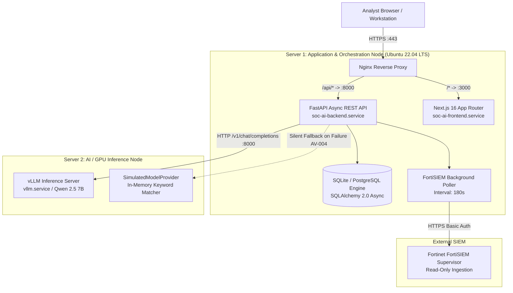

# 02. Application Architecture Baseline

## 1. Executive Summary

This report establishes the verified technical architecture baseline of AI Verdict. It documents the confirmed multi-server topology, inter-component communication channels, service boundaries, and data access layers based on empirical source-code inspection.

---

## 2. Confirmed Two-Server Deployment Topology

The application is deployed across two discrete compute nodes:

---

## 3. Subsystem Breakdown and Boundaries

| Subsystem | Host / Location | Framework & Technology | Verified Responsibility |
| :--- | :--- | :--- | :--- |
| **Frontend UI** | Server 1 (`:3000`) | Next.js 16.1.6 (App Router), React 19, TailwindCSS, Lucide Icons | Renders analyst console, policy studio, dry-run lab, and audit logs. |
| **Backend REST API** | Server 1 (`:8000`) | FastAPI `^0.110.0`, Uvicorn, Pydantic v2 | Exposes 17 routers under `/api`, handles auth, orchestrates triage. |
| **Database Engine** | Server 1 (`ai_verdict.db`) | SQLite (`aiosqlite`) / PostgreSQL (`asyncpg`), SQLAlchemy 2.0 | Persists 13 relational tables, foreign keys, and audit event logs. |
| **SIEM Poller** | Server 1 (Daemon) | Asyncio background task in FastAPI lifespan | Polls FortiSIEM Supervisor REST API every 180s with 2-min buffer. |
| **GPU Inference Node**| Server 2 (`:8000`) | vLLM `0.4.x`, CUDA 12.x, Qwen 2.5 7B AWQ / Mistral 7B | Executes structured JSON LLM inference for security triage. |

---

## 4. Inter-Component Communication Protocols

1. **Frontend $\leftrightarrow$ Backend:**
   - Protocol: HTTP/REST with JSON request/response payloads.
   - Authentication: Dual-mode JWT. Primary: HttpOnly cookie `ai_verdict_session`. Secondary: `Authorization: Bearer <token>`.
2. **Backend $\leftrightarrow$ Database:**
   - Protocol: Asynchronous SQL via SQLAlchemy `create_async_engine()`.
   - Driver: `aiosqlite` (development default) or `asyncpg` (production).
   - Session Lifecycle: Request-scoped `AsyncSessionLocal` committed automatically on HTTP 200.
3. **Backend $\leftrightarrow$ FortiSIEM Supervisor:**
   - Protocol: HTTPS REST with HTTP Basic Authentication (`Authorization: Basic <base64>`).
   - Read-Only Invariant: Zero write-back methods exist in the codebase.
4. **Backend $\leftrightarrow$ Server 2 (LLM):**
   - Protocol: HTTP/1.1 REST matching the OpenAI `/v1/chat/completions` API specification.
   - Parameters: Temperature = 0.1, Max Tokens = 350, Timeout = 45.0s.

---

## 5. Architectural Discrepancies: Advertised vs. Implemented

| Capability / Architecture Claim | Advertised Description | Actual Source-Code Reality | Discrepancy Assessment |
| :--- | :--- | :--- | :--- |
| **Autonomous SIEM Action** | Automated triage with SIEM write-back | Backend is 100% read-only; no write-back calls exist. | **Discrepancy:** Purely an advisory out-of-band console. |
| **Strict Policy Governance** | Policies require Admin approval before production | Ingestion auto-activates unapproved draft policies (`AV-001`, `AV-002`). | **Discrepancy:** Governance gate is completely bypassed. |
| **9-Section Policy Framework** | Full 9-section directive evaluated by LLM | Sections 3, 8, 9 dropped in live triage; sections 3-9 dropped in dry-runs (`AV-003`). | **Discrepancy:** Policy directives are severely pruned. |
| **Evidence Grounding** | Verifiable, evidence-grounded AI decisions | Model output accepted verbatim; zero deterministic verification (`AV-005`). | **Discrepancy:** Forensic truth is unverified LLM generation. |
| **Adaptive Memory (RAG)** | Smart semantic retrieval of historical precedents | Single record query by timestamp; cross-rule fallback injection (`AV-007`). | **Discrepancy:** Context contamination across rules. |
| **Double-Blind Evaluation** | Blind review prevents analyst bias | `raw_payload` returned unredacted, leaking closure fields (`AV-006`). | **Discrepancy:** Blind review protocol is broken. |

