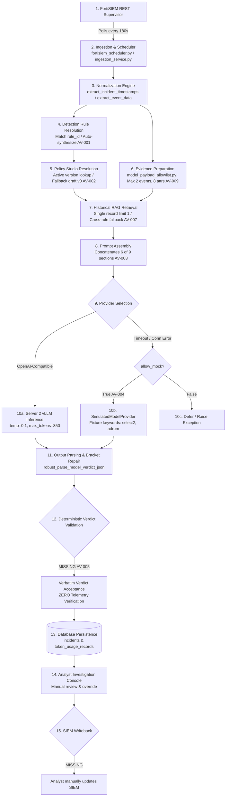

# 03. End-to-End Verdict Execution Trace (Tasks B & D)

## 1. Executive Summary

This report traces the exact, step-by-step execution path of a security incident through AI Verdict—from original SIEM ingestion through normalization, policy resolution, LLM inference, output parsing, database persistence, and human analyst review. 

It also provides rigorous, evidence-grounded answers to the 10 foundational questions regarding AI decision authority and evidence trustworthiness.

---

## 2. End-to-End Execution Flowchart

---

## 3. Stage-by-Stage Execution Trace

### Stage 1: SIEM Fetch
- **Source:** [`backend/app/services/fortisiem_service.py#L125-L175`](file:///c:/Users/amit/OneDrive/Documents/SOC-AI-Agent/backend/app/services/fortisiem_service.py#L125-L175)
- **Function/Class:** `FortiSIEMService.query_incidents()`
- **Inputs:** `time_window_start`, `time_window_end`, credentials (`FORTISIEM_USERNAME`, `FORTISIEM_PASSWORD`).
- **Outputs:** Raw JSON/XML list of incidents from FortiSIEM REST API.
- **Config:** `FORTISIEM_HOST`, `FORTISIEM_VERIFY_SSL`, `FORTISIEM_TIMEOUT`.
- **Dependencies:** `httpx.AsyncClient`.
- **Error Handling:** Catches HTTP errors; logs warning and retries next polling cycle.
- **Audit Events:** None.

### Stage 2: Ingestion & Deduplication
- **Source:** [`backend/app/services/ingestion_service.py#L480-L550`](file:///c:/Users/amit/OneDrive/Documents/SOC-AI-Agent/backend/app/services/ingestion_service.py#L480-L550)
- **Function/Class:** `IngestionService.ingest_single_incident()`
- **Inputs:** Raw incident dictionary.
- **Outputs:** Database `Incident` ORM model.
- **Deduplication:** Queries by `external_id`. If existing, updates fields; skips re-triage if already processed.
- **Audit Events:** `INCIDENT_INGESTED` (via `AuditService`).

### Stage 3: Normalization & Telemetry Extraction
- **Source:** [`backend/app/services/ingestion_service.py#L175-L290`](file:///c:/Users/amit/OneDrive/Documents/SOC-AI-Agent/backend/app/services/ingestion_service.py#L175-L290)
- **Function/Class:** `extract_incident_timestamps()`, `extract_event_data()`
- **Inputs:** `raw_payload`.
- **Outputs:** Normalized epoch timestamps (`first_seen_epoch`, `created_at_epoch`), populated `IncidentEvent` rows.
- **Fallback Logic:** Unparseable timestamps default to `datetime.utcnow()`. Unparseable events dropped.

### Stage 4: Detection Rule Resolution
- **Source:** [`backend/app/services/ingestion_service.py#L607-L730`](file:///c:/Users/amit/OneDrive/Documents/SOC-AI-Agent/backend/app/services/ingestion_service.py#L607-L730)
- **Function/Class:** `IngestionService.get_or_create_rule()`
- **Inputs:** `event_type`, `rule_id`, `incident.title`.
- **Outputs:** `Rule` ORM record.
- **Critical Flaw (`AV-001`):** Cache miss automatically registers a new rule, synthesizes a draft policy, and immediately sets `rp.active_version_id = draft.id`.

### Stage 5: Policy Studio Resolution
- **Source:** [`backend/app/services/ai_verdict_service.py#L125-L134`](file:///c:/Users/amit/OneDrive/Documents/SOC-AI-Agent/backend/app/services/ai_verdict_service.py#L125-L134)
- **Function/Class:** `VerdictTriageAgent.analyze_incident()`
- **Inputs:** `rule.id`.
- **Outputs:** Active `PromptVersion` record.
- **Critical Flaw (`AV-002`):** `active_v = next((v for v in rp.versions if v.id == rp.active_version_id), rp.versions[0])`. Unapproved draft executes if active version pointer is null.

### Stage 6: Evidence Preparation & Context Filtering
- **Source:** [`backend/app/services/model_payload_allowlist.py#L83-L160`](file:///c:/Users/amit/OneDrive/Documents/SOC-AI-Agent/backend/app/services/model_payload_allowlist.py#L83-L160)
- **Function/Class:** `build_model_facing_payload()`
- **Inputs:** `Incident`, `Rule`, `IncidentEvent` list.
- **Outputs:** Sanitized dictionary matching `ModelFacingIncidentPayload`.
- **Critical Flaw (`AV-009`):** Hardcoded cap to 2 events, 8 attributes per event, 180 chars per string. Long commands and multi-hop attack paths truncated.

### Stage 7: Historical RAG Retrieval
- **Source:** [`backend/app/services/ai_verdict_service.py#L149-L180`](file:///c:/Users/amit/OneDrive/Documents/SOC-AI-Agent/backend/app/services/ai_verdict_service.py#L149-L180)
- **Function/Class:** `VerdictTriageAgent.analyze_incident()`
- **Inputs:** `rule.id`.
- **Outputs:** Appended string under `### VERIFIED HISTORICAL PRECEDENT`.
- **Critical Flaw (`AV-007`):** Fetches single record by timestamp without similarity matching; falls back to arbitrary cross-rule records across the database.

### Stage 8: Prompt Assembly
- **Source:** [`backend/app/services/ai_verdict_service.py#L135-L146`](file:///c:/Users/amit/OneDrive/Documents/SOC-AI-Agent/backend/app/services/ai_verdict_service.py#L135-L146)
- **Function/Class:** `VerdictTriageAgent.analyze_incident()`
- **Inputs:** `active_v` (PromptVersion) attributes.
- **Outputs:** Assembled prompt string.
- **Critical Flaw (`AV-003`):** Assembles 6 sections; drops sections 3 (`detection_conditions`), 8 (`escalation_conditions`), and 9 (`analyst_questions`).

### Stage 9 & 10: Model Inference & Provider Selection
- **Source:** [`backend/app/services/ai_verdict_service.py#L188-L245`](file:///c:/Users/amit/OneDrive/Documents/SOC-AI-Agent/backend/app/services/ai_verdict_service.py#L188-L245)
- **Function/Class:** `VerdictTriageAgent.analyze_incident()` $\rightarrow$ `OpenAICompatibleProvider.analyze_incident()`
- **Inputs:** Assembled prompt, sanitized incident context JSON.
- **Outputs:** Raw JSON completion string from Server 2.
- **Critical Flaw (`AV-004`):** If Server 2 times out or fails, and `LOCAL_LLM_ALLOW_MOCK_FALLBACK=true`, silently invokes `SimulatedModelProvider`, outputting synthetic verdicts based on fixture keywords.

### Stage 11: Output Parsing & Bracket Repair
- **Source:** [`backend/app/llm/openai_compatible.py#L140-L240`](file:///c:/Users/amit/OneDrive/Documents/SOC-AI-Agent/backend/app/llm/openai_compatible.py#L140-L240)
- **Function/Class:** `robust_parse_model_verdict_json()`
- **Mechanism:** Strips markdown code fences, unescapes newlines, repairs unclosed JSON brackets, falls back to regex matching.

### Stage 12: Deterministic Verdict Validation
- **Status:** **MISSING (`AV-005`)**
- There is **zero verification** that cited evidence exists in raw incident events. Model text is accepted verbatim.

### Stage 13: Database Persistence
- **Source:** [`backend/app/services/ai_verdict_service.py#L261-L285`](file:///c:/Users/amit/OneDrive/Documents/SOC-AI-Agent/backend/app/services/ai_verdict_service.py#L261-L285)
- **Mechanism:** Updates `incidents` table (`ai_verdict`, `confidence`, `reasoning`). Writes record to `token_usage_records`.

### Stage 14: Analyst Review & Override
- **Source:** [`backend/app/services/investigation_service.py#L303-L355`](file:///c:/Users/amit/OneDrive/Documents/SOC-AI-Agent/backend/app/services/investigation_service.py#L303-L355)
- **Mechanism:** Analyst submits verdict override via UI. If marked "independently verified", immediately becomes a `VERIFIED` `LearningRecord` (`AV-008`).

### Stage 15: Downstream SIEM Actions / Write-Back
- **Status:** **MISSING**
- The system is 100% read-only. Analysts must manually log into FortiSIEM to update or close tickets.

---

## 4. Key Verdict Integrity Questions (Task D Verification)

| # | Question | Confirmed Source Answer | Source Evidence |
| :-: | :--- | :--- | :--- |
| **1** | **Who has final decision authority: LLM or deterministic code?** | **The LLM has 100% decision authority.** The backend directly saves the model's verdict string without deterministic override rules. | [`ai_verdict_service.py#L261-L285`](file:///c:/Users/amit/OneDrive/Documents/SOC-AI-Agent/backend/app/services/ai_verdict_service.py#L261) |
| **2** | **Can an unsupported conclusion be accepted?** | **YES.** If the LLM assigns `TRUE_POSITIVE` without supporting telemetry, the backend accepts and commits it without validation. | [`ai_verdict_service.py#L265`](file:///c:/Users/amit/OneDrive/Documents/SOC-AI-Agent/backend/app/services/ai_verdict_service.py#L265) |
| **3** | **Can the LLM invent evidence?** | **YES.** The model can hallucinate IP addresses, command flags, or hashes in `key_evidence`. | [`openai_compatible.py#L370-L395`](file:///c:/Users/amit/OneDrive/Documents/SOC-AI-Agent/backend/app/llm/openai_compatible.py#L370) |
| **4** | **Are model-generated evidence references verified?** | **NO.** There is no substring check or telemetry cross-referencing in the entire codebase (`AV-005`). | [`ai_verdict_service.py#L261`](file:///c:/Users/amit/OneDrive/Documents/SOC-AI-Agent/backend/app/services/ai_verdict_service.py#L261) |
| **5** | **Does missing evidence force abstention?** | **NO.** The LLM is instructed in prompt text to consider abstaining, but nothing in the application code forces `REQUIRES_ATTENTION`. | [`ai_verdict_service.py#L144-L146`](file:///c:/Users/amit/OneDrive/Documents/SOC-AI-Agent/backend/app/services/ai_verdict_service.py#L144) |
| **6** | **Can a historical example determine a verdict?** | **YES.** Cross-rule precedent injection (`AV-007`) provides strong few-shot bias that can sway model decisions. | [`ai_verdict_service.py#L161-L179`](file:///c:/Users/amit/OneDrive/Documents/SOC-AI-Agent/backend/app/services/ai_verdict_service.py#L161) |
| **7** | **Is confidence measured or generated?** | **GENERATED (Uncalibrated).** Confidence is a self-reported float emitted directly by the LLM (or hardcoded in mock). | [`openai_compatible.py#L380`](file:///c:/Users/amit/OneDrive/Documents/SOC-AI-Agent/backend/app/llm/openai_compatible.py#L380) |
| **8** | **Can a failed LLM request result in a TP or FP decision?** | **YES.** If Server 2 fails, `SimulatedModelProvider` matches fixture keywords and assigns `TP` (94%) or `FP` (96%) (`AV-004`). | [`ai_verdict_service.py#L225-L235`](file:///c:/Users/amit/OneDrive/Documents/SOC-AI-Agent/backend/app/services/ai_verdict_service.py#L225) |
| **9** | **Is a technical processing failure distinguished from REQUIRES_ATTENTION?** | **NO.** When mock fallback is disabled, an inference failure returns HTTP 500 or defers triage; it does not set a distinct system failure state. | [`ai_verdict_service.py#L200-L202`](file:///c:/Users/amit/OneDrive/Documents/SOC-AI-Agent/backend/app/services/ai_verdict_service.py#L200) |
| **10** | **Can a verdict be reproduced from historical evidence?** | **PARTIALLY.** Raw payload is saved, but the exact dynamic prompt string (with runtime few-shot RAG) is not stored per incident. | [`models/incident.py#L20-L45`](file:///c:/Users/amit/OneDrive/Documents/SOC-AI-Agent/backend/app/models/incident.py#L20) |

