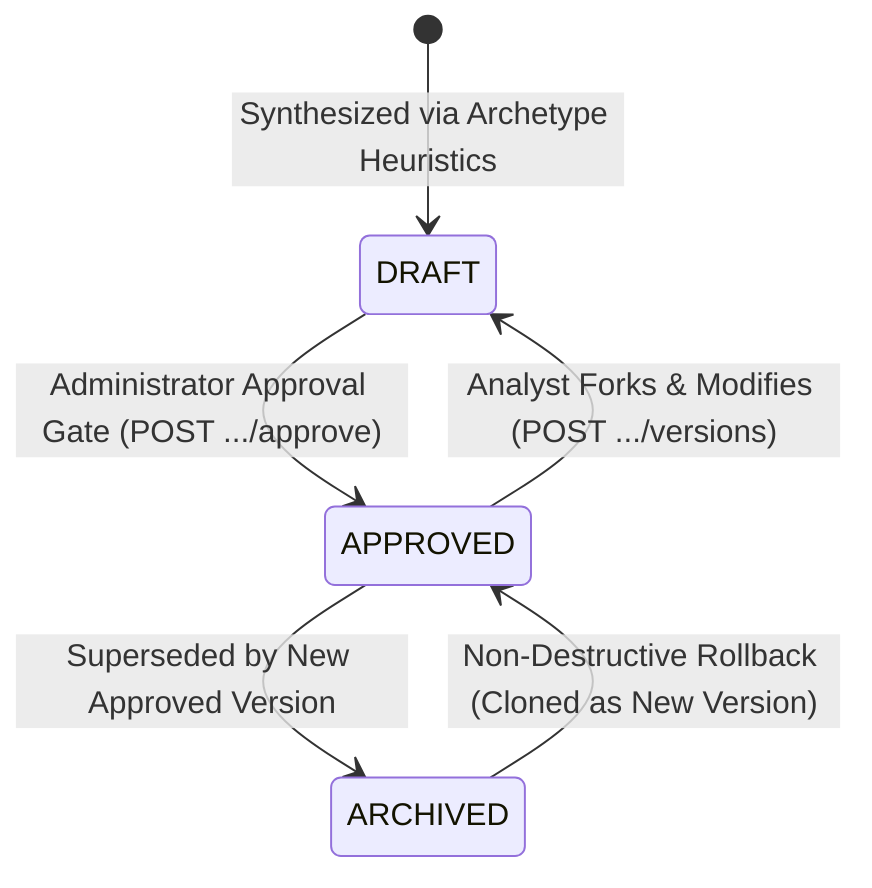

# 04. Agent Intelligence Studio Verification (Task C)

## 1. Executive Summary

This report delivers the technical verification of the **Agent Intelligence Studio (AIS)** and its underlying policy governance engine. AIS is responsible for transforming raw SIEM detection rules into structured, multi-section investigation directives that guide local LLM triage.

This audit evaluates template synthesis, version storage, approval state transitions, rollback mechanics, and establishes a comprehensive **9-Section Policy Compliance Matrix**.

---

## 2. Policy Lifecycle & Governance Architecture

Policies are managed across two primary database models:
- **`RulePrompt` (`rule_prompts`):** Links a detection rule to its policy version collection and maintains the `active_version_id` foreign key.
- **`PromptVersion` (`prompt_versions`):** Immutable version row capturing the 9 directive sections, version number, author, approval state (`DRAFT`, `APPROVED`, `ARCHIVED`), and approval timestamp.

---

## 3. Nine-Section Policy Compliance Matrix

We audited every one of the 9 documented policy sections across storage, frontend editing, approval tracking, runtime prompt compilation, deterministic enforcement, and simulation usage:

| # | Section Name | Model Attribute | Stored? | Editable? | Approved? | Passed to Live LLM? | Independently Enforced? | Can Model Ignore? | Used in Dry-Runs? |
| :-: | :--- | :--- | :---: | :---: | :---: | :---: | :---: | :---: | :---: |
| **1** | **Common SOC Baseline** | `common_prompt` | **YES** | **YES** | **YES** | **YES** | **NO** | **YES** | **YES** |
| **2** | **Rule-Specific Directive** | `rule_specific_prompt` | **YES** | **YES** | **YES** | **YES** | **NO** | **YES** | **YES** |
| **3** | **Detection Conditions** | `detection_conditions` | **YES** | **YES** | **YES** | **NO (AV-003)** | **NO** | **N/A (Omitted)** | **NO (AV-003)** |
| **4** | **Required Evidence** | `required_evidence` | **YES** | **YES** | **YES** | **YES** | **NO (AV-005)** | **YES** | **NO (AV-003)** |
| **5** | **True Positive Indicators** | `tp_indicators` | **YES** | **YES** | **YES** | **YES** | **NO** | **YES** | **NO (AV-003)** |
| **6** | **False Positive Indicators** | `fp_indicators` | **YES** | **YES** | **YES** | **YES** | **NO** | **YES** | **NO (AV-003)** |
| **7** | **Missing Info / Abstention** | `missing_info_criteria` | **YES** | **YES** | **YES** | **YES** | **NO** | **YES** | **NO (AV-003)** |
| **8** | **Escalation Conditions** | `escalation_conditions` | **YES** | **YES** | **YES** | **NO (AV-003)** | **NO** | **N/A (Omitted)** | **NO (AV-003)** |
| **9** | **Analyst Questions** | `analyst_questions` | **YES** | **YES** | **YES** | **NO (AV-003)** | **NO** | **N/A (Omitted)** | **NO (AV-003)** |

---

## 4. Critical Governance Findings & Code Verification

### 4.1 Can a DRAFT Policy Influence Live Production Inference?
- **Finding:** **YES.** Confirmed via two distinct pathways:
  1. **Automatic Activation on Discovery (`AV-001`):** In `ingestion_service.py#L724-L726` and `fortisiem_service.py#L233-L235`, newly synthesized draft prompts are immediately assigned to `rp.active_version_id`. They execute in production without ever receiving an Administrator approval click.
  2. **Unset Active Version Fallback (`AV-002`):** In `ai_verdict_service.py#L133`, if `rp.active_version_id` is null, the code selects `rp.versions[0]`. In SQLite/Postgres ordering, `versions[0]` is often an unreviewed `DRAFT`.

### 4.2 Is an APPROVED Policy Mandatory Before Live Triage?
- **Finding:** **NO.** The system permits live evaluation under any state. There is no assertion or policy gate requiring `status == 'APPROVED'` before LLM prompt compilation.

### 4.3 Is the Policy Framework Consistently Applied?
- **Finding:** **NO (`AV-003`).**
  - In **Live Triage:** The service compiles sections 1, 2, 4, 5, 6, and 7, but completely drops Section 3 (`detection_conditions`), Section 8 (`escalation_conditions`), and Section 9 (`analyst_questions`).
  - In **Dry-Run Simulation:** The simulator compiles **only sections 1 and 2**, completely dropping sections 3 through 9. A policy that scores high accuracy in simulation is running a completely different prompt than what will execute in live triage.

### 4.4 Rollback Safety Verification
- **Source:** [`backend/app/services/prompt_studio_service.py#L225-L260`](file:///c:/Users/amit/OneDrive/Documents/SOC-AI-Agent/backend/app/services/prompt_studio_service.py#L225-L260)
- **Mechanism:** When an administrator initiates a rollback via `POST /api/prompts/{prompt_id}/rollback/{target_version_id}`:
  - The service loads the historical archived version.
  - It creates a **new** `PromptVersion` record with `version_number = max + 1` and status `APPROVED`.
  - It updates `rp.active_version_id` to the new version ID.
- **Verification Status:** **COMPLIANT.** Rollback is non-destructive and preserves an immutable audit trail.

---

## 5. Audit Logging in Agent Intelligence Studio

- **Logged Actions:**
  - `PROMPT_DRAFT_CREATED`: Captured when a new draft version is saved.
  - `PROMPT_APPROVED`: Captured when an administrator approves a version.
  - `PROMPT_ROLLBACK`: Captured when a rollback clones an archived version.
- **Captured Attributes:** `user_id`, `prompt_id`, `version_number`, `change_summary`, `timestamp`.
- **Enforcement:** Enforced in `prompt_studio_service.py` via `AuditService`.

