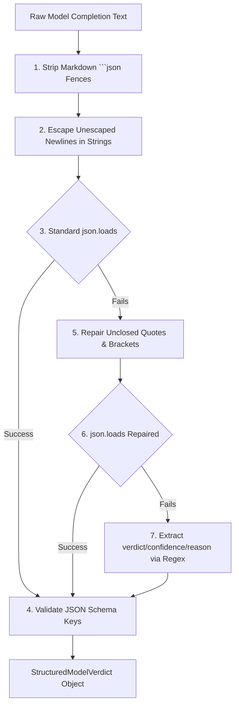

# 05. LLM and Configuration Baseline (Task E)

## 1. Executive Summary

This report audits the Local LLM inference engine, model provider abstractions, output parsing robustness, token budgeting, and system configuration variables. All findings are derived directly from source files in `backend/app/llm/`, `backend/app/services/`, and `backend/app/config.py`.

---

## 2. Model Provider Subsystem

The inference layer uses a factory pattern managed in [`backend/app/llm/factory.py`](file:///c:/Users/amit/OneDrive/Documents/SOC-AI-Agent/backend/app/llm/factory.py#L18-L45):

| Provider Name | Class Name | Implementation File | Operational Purpose |
| :--- | :--- | :--- | :--- |
| **`OPENAI_COMPATIBLE`** | `OpenAICompatibleProvider` | [`backend/app/llm/openai_compatible.py`](file:///c:/Users/amit/OneDrive/Documents/SOC-AI-Agent/backend/app/llm/openai_compatible.py) | **Primary Production Provider:** Connects to vLLM or Ollama on Server 2 via HTTP. |
| **`SIMULATED`** | `SimulatedModelProvider` | [`backend/app/llm/simulated.py`](file:///c:/Users/amit/OneDrive/Documents/SOC-AI-Agent/backend/app/llm/simulated.py) | **Testing / Fixture Fallback:** Pattern matches keywords (`select2`, `adrum`) in-memory. |
| **`DISABLED`** | `DisabledModelProvider` | [`backend/app/llm/base.py`](file:///c:/Users/amit/OneDrive/Documents/SOC-AI-Agent/backend/app/llm/base.py) | **Safety Lockout:** Unconditionally raises `LLMDisabledException` to prevent inference. |

---

## 3. Inference Parameters and Operational Profile

When communicating with Server 2 via `OpenAICompatibleProvider`:

| Parameter | Configured Value | Source Reference | Analytical Rationale |
| :--- | :---: | :--- | :--- |
| **Endpoint URL** | `http://192.0.2.10:8000/v1` | `config.py#LOCAL_LLM_URL` | Routes to dedicated private GPU node. |
| **Model Name** | `mistralai/Mistral-7B-Instruct-v0.2` | `config.py#LOCAL_LLM_MODEL` | Quantized local open-weights instruction model. |
| **Temperature** | `0.1` | `openai_compatible.py#L160` | Configured near-zero to promote deterministic classification. |
| **Top-P** | `0.95` | `openai_compatible.py#L161` | Standard nucleus sampling boundary. |
| **Max Completion Tokens** | `350` | `openai_compatible.py#L162` | Strict cap to enforce concise JSON outputs and control latency. |
| **Timeout Seconds** | `45.0` | `config.py#LOCAL_LLM_TIMEOUT` | Prevents hung connections during peak GPU queuing. |
| **Retries** | `0` (Single Attempt) | `openai_compatible.py#L170` | Fail-fast design; defers retry to poller or triggers fallback. |

---

## 4. Structured Output Validation & Robust JSON Repair

Because small 7B/8B local models frequently produce unescaped control characters or unclosed brackets, [`openai_compatible.py`](file:///c:/Users/amit/OneDrive/Documents/SOC-AI-Agent/backend/app/llm/openai_compatible.py#L185-L250) implements `robust_parse_model_verdict_json()`:

---

## 5. Token Budget Allocation

Given the 350-token output limit and the context pruning applied by `model_payload_allowlist.py`:

| Prompt Segment | Estimated Token Count | Source Component |
| :--- | :---: | :--- |
| **SOC Directive Policy** | 350 - 500 tokens | Assembled 6 sections of `PromptVersion` |
| **Few-Shot RAG Precedent** | 100 - 150 tokens | 1 learning record rationale (truncated to 150 chars) |
| **Incident Telemetry** | 300 - 450 tokens | Sanitized payload (max 2 events, 8 attrs, 180 chars) |
| **JSON Schema Overhead** | 50 tokens | Formatting instructions |
| **Total Prompt Input** | **800 - 1,150 tokens** | Safely within the 4,096 / 8,192 context window |
| **Model Completion Output** | **350 tokens (Hard Cap)** | Output verdict JSON structure |

---

## 6. Live Inference vs. Simulation Differences

| Execution Dimension | Live Production Inference | Dry-Run Simulation Lab |
| :--- | :--- | :--- |
| **Prompt Assembly** | Concatenates 6 sections (1, 2, 4, 5, 6, 7) | Concatenates **2 sections** (1 and 2 only) (`AV-003`) |
| **Few-Shot RAG** | Injects latest verified learning record (`AV-007`) | **No RAG injected** |
| **Model Provider** | Server 2 (`OpenAICompatibleProvider`) | User-selectable (OpenAI, Simulated, or Mock) |
| **Execution Context** | Asynchronous poller or background task | Synchronous loop in web request handler (`AV-013`) |
| **Database Persistence** | Updates `incidents` and writes token logs | Writes `dry_runs` and `dry_run_results` records |

---

## 7. Verified Configuration Inventory

Settings load via Pydantic in [`backend/app/config.py`](file:///c:/Users/amit/OneDrive/Documents/SOC-AI-Agent/backend/app/config.py#L12-L75). Sensitive values are redacted:

| Variable Name | Default Value (Redacted) | Source File | Risk / Operational Notes |
| :--- | :--- | :---: | :--- |
| `PROJECT_NAME` | `"AI Verdict"` | `config.py` | Branding. |
| `VERSION` | `"1.0.0"` | `config.py` | API versioning. |
| `API_V1_STR` | `"/api"` | `config.py` | Root API route mount prefix. |
| `SECRET_KEY` | `[REDACTED HARDCODED FALLBACK]` | `config.py` | **CRITICAL (AV-014):** Known default permits JWT forgery. |
| `ALGORITHM` | `"HS256"` | `config.py` | HMAC-SHA256 signature algorithm. |
| `ACCESS_TOKEN_EXPIRE_MINUTES` | `480` (8 Hours) | `config.py` | Session duration. |
| `COOKIE_NAME` | `"ai_verdict_session"` | `config.py` | Name of HttpOnly session cookie. |
| `COOKIE_SECURE` | `False` (in dev) | `config.py` | HTTPS enforcement for cookies. |
| `DATABASE_URL` | `"sqlite+aiosqlite:///./ai_verdict.db"` | `config.py` | Primary async database connection. |
| `LOCAL_LLM_PROVIDER` | `"openai_compatible"` | `config.py` | Provider selector. |
| `LOCAL_LLM_URL` | `"http://192.0.2.10:8000/v1"` | `config.py` | Server 2 private IP endpoint. |
| `LOCAL_LLM_MODEL` | `"mistralai/Mistral-7B-Instruct-v0.2"`| `config.py` | Local instruction model identifier. |
| `LOCAL_LLM_TIMEOUT` | `45.0` | `config.py` | Network timeout for model completions. |
| `LOCAL_LLM_ALLOW_MOCK_FALLBACK`| `True` (In `backend/.env`) | `.env` | **HIGH (AV-004):** Masks GPU failures with mock data. |
| `FORTISIEM_HOST` | `[REDACTED HOSTNAME/IP]` | `.env` | FortiSIEM supervisor endpoint. |
| `FORTISIEM_USERNAME` | `[REDACTED USERNAME]` | `.env` | FortiSIEM supervisor account. |
| `FORTISIEM_PASSWORD` | `[REDACTED PASSWORD]` | `.env` | **CRITICAL (AV-014):** Written in cleartext to `.env`. |
| `FORTISIEM_VERIFY_SSL` | `True` | `config.py` | Enforces TLS certificate validation. |
| `FORTISIEM_POLL_INTERVAL_SECONDS`| `180` (3 Minutes) | `config.py` | Continuous background polling period. |

