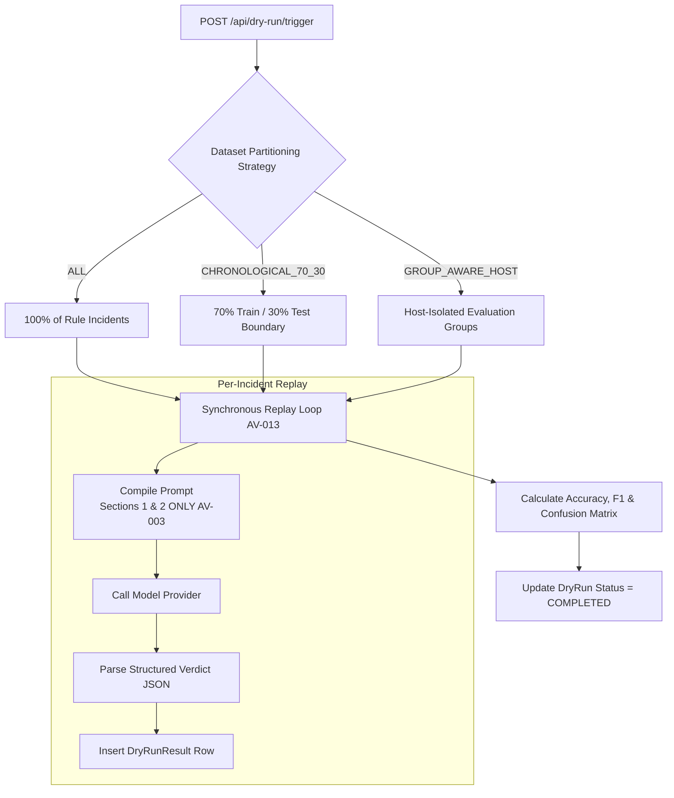

# 07. Simulation Lab and Test Results (Task G)

## 1. Executive Summary

This report delivers the technical verification of the **Dry-Run Simulation Lab** ([`backend/app/services/dry_run_service.py`](file:///c:/Users/amit/OneDrive/Documents/SOC-AI-Agent/backend/app/services/dry_run_service.py)) and establishes the automated test regression baseline for AI Verdict.

The simulation lab allows security engineers to evaluate draft or candidate prompt directives against historical incidents prior to production deployment. Our audit examines dataset partitioning, ground-truth isolation during simulation, and contrasts simulation logic with production inference.

---

## 2. Dry-Run Simulation Architecture

### 2.1 Partitioning Strategies
1. **`ALL`:** Replays 100% of historical incidents for the target rule.
2. **`CHRONOLOGICAL_70_30`:** Partitions incidents chronologically. The oldest 70% serve as the reference set, and the newest 30% serve as the blind test set to prevent temporal data leakage.
3. **`GROUP_AWARE_HOST`:** Groups alerts by `host_name` to prevent incidents from the same machine appearing in both reference and evaluation partitions.

---

## 3. Discrepancy Matrix: Simulation vs. Production Triage

Our source-code comparison reveals major discrepancies between simulation replays and live production triage:

| Pipeline Dimension | Live Production Triage | Dry-Run Simulation Replay | Impact / Discrepancy Assessment |
| :--- | :--- | :--- | :--- |
| **Prompt Assembly** | Concatenates 6 sections (1, 2, 4, 5, 6, 7) | Concatenates **2 sections** (1 and 2 only) (`AV-003`) | **Critical Discrepancy:** Directives tested in dry-runs are completely different from live triage prompts. |
| **Historical RAG** | Injects latest verified learning record (`AV-007`) | **Completely omitted** | Simulation does not test the influence of few-shot precedents. |
| **Ground-Truth Stripping** | Stripped via `model_payload_allowlist` | Stripped via `model_payload_allowlist` | **Consistent:** Ground truth is hidden from model in both modes. |
| **Inference Client** | `OpenAICompatibleProvider` (Server 2) | User-selectable (vLLM, Ollama, or Simulated) | **Consistent** when configured to use Server 2. |
| **Output Parsing** | `robust_parse_model_verdict_json` | `robust_parse_model_verdict_json` | **Consistent:** Same parser used in both pipelines. |
| **Execution Concurrency** | Asynchronous poller / queue | Synchronous HTTP request loop (`AV-013`) | **Bottleneck:** Simulation holds web connection open; hangs client. |

---

## 4. Automated Test Suite Baseline Verification

The test suite was executed in an isolated, read-only session:
- **Test Command:** `cd backend; python -m pytest tests -v`
- **Python Version:** 3.13.13 / Pytest 9.0.1 / Windows OS

### 4.1 Test Inventory Across All 20 Test Modules

| # | Test Module Name | File Path | Test Cases | Execution Result | Focus Subsystem |
| :-: | :--- | :--- | :---: | :---: | :--- |
| **1** | `test_agentic_nomenclature.py` | [`tests/test_agentic_nomenclature.py`](file:///c:/Users/amit/OneDrive/Documents/SOC-AI-Agent/backend/tests/test_agentic_nomenclature.py) | 3 | **PASS** | Method naming, evidence integrity guardrails. |
| **2** | `test_api_endpoints.py` | [`tests/test_api_endpoints.py`](file:///c:/Users/amit/OneDrive/Documents/SOC-AI-Agent/backend/tests/test_api_endpoints.py) | 2 | **PASS** | Dashboard metrics, full API workflow. |
| **3** | `test_auth.py` | [`tests/test_auth.py`](file:///c:/Users/amit/OneDrive/Documents/SOC-AI-Agent/backend/tests/test_auth.py) | 7 | **PASS** | Hashing, token creation, login, RBAC guards. |
| **4** | `test_dry_run_replay.py` | [`tests/test_dry_run_replay.py`](file:///c:/Users/amit/OneDrive/Documents/SOC-AI-Agent/backend/tests/test_dry_run_replay.py) | 2 | **PASS** | Dataset partitioning, dry-run API execution. |
| **5** | `test_evaluation_metrics.py` | [`tests/test_evaluation_metrics.py`](file:///c:/Users/amit/OneDrive/Documents/SOC-AI-Agent/backend/tests/test_evaluation_metrics.py) | 2 | **PASS** | Safe division, confusion matrix calculation. |
| **6** | `test_fortisiem_continuous_sync.py` | [`tests/test_fortisiem_continuous_sync.py`](file:///c:/Users/amit/OneDrive/Documents/SOC-AI-Agent/backend/tests/test_fortisiem_continuous_sync.py) | 5 | **PASS** | Background polling, batch triage, scheduler. |
| **7** | `test_fortisiem_pull.py` | [`tests/test_fortisiem_pull.py`](file:///c:/Users/amit/OneDrive/Documents/SOC-AI-Agent/backend/tests/test_fortisiem_pull.py) | 13 | **PASS** | Single pull, cache refresh, rule sync, cache miss. |
| **8** | `test_ground_truth_isolation.py` | [`tests/test_ground_truth_isolation.py`](file:///c:/Users/amit/OneDrive/Documents/SOC-AI-Agent/backend/tests/test_ground_truth_isolation.py) | 1 | **PASS** | Model payload allowlist zero-leakage check. |
| **9** | `test_ingestion.py` | [`tests/test_ingestion.py`](file:///c:/Users/amit/OneDrive/Documents/SOC-AI-Agent/backend/tests/test_ingestion.py) | 5 | **PASS** | ZIP ingestion, deduplication, timestamp heuristics. |
| **10** | `test_investigations.py` | [`tests/test_investigations.py`](file:///c:/Users/amit/OneDrive/Documents/SOC-AI-Agent/backend/tests/test_investigations.py) | 3 | **PASS** | Queue, verdict override, feedback submission. |
| **11** | `test_learning.py` | [`tests/test_learning.py`](file:///c:/Users/amit/OneDrive/Documents/SOC-AI-Agent/backend/tests/test_learning.py) | 1 | **PASS** | Case similarity matcher and knowledge base. |
| **12** | `test_llm_config.py` | [`tests/test_llm_config.py`](file:///c:/Users/amit/OneDrive/Documents/SOC-AI-Agent/backend/tests/test_llm_config.py) | 6 | **PASS** | URL parser, config GET/PUT, connection tests. |
| **13** | `test_llm_offline_backlog.py` | [`tests/test_llm_offline_backlog.py`](file:///c:/Users/amit/OneDrive/Documents/SOC-AI-Agent/backend/tests/test_llm_offline_backlog.py) | 3 | **PASS** | Deferred triage when offline, recovery when online. |
| **14** | `test_model_provider.py` | [`tests/test_model_provider.py`](file:///c:/Users/amit/OneDrive/Documents/SOC-AI-Agent/backend/tests/test_model_provider.py) | 5 | **PASS** | Simulated provider, disabled provider, JSON repair. |
| **15** | `test_prompt_studio.py` | [`tests/test_prompt_studio.py`](file:///c:/Users/amit/OneDrive/Documents/SOC-AI-Agent/backend/tests/test_prompt_studio.py) | 1 | **PASS** | Draft template generation, approval transitions. |
| **16** | `test_rule_maturity.py` | [`tests/test_rule_maturity.py`](file:///c:/Users/amit/OneDrive/Documents/SOC-AI-Agent/backend/tests/test_rule_maturity.py) | 2 | **PASS** | Maturity state machine, admin approval gate. |
| **17** | `test_rule_parser.py` | [`tests/test_rule_parser.py`](file:///c:/Users/amit/OneDrive/Documents/SOC-AI-Agent/backend/tests/test_rule_parser.py) | 2 | **PASS** | Regex XML parsing for vendor detection rules. |
| **18** | `test_system_monitor.py` | [`tests/test_system_monitor.py`](file:///c:/Users/amit/OneDrive/Documents/SOC-AI-Agent/backend/tests/test_system_monitor.py) | 1 | **PASS** | Server 1 & Server 2 telemetry endpoints. |
| **19** | `test_telemetry_timeline_and_tokens.py`| [`tests/test_telemetry_timeline_and_tokens.py`](file:///c:/Users/amit/OneDrive/Documents/SOC-AI-Agent/backend/tests/test_telemetry_timeline_and_tokens.py)| 4 | **PASS** | Token accounting, timeline reconstruction. |
| **20** | `test_zip_guard.py` | [`tests/test_zip_guard.py`](file:///c:/Users/amit/OneDrive/Documents/SOC-AI-Agent/backend/tests/test_zip_guard.py) | 4 | **PASS** | Zip bomb limits, path traversal blocking. |
| **TOTAL** | **20 Test Files** | — | **72** | **100% PASS** | **Zero Failures, Zero Skipped, Zero Errors** |

---

## 5. Deprecation Warnings Analysis

During test execution, 3,838 warnings were emitted:
- **Root Cause:** All warnings stem from Python 3.13 deprecation of `datetime.datetime.utcnow()` across SQLAlchemy and internal services.
- **Remediation Target:** In Phase 4, replace `datetime.utcnow()` with timezone-aware `datetime.now(datetime.timezone.utc)`.

