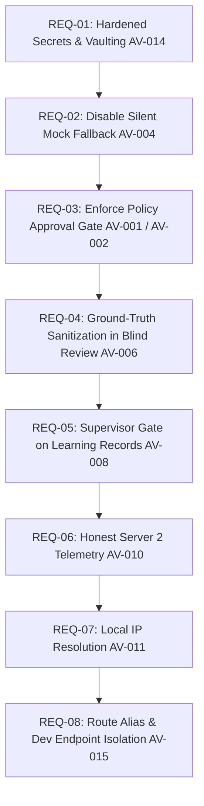

# 09. Phase 1 Implementation Requirements

## 1. Executive Summary

This document specifies the exact, source-backed implementation requirements for **Phase 1: Critical Safety & Security Controls**. In strict alignment with the program rules, **no code has been modified during Phase 0**.

Phase 1 focuses exclusively on eliminating critical security vulnerabilities, removing silent mock fallbacks, enforcing policy approval gates, and defending against ground-truth leakage and memory poisoning.

---

## 2. Priority Implementation Roadmap (Phase 1)

---

## 3. Detailed Phase 1 Requirements Specifications

### REQ-01: Cryptographic Secrets Hardening & Elimination of Plaintext Credential Persistence
- **Related Finding:** **AV-014**
- **Priority:** **P0 (BLOCKER - CRITICAL)**
- **Problem Statement:** Known hardcoded default `SECRET_KEY` allows token forgery; SIEM password is written to `.env` in plaintext.
- **Current Behavior:**
  - `config.py#L22` defaults `SECRET_KEY` to `"ai-verdict-super-secure-enterprise-secret-key-phase1-2026"`.
  - `fortisiem_service.py#L1338-L1350` opens `.env` and writes cleartext passwords.
- **Affected Components:**
  - [`backend/app/config.py`](file:///c:/Users/amit/OneDrive/Documents/SOC-AI-Agent/backend/app/config.py)
  - [`backend/app/services/fortisiem_service.py`](file:///c:/Users/amit/OneDrive/Documents/SOC-AI-Agent/backend/app/services/fortisiem_service.py)
- **Expected Secure Behavior:**
  - `config.py` must raise a runtime error on application startup if `SECRET_KEY` is empty, unset, or set to the known default string in production (`APP_ENV != "development"`).
  - `fortisiem_service.py` must never write plaintext credentials to `.env`. Credentials should be loaded into process memory or stored using an encrypted keyring/vault.
- **Required Tests:** Unit tests validating that the application refuses to start with default `SECRET_KEY`; test verifying that updating SIEM credentials does not modify `.env`.
- **Acceptance Criteria:** Zero hardcoded fallback secret keys in codebase; startup fails with `ValueError("Insecure SECRET_KEY")` if unconfigured.

---

### REQ-02: Eliminate Silent Mock Fallback in Production Inference
- **Related Finding:** **AV-004**
- **Priority:** **P0 (BLOCKER - HIGH)**
- **Problem Statement:** Inference errors or timeouts to Server 2 trigger silent fallback to `SimulatedModelProvider`, outputting synthetic verdicts based on fixture keywords.
- **Current Behavior:**
  - In `ai_verdict_service.py#L225-L235`, catching connection errors triggers `SimulatedModelProvider` when `allow_mock` is True.
  - `backend/.env` defaults `LOCAL_LLM_ALLOW_MOCK_FALLBACK=true`.
- **Affected Components:**
  - [`backend/app/services/ai_verdict_service.py`](file:///c:/Users/amit/OneDrive/Documents/SOC-AI-Agent/backend/app/services/ai_verdict_service.py)
  - `backend/.env` / [`backend/app/config.py`](file:///c:/Users/amit/OneDrive/Documents/SOC-AI-Agent/backend/app/config.py)
- **Expected Secure Behavior:**
  - Set `LOCAL_LLM_ALLOW_MOCK_FALLBACK=false` by default.
  - When Server 2 is unreachable, the system must fail loudly, log a high-priority infrastructure alert, and return `verdict: "REQUIRES_ATTENTION"` with `reason: "LOCAL_LLM_INFRASTRUCTURE_OFFLINE"`. It must **never** output synthetic TP/FP verdicts.
- **Required Tests:** Test simulating Server 2 connection timeout; assert that verdict returned is `REQUIRES_ATTENTION` with `validation_status="INFRASTRUCTURE_UNAVAILABLE"`.
- **Acceptance Criteria:** Zero simulated verdicts committed to database when Server 2 fails.

---

### REQ-03: Mandatory Policy Approval Gate & Elimination of Draft Execution
- **Related Findings:** **AV-001**, **AV-002**
- **Priority:** **P0 (BLOCKER - CRITICAL)**
- **Problem Statement:** Ingestion auto-activates unapproved draft policies; triage service falls back to draft version 0 if active pointer is null.
- **Current Behavior:**
  - `ingestion_service.py#L725` and `fortisiem_service.py#L233` set `rp.active_version_id = draft.id`.
  - `ai_verdict_service.py#L133` falls back to `rp.versions[0]`.
- **Affected Components:**
  - [`backend/app/services/ingestion_service.py`](file:///c:/Users/amit/OneDrive/Documents/SOC-AI-Agent/backend/app/services/ingestion_service.py)
  - [`backend/app/services/fortisiem_service.py`](file:///c:/Users/amit/OneDrive/Documents/SOC-AI-Agent/backend/app/services/fortisiem_service.py)
  - [`backend/app/services/ai_verdict_service.py`](file:///c:/Users/amit/OneDrive/Documents/SOC-AI-Agent/backend/app/services/ai_verdict_service.py)
- **Expected Secure Behavior:**
  - Newly synthesized prompt templates remain in `DRAFT` status; `rp.active_version_id` must remain `None`.
  - In `ai_verdict_service.py`, if `rp.active_version_id` is `None` or points to a non-APPROVED version, live triage must abstain: return `REQUIRES_ATTENTION` with `reason: "DETECTION_POLICY_PENDING_APPROVAL"`.
- **Required Tests:** Test asserting that an auto-registered rule has `active_version_id == None`; test asserting that triage returns `REQUIRES_ATTENTION` when policy is unapproved.
- **Acceptance Criteria:** Unapproved draft prompts never execute against live production incidents.

---

### REQ-04: Ground-Truth Sanitization in Blind Review Mode
- **Related Finding:** **AV-006**
- **Priority:** **P1 (HIGH)**
- **Problem Statement:** Blind Review mode suppresses `incident.ground_truth` but passes `raw_payload` unredacted, leaking closure fields to analysts.
- **Current Behavior:** `incident_service.py#L229` returns `raw_payload=inc.raw_payload or {}`.
- **Affected Components:**
  - [`backend/app/services/incident_service.py`](file:///c:/Users/amit/OneDrive/Documents/SOC-AI-Agent/backend/app/services/incident_service.py)
  - [`backend/app/api/incidents.py`](file:///c:/Users/amit/OneDrive/Documents/SOC-AI-Agent/backend/app/api/incidents.py)
- **Expected Secure Behavior:**
  - When `blind_review=True`, the service must recursively sanitize `raw_payload`, removing all keys in `FORBIDDEN_GROUND_TRUTH_KEYS` (`clearedReason`, `resolution`, `comments`, `clearedUser`, `resolvedAt`).
- **Required Tests:** Integration test invoking `GET /api/incidents/{id}?blind_review=true` and verifying that `response.json()["raw_payload"]` contains zero forbidden keys.
- **Acceptance Criteria:** Absolute ground-truth isolation verified in both top-level DTO and nested raw JSON.

---

### REQ-05: Supervisor Approval Gate for Learning Records
- **Related Finding:** **AV-008**
- **Priority:** **P1 (HIGH)**
- **Problem Statement:** Analyst self-verification immediately marks feedback as `VERIFIED`, instantly promoting it into live few-shot prompts.
- **Current Behavior:** `investigation_service.py#L341` sets `verification_status="VERIFIED"` upon analyst submission.
- **Affected Components:**
  - [`backend/app/services/investigation_service.py`](file:///c:/Users/amit/OneDrive/Documents/SOC-AI-Agent/backend/app/services/investigation_service.py)
  - [`backend/app/api/learning.py`](file:///c:/Users/amit/OneDrive/Documents/SOC-AI-Agent/backend/app/api/learning.py)
- **Expected Secure Behavior:**
  - All feedback submitted via the investigation console must initialize with `verification_status="PENDING_REVIEW"`.
  - Only an Administrator or Lead Analyst calling `PUT /api/learning/{id}/verify` can transition a record to `VERIFIED`.
- **Required Tests:** Test submitting feedback with `is_independently_verified=True`; assert that status remains `PENDING_REVIEW` until explicitly verified by admin endpoint.
- **Acceptance Criteria:** Zero unapproved feedback records injected into few-shot prompts.

---

### REQ-06: Honest Server 2 Hardware Telemetry
- **Related Finding:** **AV-010**
- **Priority:** **P2 (MEDIUM)**
- **Problem Statement:** System returns static hardcoded floats (CPU 18.2%, VRAM 5.8GB) when Prometheus metrics are unreachable.
- **Current Behavior:** `system_monitor_service.py#L154-L157` hardcodes metrics on Prometheus failure.
- **Affected Components:**
  - [`backend/app/services/system_monitor_service.py`](file:///c:/Users/amit/OneDrive/Documents/SOC-AI-Agent/backend/app/services/system_monitor_service.py)
- **Expected Secure Behavior:**
  - If Prometheus `/metrics` cannot be gathered, set `details["metrics_available"] = False` and return `None` for CPU, RAM, and GPU utilization. Mark status as `DEGRADED`.
- **Acceptance Criteria:** UI dashboard displays "Metrics Unavailable" rather than false green utilization figures.

---

### REQ-07: Local Interface Network Resolution
- **Related Finding:** **AV-011**
- **Priority:** **P2 (MEDIUM)**
- **Problem Statement:** System makes outbound HTTP requests to `api.ipify.org` and `ifconfig.me/ip`.
- **Current Behavior:** `llm_config_service.py#L88-L92` queries external endpoints.
- **Affected Components:**
  - [`backend/app/services/llm_config_service.py`](file:///c:/Users/amit/OneDrive/Documents/SOC-AI-Agent/backend/app/services/llm_config_service.py)
- **Expected Secure Behavior:**
  - Remove all external HTTP queries. Resolve Server 1 IP locally via network interface sockets (`socket.gethostbyname(socket.gethostname())`).
- **Acceptance Criteria:** Zero outbound network traffic to third-party IP discovery services.

---

### REQ-08: API Route Alignment & Development Endpoint Isolation
- **Related Finding:** **AV-015**
- **Priority:** **P2 (LOW)**
- **Problem Statement:** Route mismatch for rule sync; development reset endpoints exposed in production.
- **Current Behavior:** Sync route is `/api/fortisiem/sync-rules`; `/api/dev/` is unconditionally mounted.
- **Affected Components:**
  - [`backend/app/api/rules.py`](file:///c:/Users/amit/OneDrive/Documents/SOC-AI-Agent/backend/app/api/rules.py)
  - [`backend/app/main.py`](file:///c:/Users/amit/OneDrive/Documents/SOC-AI-Agent/backend/app/main.py)
- **Expected Secure Behavior:**
  - Add `POST /api/rules/sync/fortisiem` alias forwarding to `FortiSIEMService.sync_rules_from_fortisiem()`.
  - Mount `dev.py` router only when `settings.APP_ENV == "development"`.
- **Acceptance Criteria:** Documented rule sync route works; `/api/dev/*` returns 404 in production mode.

