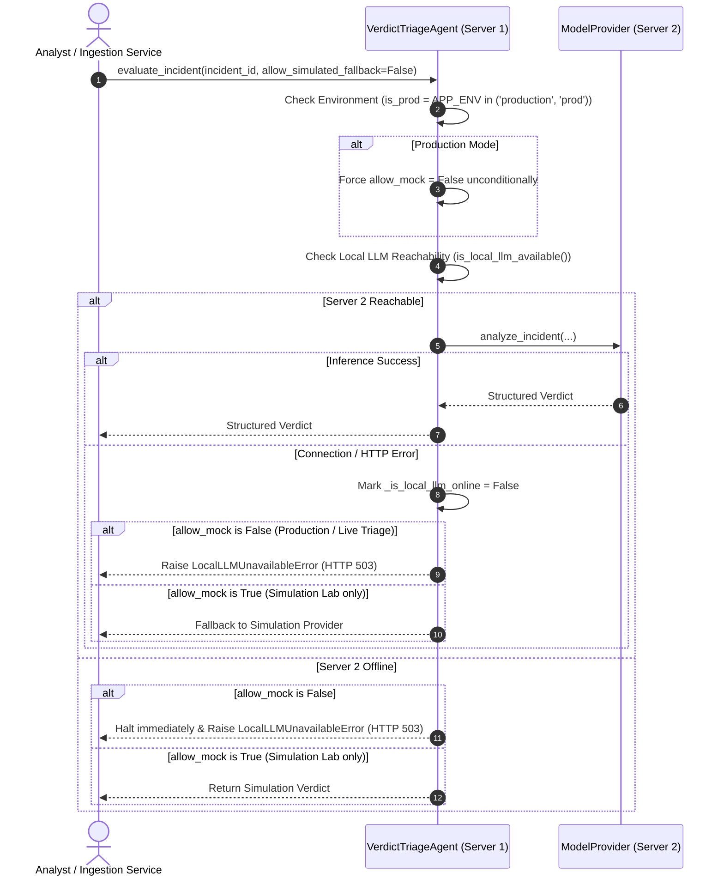

# AI Verdict — Phase 1: Inference Failure Safety & Mock Fallback Elimination

**Requirement:** REQ-02  
**Audit Finding:** AV-004 (Mock Fallback During Inference Failures & Outages)  
**Status:** **VERIFIED & IMPLEMENTED**  

---

### 1. Threat Model & Vulnerability Analysis

In the pre-Phase 1 audit baseline:
- When the Local LLM (Server 2) went offline, had HTTP timeouts, or crashed, `ai_verdict_service.py` checked `LOCAL_LLM_ALLOW_MOCK_FALLBACK`. If enabled (or if simulated fallback was triggered), it dispatched the incident to `SimulatedModelProvider`.
- `SimulatedModelProvider` used simple string keyword heuristics to emit `TRUE_POSITIVE` or `FALSE_POSITIVE` verdicts.
- To an analyst or downstream SIEM webhook, the verdict payload appeared as an authentic AI analysis, potentially closing real security incidents or ignoring critical attacks based on simulated random heuristics.

---

### 2. Architecture of Implemented Solution



---

### 3. Source Code Modifications

#### `backend/app/services/ai_verdict_service.py`
```python
# 4. Resolve evaluation mode & Model Availability Guard (REQ-02 / AV-004)
is_prod = getattr(settings, "APP_ENV", "development").lower() in ("production", "prod")
if is_prod:
    allow_mock = False
else:
    allow_mock = allow_simulated_fallback and getattr(settings, "LOCAL_LLM_ALLOW_MOCK_FALLBACK", False)

if not allow_mock and not model_provider_type:
    is_online = await self.is_local_llm_available()
    if not is_online:
        raise LocalLLMUnavailableError(
            "Local LLM (Server 2) is currently offline. AI verdict generation is deferred until Local LLM comes online."
        )
```

In `VerdictTriageAgent.evaluate_pending_incidents()` and `evaluate_unprocessed_batch()`:
```python
is_prod = getattr(settings, "APP_ENV", "development").lower() in ("production", "prod")
allow_mock = False if is_prod else getattr(settings, "LOCAL_LLM_ALLOW_MOCK_FALLBACK", False)
if not is_online and not allow_mock:
    # Halt immediately, preserve backlog, return pending count
    return {"message": "Local LLM offline. Incident triage deferred.", "pending": pending_count}
```

---

### 4. Verification & Testing

Tests implemented in `backend/tests/test_phase1_security_controls.py`:
- `test_req02_production_strictly_rejects_mock_fallback`:
  - Configures `APP_ENV="production"`.
  - Mocks `AIVerdictService.is_local_llm_available` to return `False`.
  - Attempts to evaluate an incident with `allow_simulated_fallback=True`.
  - Verifies that `LocalLLMUnavailableError` is strictly raised.
  - Verifies that no simulated TP/FP verdicts are produced.

