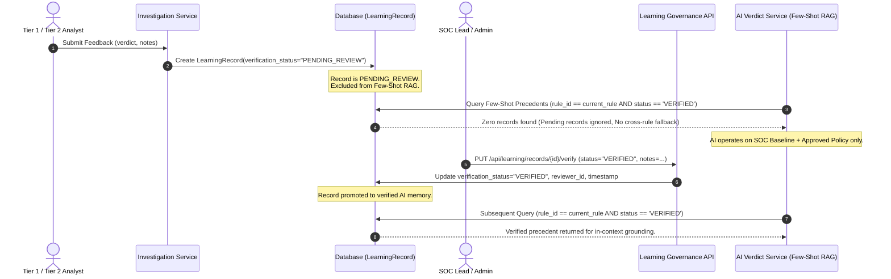

# AI Verdict — Phase 1: Analyst Learning Governance & Approval Gating

**Requirement:** REQ-05  
**Audit Finding:** AV-008 (Unreviewed Analyst Feedback Ingestion into Few-Shot Learning)  
**Status:** **VERIFIED & IMPLEMENTED**  

---

### 1. Threat Model & Vulnerability Analysis

In the pre-Phase 1 audit baseline:
1. When a human analyst entered an investigation verdict and submitted feedback, the system created a `LearningRecord` with `verification_status = "VERIFIED"` immediately.
2. The AI Verdict engine's Few-Shot RAG module queried verified learning records to inject as in-context examples.
3. Crucially, if no verified records existed for the specific rule, the query executed an unconstrained fallback (`lr_fallback`) selecting the most recent verified record across *any other detection rule*.
4. This created two serious risks:
   - **Feedback Poisoning:** A single rogue or mistaken analyst could submit an erroneous classification that immediately became part of the AI's training memory.
   - **Cross-Rule Hallucination:** A PowerShell execution incident could receive few-shot guidance derived from a firewall port-scan investigation, corrupting verdict accuracy.

---

### 2. Architecture of Implemented Solution



---

### 3. Source Code Modifications

#### `backend/app/models/learning.py` & `backend/app/schemas/learning.py`
```python
# Default verification status changed from "VERIFIED" to "PENDING_REVIEW"
verification_status: Mapped[str] = mapped_column(String(32), default="PENDING_REVIEW", index=True)

class LearningRecordVerifyRequest(BaseModel):
    status: str = Field(..., description="Target status: VERIFIED or REJECTED")
    review_notes: Optional[str] = Field(None, description="Reviewer supervisor comments")
```

#### `backend/app/services/investigation_service.py`
In `submit_analyst_feedback()`:
```python
learning_record = LearningRecord(
    incident_id=incident.incident_id,
    rule_id=rule.id if rule else None,
    analyst_id=username,
    analyst_verdict=analyst_verdict,
    final_verdict=analyst_verdict,
    feedback_notes=notes or "",
    verification_status="PENDING_REVIEW",  # REQ-05: Requires supervisor approval
    feedback_timestamp=datetime.utcnow(),
)
```

#### `backend/app/api/learning.py`
```python
@router.put("/records/{record_id}/verify", response_model=LearningRecordResponse)
async def verify_learning_record(
    record_id: str,
    req: LearningRecordVerifyRequest,
    current_user: User = Depends(require_role(["Administrator"])),
    db: AsyncSession = Depends(get_db),
):
    """
    Supervisor verification gate for analyst learning records.
    Only approved records become active few-shot examples.
    Restricted to Administrator role.
    """
    svc = LearningService(db)
    updated = await svc.update_verification_status(
        record_id=record_id,
        status=req.status.upper(),
        reviewer_username=current_user.username,
        review_notes=req.review_notes,
    )
    return updated

@router.post("/seed-historical")
async def seed_historical_learning_data(...):
    # Guard against accidental dev seeding in production environments
    if getattr(settings, "APP_ENV", "development").lower() in ("production", "prod"):
        raise HTTPException(
            status_code=403,
            detail="Seeding historical learning data is disabled in production environments.",
        )
```

#### `backend/app/services/ai_verdict_service.py`
In `VerdictTriageAgent.evaluate_incident()`:
```python
# In-Context Learning (Few-Shot RAG from Verified Learning History for THIS RULE ONLY)
lr_q = await self.db.execute(
    select(LearningRecord)
    .where(
        LearningRecord.rule_id == rule.id,
        LearningRecord.verification_status == "VERIFIED",
    )
    .options(selectinload(LearningRecord.incident))
    .order_by(desc(LearningRecord.feedback_timestamp))
    .limit(1)
)
learning_records = lr_q.scalars().all()
# REQ-05 / AV-008: Cross-rule fallback permanently removed to prevent cross-rule training poisoning.
```

---

### 4. Verification & Testing

Tests implemented in `backend/tests/test_phase1_security_controls.py`:
1. `test_req05_learning_record_verification_gate`:
   - Submits analyst feedback on an investigation.
   - Confirms `verification_status` is initialized as `"PENDING_REVIEW"`.
   - Simulates Few-Shot RAG query and asserts that `PENDING_REVIEW` records are excluded.
   - Admin calls `PUT /api/learning/records/{id}/verify` with `status: "VERIFIED"`.
   - Asserts that record transitions to `VERIFIED` and reviewer metadata is recorded.
2. `test_req05_seed_historical_forbidden_in_production`:
   - Configures `APP_ENV="production"`.
   - Calls `POST /api/learning/seed-historical`.
   - Asserts that endpoint returns `403 Forbidden`.

