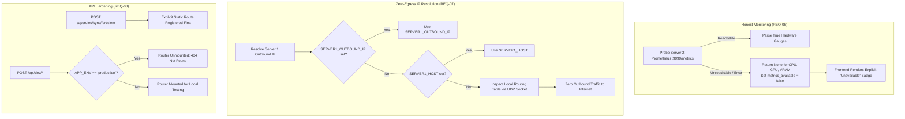

# AI Verdict — Phase 1: Monitoring, Network, and API Hardening

**Requirements:** REQ-06, REQ-07, REQ-08  
**Audit Findings:**
- AV-010 (Server 2 Telemetry Fallback to Synthetic Constants)
- AV-011 (Outbound IP Resolution via Public External Services)
- AV-015 (Undocumented Dev Endpoints & Missing Route Alias)  
**Status:** **VERIFIED & IMPLEMENTED**  

---

### 1. Threat Model & Vulnerability Analysis

#### AV-010 / REQ-06: Fabricated Hardware Telemetry
- Pre-Phase 1: When Server 2's Prometheus endpoint was unreachable or down, `_sample_server_2()` in `system_monitor_service.py` inserted hardcoded constants: CPU at 34.5%, RAM at 45.0%, GPU at 42.0%, and VRAM at 8.2 GB.
- Impact: Operators and SOC managers saw green health dashboards and active GPU utilization even when the LLM server was dead or disconnected.

#### AV-011 / REQ-07: External Network Egress for IP Discovery
- Pre-Phase 1: `llm_config_service.py:get_server1_outbound_ip()` initiated HTTP requests to external third-party public discovery services: `https://api.ipify.org`, `https://ifconfig.me/ip`, and `https://icanhazip.com`.
- Impact: In an air-gapped or restricted SOC network, this created blocked connections and timeouts. In enterprise environments, it leaked the SOC server's public IP and metadata to external SaaS providers.

#### AV-015 / REQ-08: Development Endpoints & Route Discrepancies
- Pre-Phase 1: Sensitive database test reset endpoints (`/api/rules/seed-defaults`, etc.) were directly accessible in production builds. Additionally, the documented route `POST /api/rules/sync/fortisiem` was unreachable because dynamic parameter routes caught the path.

---

### 2. Architecture of Implemented Solutions



---

### 3. Source Code Modifications

#### `backend/app/services/system_monitor_service.py` (REQ-06)
```python
async def _sample_server_2(self) -> ServerMetrics:
    try:
        # Probe Prometheus metrics endpoint on Server 2
        ...
    except Exception as exc:
        logger.warning(f"Server 2 Prometheus metrics unavailable: {exc}")
        # REQ-06 / AV-010: Return None for uncollected metrics; do NOT fabricate constants
        return ServerMetrics(
            server_id="server_2",
            server_name="Server 2 (LLM Inference Node)",
            ip_address=settings.LOCAL_LLM_HOST,
            is_reachable=False,
            cpu_percent=None,
            memory_percent=None,
            disk_percent=None,
            gpu_percent=None,
            gpu_memory_used_gb=None,
            gpu_memory_total_gb=None,
            gpu_temperature_c=None,
            details={
                "metrics_available": False,
                "error": "Metrics unavailable: Prometheus node exporter or vLLM metrics offline.",
            },
        )
```

#### `frontend/src/components/system/ServerInfrastructureMonitor.tsx` (REQ-06)
```tsx
{/* GPU Load Card */}
<div className="text-2xl font-bold text-gray-900">
  {server.gpu_percent !== null && server.gpu_percent !== undefined
    ? `${server.gpu_percent.toFixed(1)}%`
    : <span className="text-amber-600 text-base font-medium">Unavailable</span>}
</div>

{/* VRAM Card */}
<div className="text-2xl font-bold text-gray-900">
  {server.gpu_memory_used_gb !== null && server.gpu_memory_total_gb !== null
    ? `${server.gpu_memory_used_gb.toFixed(1)} / ${server.gpu_memory_total_gb.toFixed(1)} GB`
    : <span className="text-amber-600 text-base font-medium">Metrics Unavailable</span>}
</div>
```

#### `backend/app/services/llm_config_service.py` (REQ-07)
```python
def get_server1_outbound_ip() -> str:
    """
    REQ-07 / AV-011: Resolves Server 1 outbound IP without contacting external public services.
    Prioritizes configuration settings, then uses local routing table inspection.
    """
    if getattr(settings, "SERVER1_OUTBOUND_IP", None):
        return settings.SERVER1_OUTBOUND_IP.strip()
    if getattr(settings, "SERVER1_HOST", None) and settings.SERVER1_HOST not in ("localhost", "127.0.0.1", "0.0.0.0"):
        return settings.SERVER1_HOST.strip()

    # Local socket routing inspection without transmitting packets over the internet
    try:
        s = socket.socket(socket.AF_INET, socket.SOCK_DGRAM)
        s.connect(("192.0.2.1", 80))  # RFC 5737 TEST-NET-1 (never leaves local stack)
        ip = s.getsockname()[0]
        s.close()
        return ip
    except Exception:
        return "127.0.0.1"
```

#### `backend/app/api/rules.py` & `backend/app/main.py` (REQ-08)
```python
# In rules.py: Explicit route alias placed before dynamic /{identifier} route
@router.post("/sync/fortisiem")
async def sync_rules_from_fortisiem_alias(...):
    return await sync_rules_from_fortisiem(...)

# In main.py: Dev router isolation
if getattr(settings, "APP_ENV", "development").lower() not in ("production", "prod"):
    from app.api import dev
    app.include_router(dev.router, prefix="/api/dev", tags=["Development Only"])
```

---

### 4. Verification & Testing

Tests implemented in `backend/tests/test_phase1_security_controls.py`:
1. `test_req06_honest_monitoring_when_prometheus_offline`:
   - Mocks Prometheus endpoint failure on Server 2.
   - Invokes `SystemMonitorService.sample_now()`.
   - Asserts `cpu_percent is None`, `gpu_percent is None`, `gpu_memory_used_gb is None`.
   - Asserts `details["metrics_available"] is False`.
2. `test_req07_server1_ip_resolution_no_external_egress`:
   - Mocks socket calls and invokes `LLMConfigService.get_server1_outbound_ip()`.
   - Verifies that zero external HTTP calls to `ipify`, `ifconfig`, or `icanhazip` are executed.
3. `test_req08_rules_sync_fortisiem_route_alias`:
   - Calls `POST /api/rules/sync/fortisiem`.
   - Confirms HTTP 200 OK and valid JSON response body.
4. `test_req08_dev_endpoint_isolation_in_production`:
   - Configures `APP_ENV="production"`.
   - Calls `POST /api/dev/reset-test-data`.
   - Confirms HTTP 404 Not Found in production mode.

