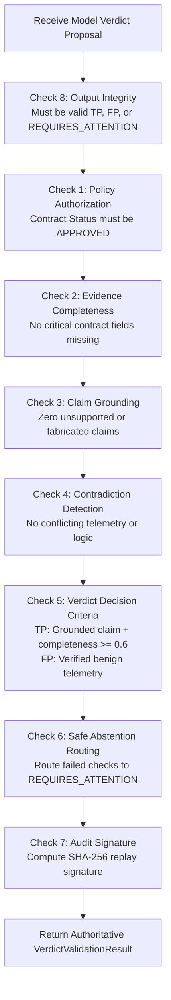

# AI VERDICT — PHASE 2: INDEPENDENT VERDICT VALIDATOR
## 06. INDEPENDENT DETERMINISTIC VERDICT VALIDATOR (P2-REQ-05)

---

### 1. Architectural Authority
`IndependentVerdictValidator` is the authoritative core of Phase 2.
The model proposes conclusions, but the validator enforces ground truth and deterministic criteria. The model's self-assessed confidence or analytical eloquence has **zero authority** to bypass these checks.

---

### 2. Validation Result Schema (`app/schemas/verdict_validation.py`)

```python
class VerdictValidationResult(BaseModel):
    incident_id: str
    proposed_verdict: str  # Verdict proposed by model
    final_verdict: str     # Authoritative accepted verdict
    validation_status: str # VALIDATED, ABSTAINED, REJECTED, INSUFFICIENT_EVIDENCE
    validation_reason_codes: List[str]
    is_decisive_accepted: bool  # True if TP/FP accepted; False if REQUIRES_ATTENTION
    evidence_completeness: float
    grounding_ratio: float
    total_claims_count: int = 0
    grounded_claims_count: int = 0
    unsupported_claims_count: int = 0
    missing_evidence_fields: List[str]
    unsupported_claims: List[Dict[str, Any]]
    detected_contradictions: List[str]
    analyst_action_directive: str
    contract_id: Optional[str] = None
    contract_version: int = 1
    validator_version: str = "2.0.0"
    raw_model_confidence: float = 0.0
    validated_confidence_display: Optional[float] = None
    replay_signature: str = ""
```

---

### 3. The 8 Mandatory Deterministic Verification Checks



#### Detailed Check Descriptions:
1. **Check 1: Policy & Contract Authorization**
   - Verifies `contract.status == "APPROVED"`.
   - If not approved: sets `final_verdict = "REQUIRES_ATTENTION"`, `validation_status = "ABSTAINED"`, code `EVIDENCE_CONTRACT_UNVERIFIED`.
2. **Check 2: Mandatory Evidence Completeness**
   - Verifies that `critical_missing_fields` from preflight is empty.
   - If missing: sets `final_verdict = "REQUIRES_ATTENTION"`, `validation_status = "INSUFFICIENT_EVIDENCE"`, code `EVIDENCE_MISSING`.
3. **Check 3: Source Grounding & Unsupported Claims**
   - Verifies that `claim_grounding.has_hallucinations` is False.
   - If model fabricated any IP, hash, or process name: sets `final_verdict = "REQUIRES_ATTENTION"`, `validation_status = "REJECTED"`, codes `CLAIM_NOT_VERIFIABLE` / `EVIDENCE_REFERENCE_NOT_FOUND` / `EVIDENCE_VALUE_MISMATCH`.
4. **Check 4: Evidence Consistency & Contradictions**
   - Verifies that telemetry does not contradict claims (e.g. model claiming external C2 communication when all observed source and destination IPs are loopback `127.0.0.1` or internal subnet).
   - If contradictory: sets `final_verdict = "REQUIRES_ATTENTION"`, `validation_status = "REJECTED"`, code `EVIDENCE_CONTRADICTION`.
5. **Check 5: Verdict-Specific Decision Criteria**
   - **For `TRUE_POSITIVE`:** Requires evidence completeness $\ge 0.6$ and at least 1 grounded factual claim.
   - **For `FALSE_POSITIVE`:** Requires evidence completeness $\ge 0.5$ and verified benign context; cannot be FP solely on suspicion.
   - If criteria unsatisfied: sets `final_verdict = "REQUIRES_ATTENTION"`, code `TP_CRITERIA_UNSATISFIED` or `FP_CRITERIA_UNSATISFIED`.
6. **Check 6: Safe Abstention Routing**
   - If any check fails, the verdict is forced to `REQUIRES_ATTENTION`, `is_decisive_accepted = False`, and display confidence is zeroed to `0.0`.
7. **Check 7: Cryptographic Replay Signature**
   - Computes deterministic SHA-256 signature over incident ID, contract ID, proposed verdict, final verdict, and validator version.
8. **Check 8: Output Integrity & Enum Normalization**
   - Verifies proposed string is one of `"TRUE_POSITIVE"`, `"FALSE_POSITIVE"`, `"REQUIRES_ATTENTION"`. Any unparseable output is coerced to `REQUIRES_ATTENTION` with code `MODEL_OUTPUT_INVALID`.

---

### 4. Deterministic Replay Engine (`replay_validation`)
The validator implements an independent replay method:
```python
@classmethod
def replay_validation(
    cls,
    incident_id: str,
    saved_evidence_records: List[Dict[str, Any]],
    contract_dict: Dict[str, Any],
    saved_model_output: Dict[str, Any],
) -> VerdictValidationResult:
```
Given a saved evidence snapshot, contract, and model output, it executes the identical validation pipeline without touching live network or LLM APIs. If any evidence field was tampered with, the replay signature and validation status immediately diverge, providing cryptographic tamper detection.

