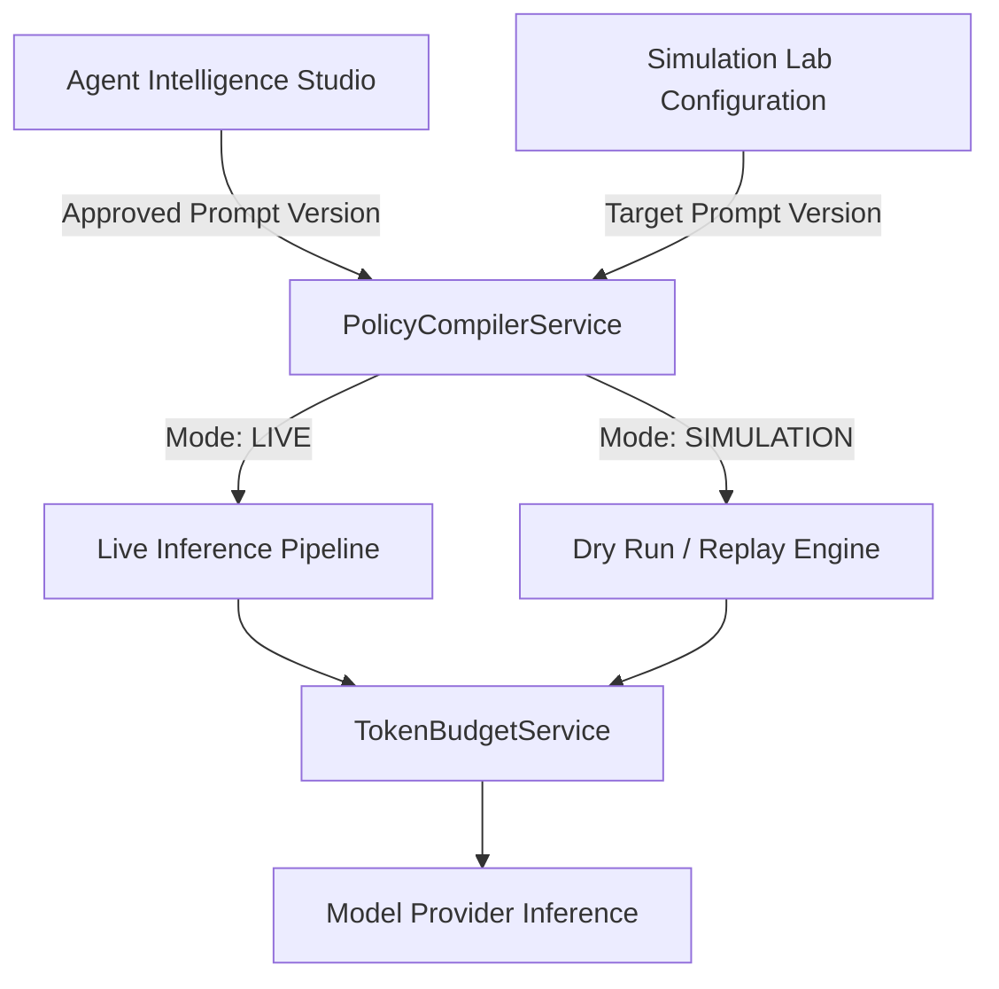

# 02. LIVE & SIMULATION PARITY ARCHITECTURE

**Document Identifier:** `AV-P3-DOC-02`  
**Requirement Mapping:** `P3-REQ-02` (Full Live and Simulation Lab Parity), Finding `AV-003`  
**Implementation Modules:** `app/services/ai_verdict_service.py`, `app/services/dry_run_service.py`  

---

## 1. Problem Statement & Parity Breakdown

Before Phase 3:
- In `ai_verdict_service.py`, live triage assembled `common_prompt`, `rule_specific_prompt`, and indicators.
- In `dry_run_service.py`, simulation replay constructed a truncated string: `f"{pv.common_prompt}\n\n{pv.rule_specific_prompt}"`.
- As a consequence, policies validated in Simulation Lab exhibited significant behavioral divergence when deployed into live SOC production triage.

---

## 2. Parity Architecture

In Phase 3, prompt generation across all environments is consolidated into a single unified service: `PolicyCompilerService`.

### Architectural Guarantees:
1. **Identical Section Content:** Sections 1 through 9 contain exactly identical prompt text and ordering.
2. **Identical Instruction Delimiters:** `<UNTRUSTED_INCIDENT_DATA>` and `<VERIFIED_HISTORICAL_PRECEDENTS>` are used in both pipelines.
3. **Identical Response Schema:** Both environments pass the identical JSON schema requirement.
4. **Identical Token Budgeting:** Both pipelines invoke `TokenBudgetService.budget_prompt` with the same priority hierarchy, ensuring that if a prompt fits in simulation, it fits identically in live triage.

---

## 3. Execution Mode Tagging

The only difference between Live and Simulation is the execution mode flag in the prompt header:
- Live Mode: `Execution Mode: LIVE | Policy Status: APPROVED`
- Simulation Mode: `Execution Mode: SIMULATION | Policy Status: DRAFT / APPROVED`

Live mode strictly enforces that only `APPROVED` versions can execute. If an unapproved draft is passed, live triage defers to human analysts with `POLICY_NOT_APPROVED`. Simulation Lab permits backtesting against draft versions, with results explicitly marked as `is_simulated = True`.

