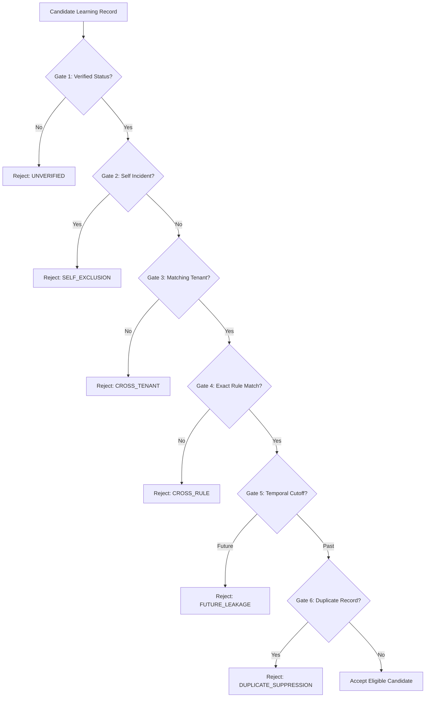

# 04. MEMORY GOVERNANCE & GATE CONTROLS

**Document Identifier:** `AV-P3-DOC-04`  
**Requirement Mapping:** `P3-REQ-04` (Memory Governance & Gate Controls), Finding `AV-007`, `AV-008`  
**Implementation Modules:** `app/services/verified_semantic_retrieval_service.py`  

---

## 1. Six Mandatory Governance Gates

Before any historical precedent can enter the model prompt context, it must pass 6 deterministic gating filters:

### Gate Details:
1. **Gate 1: Verification Status Check:**
   - Candidate `verification_status` MUST equal `"VERIFIED"`. Unreviewed (`PENDING_REVIEW`), disputed, or rejected analyst feedback is barred from entering prompt context.
2. **Gate 2: Self-Exclusion Gate:**
   - The candidate incident ID cannot equal the target incident ID. A re-evaluated incident cannot use itself as a precedent.
3. **Gate 3: Strict Tenant Isolation Gate:**
   - Customer/Tenant ID of the candidate must strictly match the target incident (`customer == query_customer`). Cross-tenant telemetry is completely isolated.
4. **Gate 4: Exact Rule-Scoping Gate:**
   - Candidate `rule_id` must match the target rule ID (`rule_id == query_rule_id`). Fallback across rules is prohibited by default to prevent cross-rule training poisoning.
5. **Gate 5: Temporal Integrity Gate:**
   - The feedback timestamp or verification timestamp of the precedent must be prior to or equal to the target incident's creation timestamp (`candidate_time <= query_time`). This prevents future-case data leakage during backtesting, historical replay, and Simulation Lab runs.
6. **Gate 6: Duplicate Suppression Gate:**
   - Precedents sharing the same incident ID and verdict are deduplicated, preserving only the most recent verified submission.

---

## 2. Rejection Audit Logging

`RAGRetrievalResult` tracks full diagnostic metrics for every retrieval attempt:
- `total_candidates_examined`
- `candidates_rejected_unverified`
- `candidates_rejected_cross_tenant`
- `candidates_rejected_cross_rule`
- `candidates_rejected_future_leakage`
- `candidates_rejected_duplicate`

