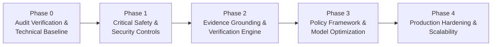

# AI Verdict Implementation Program

## Overview

The **AI Verdict Implementation Program** is a structured, five-phase engineering and governance initiative designed to elevate the **AI Verdict** (Agentic SOC Intelligence Platform) from its original prototype state to an enterprise-grade, evidence-grounded, and auditable SOC decision support system.

The platform triages security incidents ingested from Fortinet FortiSIEM, evaluates alerts against customizable detection policies, retrieves historical precedent cases, orchestrates local LLM inference on private GPU infrastructure (vLLM / Ollama), and outputs calibrated verdicts: `TRUE_POSITIVE`, `FALSE_POSITIVE`, or `REQUIRES_ATTENTION`.

---

## Program Roadmap

| Phase | Title | Objective | Status |
| :---: | :--- | :--- | :---: |
| **Phase 0** | **Audit Verification & Technical Baseline** | Independently verify all 15 audit findings against source code, trace all execution paths, establish an automated test baseline, and define Phase 1 requirements without modifying code. | **COMPLETED** |
| **Phase 1** | **Critical Safety & Security Controls** | Fix hardcoded secrets, disable silent mock fallbacks, eliminate unapproved policy auto-activation, prevent blind-review ground-truth leakage, block unreviewed feedback poisoning, and harden monitoring. | **COMPLETED** |
| **Phase 2** | **Evidence Grounding & Verification Engine** | Implement canonical evidence normalization, machine-verifiable rule contracts, pre-inference telemetry gating, independent factual claim grounding, and deterministic 8-check verdict validation. | **COMPLETED** |
| **Phase 3** | **Policy Framework & Model Optimization** | Standardize complete 9-section prompt assembly across live and dry-run inference, implement semantic similarity RAG, optimize token budgeting, and establish honest empirical evaluation. | **COMPLETED** |
| **Phase 4** | **Production Hardening & Scalability** | Transition from SQLite to PostgreSQL with connection pooling, implement asynchronous Celery/Redis task queues, and harden deployment scripts. | *Pending Authorization* |

---

## Phase 3 Documentation Deliverables

All Phase 3 implementation reports and verification matrices are located under [`docs/AI_VERDICT_IMPLEMENTATION/PHASE_3/`](file:///c:/Users/amit/OneDrive/Documents/SOC-AI-Agent/docs/AI_VERDICT_IMPLEMENTATION/PHASE_3/00_PHASE_3_EXECUTIVE_SUMMARY.md):

1. [**`00_PHASE_3_EXECUTIVE_SUMMARY.md`**](file:///c:/Users/amit/OneDrive/Documents/SOC-AI-Agent/docs/AI_VERDICT_IMPLEMENTATION/PHASE_3/00_PHASE_3_EXECUTIVE_SUMMARY.md): Executive summary, program metrics, and milestone sign-off.
2. [**`01_UNIFIED_NINE_SECTION_POLICY_COMPILER.md`**](file:///c:/Users/amit/OneDrive/Documents/SOC-AI-Agent/docs/AI_VERDICT_IMPLEMENTATION/PHASE_3/01_UNIFIED_NINE_SECTION_POLICY_COMPILER.md): P3-REQ-01: Deterministic 9-section compiler with SHA-256 digest binding.
3. [**`02_LIVE_SIMULATION_PARITY_ARCHITECTURE.md`**](file:///c:/Users/amit/OneDrive/Documents/SOC-AI-Agent/docs/AI_VERDICT_IMPLEMENTATION/PHASE_3/02_LIVE_SIMULATION_PARITY_ARCHITECTURE.md): P3-REQ-02: Complete prompt parity across live inference and Simulation Lab.
4. [**`03_VERIFIED_SEMANTIC_RAG_ENGINE.md`**](file:///c:/Users/amit/OneDrive/Documents/SOC-AI-Agent/docs/AI_VERDICT_IMPLEMENTATION/PHASE_3/03_VERIFIED_SEMANTIC_RAG_ENGINE.md): P3-REQ-03: 100% local lexical/semantic retrieval with zero cloud egress.
5. [**`04_MEMORY_GOVERNANCE_AND_GATE_CONTROLS.md`**](file:///c:/Users/amit/OneDrive/Documents/SOC-AI-Agent/docs/AI_VERDICT_IMPLEMENTATION/PHASE_3/04_MEMORY_GOVERNANCE_AND_GATE_CONTROLS.md): P3-REQ-04: 6 isolation gates (status, self-exclusion, tenant, rule, temporal, dedup).
6. [**`05_TOKEN_BUDGETING_AND_PRIORITY_ALLOCATION.md`**](file:///c:/Users/amit/OneDrive/Documents/SOC-AI-Agent/docs/AI_VERDICT_IMPLEMENTATION/PHASE_3/05_TOKEN_BUDGETING_AND_PRIORITY_ALLOCATION.md): P3-REQ-05: 7-tier priority allocation; prevents naive truncation of command lines.
7. [**`06_STRUCTURED_OUTPUT_AND_INJECTION_DEFENSE.md`**](file:///c:/Users/amit/OneDrive/Documents/SOC-AI-Agent/docs/AI_VERDICT_IMPLEMENTATION/PHASE_3/06_STRUCTURED_OUTPUT_AND_INJECTION_DEFENSE.md): P3-REQ-06: Strict JSON output schema and dual-layer prompt injection defense.
8. [**`07_EMPIRICAL_EVALUATION_FRAMEWORK.md`**](file:///c:/Users/amit/OneDrive/Documents/SOC-AI-Agent/docs/AI_VERDICT_IMPLEMENTATION/PHASE_3/07_EMPIRICAL_EVALUATION_FRAMEWORK.md): P3-REQ-07: Scientific metrics (Precision, Recall, FNR, ECE, Brier score).
9. [**`08_HONEST_CONFIDENCE_CALIBRATION.md`**](file:///c:/Users/amit/OneDrive/Documents/SOC-AI-Agent/docs/AI_VERDICT_IMPLEMENTATION/PHASE_3/08_HONEST_CONFIDENCE_CALIBRATION.md): P3-REQ-07: 30-sample threshold; reports NOT_CALIBRATED when sample size < 30.
10. [**`09_DATASET_PARTITION_MANAGEMENT.md`**](file:///c:/Users/amit/OneDrive/Documents/SOC-AI-Agent/docs/AI_VERDICT_IMPLEMENTATION/PHASE_3/09_DATASET_PARTITION_MANAGEMENT.md): P3-REQ-07: Stateless SHA-256 modulo 4-way dataset partitioning.
11. [**`10_STUDIO_POLICY_INTEGRATION.md`**](file:///c:/Users/amit/OneDrive/Documents/SOC-AI-Agent/docs/AI_VERDICT_IMPLEMENTATION/PHASE_3/10_STUDIO_POLICY_INTEGRATION.md): P3-REQ-01: Studio compilation integration and rule export endpoints.
12. [**`11_API_SPECIFICATIONS_AND_CONTRACTS.md`**](file:///c:/Users/amit/OneDrive/Documents/SOC-AI-Agent/docs/AI_VERDICT_IMPLEMENTATION/PHASE_3/11_API_SPECIFICATIONS_AND_CONTRACTS.md): P3-REQ-01/06/07: Updated verdict payload schema and rule endpoints.
13. [**`12_SECURITY_AND_ISOLATION_CONTROLS.md`**](file:///c:/Users/amit/OneDrive/Documents/SOC-AI-Agent/docs/AI_VERDICT_IMPLEMENTATION/PHASE_3/12_SECURITY_AND_ISOLATION_CONTROLS.md): P3-REQ-03/04: Zero cloud egress, tenant isolation, and memory poisoning defense.
14. [**`13_DECISION_PROVENANCE_AND_AUDIT_BINDING.md`**](file:///c:/Users/amit/OneDrive/Documents/SOC-AI-Agent/docs/AI_VERDICT_IMPLEMENTATION/PHASE_3/13_DECISION_PROVENANCE_AND_AUDIT_BINDING.md): P3-REQ-01/08: Hardened Audit Verification Token binding compilation digest.
15. [**`14_FRONTEND_UI_INTEGRATION.md`**](file:///c:/Users/amit/OneDrive/Documents/SOC-AI-Agent/docs/AI_VERDICT_IMPLEMENTATION/PHASE_3/14_FRONTEND_UI_INTEGRATION.md): P3-REQ-07/08: UI enhancements, compiler badge, RAG precedent card, TypeScript green.
16. [**`15_TEST_SUITE_AND_SCENARIO_COVERAGE.md`**](file:///c:/Users/amit/OneDrive/Documents/SOC-AI-Agent/docs/AI_VERDICT_IMPLEMENTATION/PHASE_3/15_TEST_SUITE_AND_SCENARIO_COVERAGE.md): P3-REQ-08: 14 Phase 3 tests passed; 149/149 full regression tests passed.
17. [**`16_PHASE_3_COMPLETION_CHECKLIST.md`**](file:///c:/Users/amit/OneDrive/Documents/SOC-AI-Agent/docs/AI_VERDICT_IMPLEMENTATION/PHASE_3/16_PHASE_3_COMPLETION_CHECKLIST.md): Complete verification checklist and sign-off for all Phase 3 requirements.
