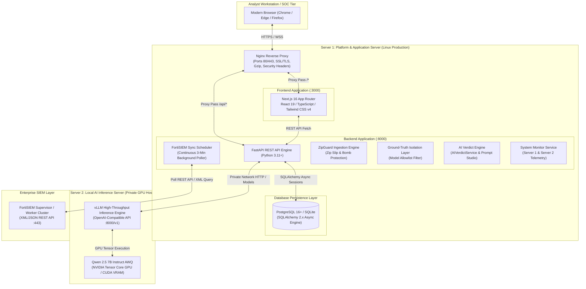

# AI Verdict — System Architecture, Data Flows, Tech Stack & Logic Taxonomy

> **Comprehensive Enterprise Technical Specification**  
> *Authoritative reference for platform architecture, execution flows, underlying libraries, and code naming conventions.*

---

## 1. System Architecture

AI Verdict operates under an enterprise **Two-Server Topology** designed to isolate mission-critical SOC operations, web application services, and database persistence from heavy GPU-accelerated local AI inference workloads.

### 1.1 High-Level Server Topology



---

### 1.2 Architectural Roles & Responsibilities

| Tier / Node | Primary Responsibility | Critical Components | Network Security |
| :--- | :--- | :--- | :--- |
| **Server 1: Platform Core** | Serves Next.js UI, processes API routes, authenticates analysts, validates ZIP archives, manages continuous SIEM synchronization, and enforces Ground-Truth Isolation. | FastAPI, Uvicorn, Next.js 16, Nginx, PostgreSQL/SQLite. | Exposed via Nginx (TLS 1.3, Strict CORS, SameSite Cookies). |
| **Server 2: Inference Node** | Dedicated GPU host running quantized local LLMs for evidence analysis, returning strictly structured verdicts with zero cloud leaks. | vLLM Engine, PyTorch CUDA, Qwen 2.5 7B Instruct AWQ. | Completely isolated on private internal network; only accepts inbound requests from Server 1. |
| **FortiSIEM Supervisor** | Upstream enterprise SIEM generating raw incident notifications, event logs, and detection rules. | FortiSIEM REST API, XML Query Engine. | Authenticated via API token / HTTP Basic over mutual TLS. |

---

### 1.3 Security & Boundary Architecture

1. **Ground-Truth Isolation Layer**:
   - Historical analyst verdicts, closure resolutions, cleared reasons, and closure times are strictly segregated into `historical_ground_truth` and dropped before LLM payload generation.
   - Prevents prompt bias and prevents the model from "cheating" by inspecting historical human answers.
2. **Zero Direct Push & RepoDeploy Governor**:
   - All Git pushes and remote server deployments are hard-gated by the RepoDeploy Governor with two-stage approval tokens (`git-gate` and `deploy-gate`).
   - Automated pre-push secret scanning blocks any code containing credentials or internal IP addresses.
3. **ZipGuard Archive Sandbox**:
   - Validates all uploaded archive packages against Zip Slip traversal (`../`), decompression bombs (>50:1 ratio), and file count limits (>2,000 files).
4. **Strict Offline LLM Protection**:
   - If Server 2 is offline or unreachable, the system never generates fake, simulated, or default verdicts. Incidents are preserved in `Pending` state (`ai_verdict = None`) until Server 2 is verified online.

---

## 2. Operational Flows

```mermaid
sequenceDiagram
    autonumber
    participant Analyst as Analyst (UI)
    participant UI as Next.js Frontend
    participant API as FastAPI Backend
    participant Poller as FortiSIEM Sync Scheduler
    participant SIEM as FortiSIEM Supervisor
    participant DB as Relational DB
    participant LLM as Server 2 Local LLM (vLLM)

    rect rgb(15, 23, 42)
    note over Poller, SIEM: Flow 1: Continuous 3-Minute SIEM Sync & Auto-Ingest
    Poller->>SIEM: GET /phoenix/rest/incident/list (Checkpoint epoch)
    SIEM-->>Poller: Raw Incidents JSON
    Poller->>DB: Check if Incident ID exists
    DB-->>Poller: New Incident Detected
    Poller->>DB: Ingest normalized incident + raw events + ground truth
    Poller->>SIEM: Fetch detection rule definition if rule unmapped
    SIEM-->>Poller: Rule XML/JSON
    Poller->>DB: Upsert SIEM Rule in registry
    end

    rect rgb(30, 41, 59)
    note over Poller, LLM: Flow 2: Automated AI Verdict & Offline LLM Protection
    Poller->>API: Probe Server 2 LLM Health (/v1/models)
    alt Server 2 is ONLINE
        API->>DB: Fetch model allowlisted payload (No ground truth)
        API->>DB: Fetch Level-2 SOC Prompt + Rule Prompt + Few-Shot Examples
        API->>LLM: POST /v1/chat/completions (Structured schema prompt)
        LLM-->>API: JSON Structured Verdict (Determination, Confidence, Reason)
        API->>DB: Persist ai_verdict & update Investigation queue
    else Server 2 is OFFLINE
        API->>DB: Save incident with ai_verdict = None (Pending Backlog)
        API-->>UI: Badge: "Unlabeled / Pending Investigation"
    end
    end

    rect rgb(15, 23, 42)
    note over Analyst, DB: Flow 3: Analyst Review & Continuous Learning Loop
    Analyst->>UI: Inspect Incident (Blind Review Mode: Ground Truth Hidden)
    UI->>API: GET /api/incidents/{id}
    API-->>UI: Normalized incident + raw events (Ground truth masked)
    Analyst->>UI: Submit human determination & rationale
    UI->>API: POST /api/learning/feedback
    API->>DB: Insert LearningRecord (Verified Precedent)
    note over API, DB: Precedent now automatically feeds future few-shot LLM prompts!
    end
```



### 2.1 Flow Breakdown

#### Flow 1: Continuous Ingestion & 3-Minute Background Poller
1. `FortiSIEMSyncScheduler` initializes on backend startup (configured via `FORTISIEM_AUTO_POLL_ENABLED=true`).
2. A background `asyncio` task wakes every 180 seconds.
3. Calls `FortiSIEMService.pull_all_incidents()`.
4. Idempotently normalizes newly received incidents, extracts raw event telemetry (`IncidentEvent`), and saves unmodified JSON payloads into `raw_payload`.
5. Missing rules are auto-synced from FortiSIEM into the `rules` table.

#### Flow 2: Resilient AI Verdict Generation & Dynamic Prompt Synthesis
1. Invoked automatically by poller or manually by analyst clicking **Re-evaluate AI Verdict**.
2. Checks Server 2 health via `AIVerdictService.is_local_llm_available()`.
3. If offline, throws `LocalLLMUnavailableError` leaving `ai_verdict = None` (zero mock hallucinations).
4. If online, synthesizes dynamic multi-layer prompt:
   - **Layer 1: Common SOC Baseline** (`COMMON_SOC_BASELINE` Level-2 SOC triage instructions).
   - **Layer 2: Rule Prompt Studio** (Custom active draft/approved rules from `prompt_versions`).
   - **Layer 3: Dynamic Few-Shot Precedents** (Top 3 verified precedents from `learning_records`).
   - **Layer 4: Sanitized Model Payload** (`build_model_facing_payload` filtering out closure keys).
5. Dispatches request to `OpenAICompatibleProvider`.
6. Parses structured JSON verdict (`verdict`, `confidence`, `reason`, `supporting_evidence`, `missing_evidence`).
7. Persists verdict in database and logs audit entry.

#### Flow 3: Offline Backlog Recovery (`process_pending_incidents`)
1. When Server 2 is offline, incoming alerts accumulate in the database with `ai_verdict = None`.
2. As soon as Server 2 comes back online, `AIVerdictService.process_pending_incidents()` queries all unanalyzed incidents ordered chronologically (`created_at_epoch.asc()`).
3. Evaluates each incident sequentially one-by-one with 150ms pacing.
4. If the LLM disconnects mid-batch, the queue gracefully halts, preserving state without data loss.

#### Flow 4: SIEM Detection Rule Registry & Analytics
1. Detection rules are parsed and stored in `rules`.
2. `GET /api/rules/stats` calculates live aggregations:
   - Total rules ingested
   - Active vs. inactive count
   - Alert coverage (rules linked to active incident records)
   - Severity distribution (Critical, High, Medium, Low)
   - Prompt Studio customization coverage
3. Frontend renders 5 responsive Cyberpunk-styled analytical cards with real-time refresh.

#### Flow 5: Blind Review & Analyst Learning Loop
1. Analyst toggles **Blind Review Mode** in UI header.
2. Ground-truth badges are hidden, forcing unbiased human triage.
3. Analyst submits independent verdict.
4. If analyst confirms or refines the verdict, a record is added to `learning_records`.
5. `AIVerdictService` pulls the latest verified precedents into few-shot RAG context for future alerts matching that rule.

---

## 3. Tools & Libraries Used

### 3.1 Technology Stack Matrix

```
+---------------------------------------------------------------------------------------+
|                                    TECHNOLOGY MATRIX                                  |
+---------------------------------------------------------------------------------------+
|  Layer               | Technology / Library       | Version       | Key Purpose       |
|======================+============================+===============+===================|
|  Frontend UI         | Next.js (App Router)       | 16.4.5        | React Framework   |
|                      | React / React DOM          | 19.3.0        | Component UI      |
|                      | TypeScript                 | 5.x           | Type Safety       |
|                      | Tailwind CSS               | 4.x           | Utility Styling   |
|                      | Lucide React               | 1.69.0        | SOC Iconography   |
|                      | clsx / tailwind-merge      | 2.1 / 3.7     | Class Merging     |
|----------------------+----------------------------+---------------+-------------------|
|  Backend API         | Python                     | 3.11+ / 3.13  | Core Language     |
|                      | FastAPI                    | 0.110.0+      | Async Web API     |
|                      | Uvicorn                    | 0.28.0+       | ASGI Web Server   |
|                      | Pydantic / Settings        | 2.6.0+        | Data Validation   |
|                      | SQLAlchemy                 | 2.0.28+       | Async ORM Engine  |
|                      | Alembic                    | 1.13.1+       | DB Migrations     |
|                      | aiosqlite / asyncpg        | 0.20+ / 0.29+ | Async DB Drivers  |
|                      | HTTPX                      | 0.27.0+       | Async HTTP Client |
|                      | PyJWT / Bcrypt             | 2.8+ / 4.1+   | JWT Auth & Hash   |
|                      | Psutil                     | 5.9.0+        | Server Telemetry  |
|                      | Pytest / Pytest-Asyncio    | 8.0+ / 0.23+  | Test Suite        |
|----------------------+----------------------------+---------------+-------------------|
|  AI Inference        | vLLM                       | 0.6.0+        | GPU Serving       |
|                      | PyTorch / CUDA             | 12.x          | Tensor Compute    |
|                      | Qwen 2.5 7B Instruct AWQ   | 4-bit Quant   | Core LLM Model    |
|----------------------+----------------------------+---------------+-------------------|
|  DevOps & Gov        | RepoDeploy Governor        | CLI v1.0      | Zero-Leak Push    |
|                      | Nginx                      | 1.24+         | Reverse Proxy     |
|                      | Systemd / PM2              | Native        | Process Daemon    |
+---------------------------------------------------------------------------------------+
```

---

## 4. Logical Components & Naming Taxonomy

This section provides a definitive dictionary of classes, functions, files, schemas, and database tables used across the codebase.

### 4.1 Backend Service Layer (`backend/app/services/`)

| Logic Name (Class / Function) | File Path | Architectural Role & Description |
| :--- | :--- | :--- |
| `FortiSIEMService` | [`fortisiem_service.py`](file:///c:/Users/amit/OneDrive/Documents/SOC-AI-Agent/backend/app/services/fortisiem_service.py) | Coordinates live HTTP REST calls to FortiSIEM supervisor, pulls incidents by ID, executes full alert syncs, parses XML/JSON responses, and syncs detection rules. |
| `FortiSIEMSyncScheduler` / `fortisiem_scheduler` | [`fortisiem_scheduler.py`](file:///c:/Users/amit/OneDrive/Documents/SOC-AI-Agent/backend/app/services/fortisiem_scheduler.py) | Singleton background worker running an `asyncio` loop every 180s to pull new telemetry and dispatch automated AI verdicts. |
| `AIVerdictService` | [`ai_verdict_service.py`](file:///c:/Users/amit/OneDrive/Documents/SOC-AI-Agent/backend/app/services/ai_verdict_service.py) | Central AI triage engine. Enforces LLM availability checks, synthesizes multi-layer prompts, formats allowlisted payloads, invokes model providers, and handles offline backlog queues. |
| `LocalLLMUnavailableError` | [`ai_verdict_service.py`](file:///c:/Users/amit/OneDrive/Documents/SOC-AI-Agent/backend/app/services/ai_verdict_service.py) | Custom exception raised when Server 2 is offline, ensuring zero fake or simulated verdicts are written to the database. |
| `build_model_facing_payload` | [`model_payload_allowlist.py`](file:///c:/Users/amit/OneDrive/Documents/SOC-AI-Agent/backend/app/services/model_payload_allowlist.py) | Ground-Truth Isolation filter that strips all resolution, cleared reasons, analyst notes, and closure metadata, outputting a sanitized dictionary for the LLM. |
| `sanitize_event_attributes` | [`model_payload_allowlist.py`](file:///c:/Users/amit/OneDrive/Documents/SOC-AI-Agent/backend/app/services/model_payload_allowlist.py) | Recursively scrubs nested event dictionaries of closure keys, limits key count, and truncates long strings to preserve token budgets. |
| `FORBIDDEN_GROUND_TRUTH_KEYS` | [`model_payload_allowlist.py`](file:///c:/Users/amit/OneDrive/Documents/SOC-AI-Agent/backend/app/services/model_payload_allowlist.py) | Frozenset of blocked field names (e.g. `resolution`, `clearedreason`, `comments`, `cleareduser`, `resolvedat`, `mttr`). |
| `ZipGuard` / `ZipSecurityException` | [`backend/app/utils/zip_guard.py`](file:///c:/Users/amit/OneDrive/Documents/SOC-AI-Agent/backend/app/utils/zip_guard.py) | Security utility defending against Zip Slip path traversal, zip bombs, and DoS archive file floods. |
| `PromptStudioService` | [`prompt_studio_service.py`](file:///c:/Users/amit/OneDrive/Documents/SOC-AI-Agent/backend/app/services/prompt_studio_service.py) | Manages rule-specific prompt templates, versioning (DRAFT, APPROVED, ARCHIVED), indicator definitions, and analyst question sets. |
| `COMMON_SOC_BASELINE` | [`prompt_studio_service.py`](file:///c:/Users/amit/OneDrive/Documents/SOC-AI-Agent/backend/app/services/prompt_studio_service.py) | Global system prompt defining Level-2 SOC criteria for `FALSE_POSITIVE`, `TRUE_POSITIVE`, and `REQUIRES_ATTENTION`. |
| `LearningService` | [`learning_service.py`](file:///c:/Users/amit/OneDrive/Documents/SOC-AI-Agent/backend/app/services/learning_service.py) | Captures analyst ground-truth corrections, indexes verified precedents, and provides few-shot RAG examples to `AIVerdictService`. |
| `SystemMonitorService` | [`system_monitor_service.py`](file:///c:/Users/amit/OneDrive/Documents/SOC-AI-Agent/backend/app/services/system_monitor_service.py) | Probes local platform health for Server 1 (CPU, RAM, Disk, Uptime) and HTTP `/v1/models` health/latency for Server 2 (vLLM GPU node). |
| `RuleParser` | [`rule_parser.py`](file:///c:/Users/amit/OneDrive/Documents/SOC-AI-Agent/backend/app/services/rule_parser.py) | Extracts detection rules from raw text or FortiSIEM XML/JSON definitions, normalizing name, event type, severity, and pattern logic. |
| `IngestionService` | [`ingestion_service.py`](file:///c:/Users/amit/OneDrive/Documents/SOC-AI-Agent/backend/app/services/ingestion_service.py) | Core logic for parsing bulk JSON dumps, extracting timestamps (`extract_incident_timestamps`), and normalizing raw event lists (`extract_event_data`). |
| `get_model_provider` | [`model_provider/factory.py`](file:///c:/Users/amit/OneDrive/Documents/SOC-AI-Agent/backend/app/services/model_provider/factory.py) | Factory returning either `OpenAICompatibleProvider`, `SimulatedProvider`, or `DisabledModelProvider`. |
| `OpenAICompatibleProvider` | [`model_provider/openai_compatible.py`](file:///c:/Users/amit/OneDrive/Documents/SOC-AI-Agent/backend/app/services/model_provider/openai_compatible.py) | Dispatches chat completions to Server 2 vLLM, enforcing structured JSON parsing and token telemetry collection. |

---

### 4.2 Database Models & Table Mapping (`backend/app/models/`)

| Model Class | SQL Table Name | Key Columns & Descriptions |
| :--- | :--- | :--- |
| `Incident` | `incidents` | `id`, `incident_id`, `event_type`, `title`, `severity`, `source_ip`, `reporting_device`, `first_seen_epoch`, `created_at_epoch`, `ai_verdict` (JSON), `raw_payload` (JSON). |
| `IncidentEvent` | `incident_events` | `id`, `incident_id` (FK), `event_id`, `event_receive_time`, `event_type`, `raw_log` (Text), `attributes` (JSON). |
| `HistoricalGroundTruth` | `historical_ground_truth` | `id`, `incident_id` (FK, Unique), `resolution`, `cleared_reason`, `comments`, `cleared_user`, `cleared_time_epoch`, `resolved_at_epoch`. *(Strictly isolated from AI payloads).* |
| `Rule` | `rules` | `id`, `rule_id`, `name`, `event_type`, `severity`, `status`, `data_source`, `pattern_logic`, `remediation`, `raw_rule_text`. |
| `RulePrompt` | `rule_prompts` | `id`, `rule_id` (FK, Unique), `title`, `active_version_id`. |
| `PromptVersion` | `prompt_versions` | `id`, `prompt_id` (FK), `version_number`, `status`, `common_prompt`, `rule_specific_prompt`, `tp_indicators`, `fp_indicators`, `analyst_questions`. |
| `LearningRecord` | `learning_records` | `id`, `incident_id` (FK), `rule_id` (FK), `verified_verdict`, `analyst_explanation`, `verification_status`, `feedback_timestamp`. |
| `Investigation` | `investigations` | `id`, `incident_id` (FK), `status`, `priority`, `assigned_to`, `analyst_verdict`, `analyst_notes`. |
| `SystemServerSample`| `system_server_samples` | `id`, `server_id`, `cpu_percent`, `memory_percent`, `disk_percent`, `gpu_percent`, `latency_ms`, `status`. |
| `ImportJob` | `import_jobs` | `id`, `filename`, `status`, `total_records`, `imported_count`, `error_message`. |
| `User` | `users` | `id`, `username`, `email`, `hashed_password`, `role` (Admin/Analyst), `is_active`. |
| `AuditLog` | `audit_logs` | `id`, `user_id`, `action`, `resource_type`, `resource_id`, `details` (JSON), `timestamp`. |

---

### 4.3 API Router Endpoints (`backend/app/api/`)

| HTTP Method & Endpoint | Router Module | Underlying Logic / Action |
| :--- | :--- | :--- |
| `POST /api/auth/login` | `auth.py` | Authenticates username/password via bcrypt, sets HTTP-only JWT cookie. |
| `GET /api/incidents` | `incidents.py` | Lists normalized incidents with sorting, search, severity filters, and pagination. |
| `GET /api/incidents/{id}` | `incidents.py` | Retrieves incident detail, raw security events, AI verdict, and ground truth (subject to blind review). |
| `POST /api/incidents/{id}/evaluate` | `incidents.py` | Triggers immediate single-incident AI verdict evaluation using `AIVerdictService`. |
| `POST /api/incidents/evaluate/pending-backlog` | `incidents.py` | Evaluates all pending incidents sequentially once Server 2 is confirmed online. |
| `GET /api/rules` | `rules.py` | Lists registered SIEM detection rules with search and pagination. |
| `GET /api/rules/stats` | `rules.py` | Computes live metrics: total rules, active count, alert coverage, and severity distribution. |
| `POST /api/rules/sync/fortisiem`| `rules.py` | Synchronizes detection rules directly from the connected FortiSIEM supervisor. |
| `POST /api/fortisiem/pull-by-id`| `fortisiem.py` | Fetches a single incident by FortiSIEM Incident ID on demand. |
| `POST /api/fortisiem/pull-all` | `fortisiem.py` | Executes initial or full pull of all historical incidents. |
| `GET /api/fortisiem/sync/status`| `fortisiem.py` | Returns the state of the 3-minute continuous poller (`IDLE`, `RUNNING`, last sync time). |
| `POST /api/fortisiem/sync/start` | `fortisiem.py` | Starts the background continuous poller loop. |
| `POST /api/fortisiem/sync/stop` | `fortisiem.py` | Halts the background continuous poller loop. |
| `POST /api/fortisiem/sync/cycle-now`| `fortisiem.py` | Triggers an immediate one-off synchronization cycle outside the normal schedule. |
| `GET /api/dashboard/stats` | `dashboard.py` | Returns high-level metrics (Total Imported, Rules, TP/FP counts, Unlabeled count). |
| `GET /api/system/servers` | `system_monitor.py`| Returns real-time health and hardware metrics for Server 1 and Server 2. |
| `GET /api/prompts/{rule_id}` | `prompts.py` | Retrieves prompt versions and active prompt configuration for a rule. |
| `GET /api/learning` | `learning.py` | Retrieves analyst feedback records and verified few-shot precedents. |

---

### 4.4 Frontend Component & Page Structure (`frontend/src/`)

| Page / Component Path | Route | Operational Logic & User Experience |
| :--- | :--- | :--- |
| `app/page.tsx` | `/` (Dashboard) | Real-time SOC operational dashboard displaying telemetry cards, severity charts, and recent activity. |
| `app/incidents/page.tsx` | `/incidents` | Incident Explorer table featuring sortable occurrence dates, severity badges, and stored verdicts. |
| `app/incidents/[id]/page.tsx` | `/incidents/[id]` | Incident detail workbench: displays AI Verdict card, Raw Events viewer (with parsed vendor attributes), and Ground Truth tab. |
| `app/rules/page.tsx` | `/rules` | SIEM Detection Rule Registry: displays 5 analytical metric cards, rule table, and FortiSIEM rule sync button. |
| `app/imports/page.tsx` | `/imports` | FortiSIEM Data Ingestion hub: continuous 3-minute sync poller controls, pull-by-ID form, and ZipGuard upload. |
| `app/prompt-studio/page.tsx` | `/prompt-studio` | Rule Prompt Studio: customize Level-2 triage instructions, TP/FP indicators, and version approvals. |
| `app/learning-history/page.tsx`| `/learning-history`| Review human analyst feedback, ground-truth verifications, and active few-shot prompt examples. |
| `app/infrastructure/page.tsx` | `/infrastructure` | Real-time server telemetry cards showing Server 1 & Server 2 status, CPU, RAM, Disk, and GPU VRAM. |
| `components/layout/Header.tsx` | Layout Header | Persistent navigation, global search, **Blind Review Mode toggle**, and user session status. |
| `lib/api.ts` | Client API Library | Typed Axios/Fetch client with full endpoint definitions, error handling, and TypeScript interfaces. |
| `context/AppContext.tsx` | Global React State | Manages application state, Blind Review toggle, and active user session. |

---

## 5. Summary & Verification Reference

This document represents the current, verified production state of the **AI Verdict** platform (as of commit `479ba93`). All components, naming conventions, and API routes strictly reflect the live codebase and tested behaviors.
