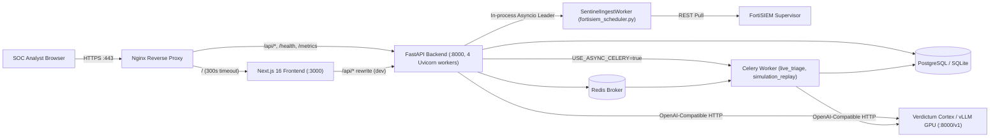
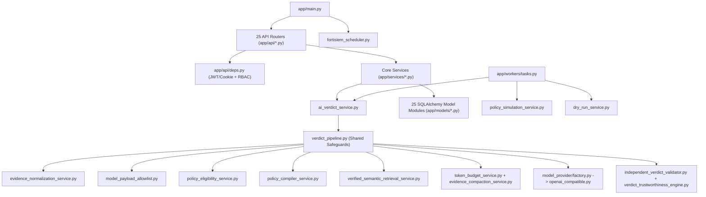
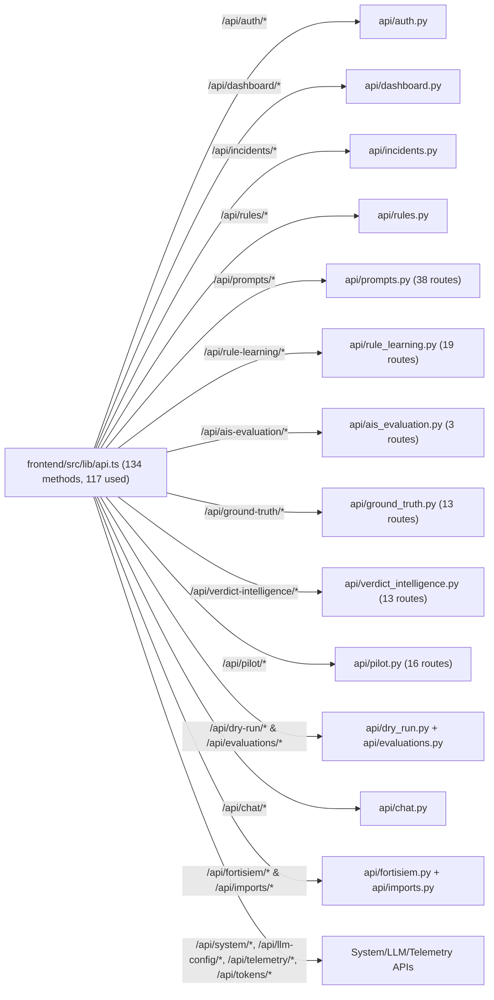
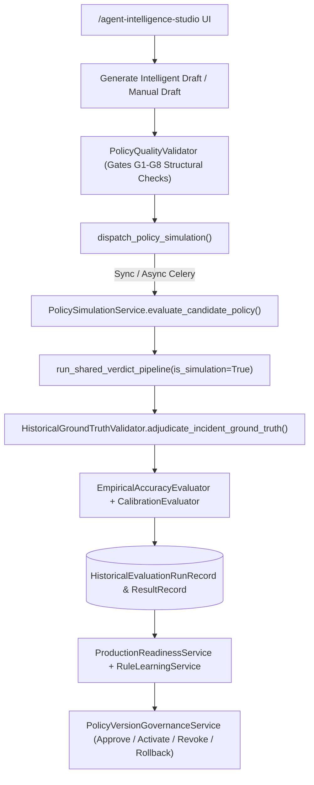

# 01 — Repository & Architecture Baseline

## 1. Repository & Git Baseline

| Attribute | Verified Value |
|---|---|
| Git Branch | `feature/phase3-compact-ui` |
| Commit SHA | `1e099d5b5954f6921e154ce124d04e604f466d9e` |
| Tracked Repository Files | 2,229 |
| Untracked Files at Baseline | 81 (`docs/AIS_2_7/` untracked reports/evidence; plus gitignored `scratch/` local files) |
| Modified Tracked Files | 0 |
| Frontend Source Files | 82 (45,559 raw lines / 42,751 code lines) |
| Backend Source Files | 190 (58,713 raw lines / 51,102 code lines) |
| Alembic Migrations | 16 (`001` through `016`) |
| Test Files | 122 (106 backend Python + 16 frontend `.mjs`) |
| Deployment Files | 18 (`deployment/`) |
| Scripts & Tracked Scratch | 77 (39 `scripts/`, 7 `backend/**/scripts/`, 31 tracked `scratch/`) |

### Counting Methodology
- **Application Source Code**: Tracked files under `frontend/src/` (excluding binary icon/image assets) and `backend/app/` (including `backend/app/scripts/`), excluding `backend/tests/`, `frontend/tests/`, `backend/alembic/`, `docs/`, `scratch/`, root `scripts/`, `deployment/`, `node_modules/`, `backend/venv/`, and `frontend/.next/`.
- **Code Lines**: Non-empty lines excluding single-line comments (`#` for Python/shell, `//` for TypeScript/CSS).

## 2. Discovered Technology Stack

- **Frontend**: Next.js `16.4.5` (App Router, `next.config.ts` rewrites `/api/:path*` -> `http://127.0.0.1:8000/api/:path*`), React `19.3.0`, TypeScript `5`, Tailwind CSS v4 (`@tailwindcss/postcss`), Lucide icons (`lucide-react`). Built with Node `v26.13.1`, tested with `node --experimental-strip-types --test`.
- **Backend**: FastAPI (`>=0.110.0`), Uvicorn (4 workers in systemd), Pydantic v2 + `pydantic-settings`, SQLAlchemy `2.0+` async (`asyncpg` for PostgreSQL in production, `aiosqlite` for dev/tests), Alembic (`001`–`016`).
- **Workers & Scheduling**: Celery (`celery_app.py` with Redis broker/backend; queues `live_triage`, `simulation_replay`, `maintenance`) + in-process asyncio `SentinelIngestWorker` (`fortisiem_scheduler.py`) with file-backed multi-worker leader election (`scheduler_state.json`).
- **LLM Inference (Server 2)**: OpenAI-compatible vLLM endpoint (`Qwen/Qwen2.5-7B-Instruct-AWQ` default) via `OpenAICompatibleProvider` protected by `GPUWorkloadManager` semaphore & circuit breaker (`gpu_manager.py`).
- **Deployment & Reverse Proxy**: Native Ubuntu systemd services (`ai-verdict-backend`, `ai-verdict-worker`, `ai-verdict-scheduler`, `ai-verdict-frontend`) behind Nginx (`deployment/nginx/ai-verdict.conf`) with TLS and 300s proxy timeouts.

---

## 3. Architecture & Workflow Diagrams (Actual Discovered Code)

### 3.1 Current Application Architecture


### 3.2 Frontend Component Dependency Graph

```mermaid
flowchart TD
    RootLayout["app/layout.tsx"] --> AppProvider["context/AppContext.tsx"]
    RootLayout --> Shell["components/layout/Shell.tsx"]
    Shell --> Sidebar["components/layout/Sidebar.tsx"]
    Shell --> Header["components/layout/Header.tsx"]
    Sidebar --> NavIcon["components/navigation/NavigationIcon.tsx"]
    Sidebar --> BrandLogo["components/common/BrandLogo.tsx"]
    Header --> HeaderBrand["components/layout/HeaderBranding.tsx"]

    Mission["app/page.tsx (/ & /agent-mission-control)"] --> InfraMon["components/system/ServerInfrastructureMonitor.tsx"]
    TriageDetail["app/ai-triage-workbench/[id]/page.tsx"] --> Matrix["components/compact/IncidentVerdictMatrix.tsx"]
    TriageDetail --> CDS["components/compact/CompactDesignSystem.tsx"]
    TriageDetail --> PromptModal["components/prompt-inspector/ActualPromptInspectorModal.tsx"]

    AIS["app/agent-intelligence-studio/page.tsx (5,162L)"] --> AISOverview["components/compact/AgentIntelligenceStudioOverview.tsx"]
    AIS --> AiTest["components/compact/AiTestWorkbench.tsx"]
    AIS --> AccSum["components/compact/AccuracyLearningSummary.tsx"]
    AIS --> RevWB["components/compact/ReviewIncidentsWorkbench.tsx"]
    AIS --> VerHist["components/compact/ManageVersionHistory.tsx"]
    AIS --> RuleLearn["components/learning/RuleLearningDashboard.tsx"]
    AIS --> PromptModal
    AIS --> CDS

    VerIntel["app/verdict-intelligence/page.tsx"] --> PilotDash["components/pilot/PilotControlAndDashboard.tsx"]
    VerIntel --> HistElig["components/pilot/HistoricalEligibilityPanel.tsx"]
    HumanRev["app/human-review-queue/page.tsx"] --> GTCert["components/review/GroundTruthCertificationPanel.tsx"]
    InfCtrl["app/inference-control/page.tsx"] --> InfraMon
    InfCtrl --> TokBif["components/telemetry/TokenBifurcationWidget.tsx"]
    AdminGuide["app/admin-guide/page.tsx"] --> GuideComp["components/admin-guide/* (9 components)"]

    Orphan1["ORPHAN: PhasePlaceholder.tsx"] -.->|"0 importers"| Nowh["Unreferenced"]
    Orphan2["ORPHAN: CompactGovernancePanels.tsx"] -.->|"0 importers"| Nowh
```


### 3.3 Backend Module Dependency Graph


### 3.4 Frontend-to-Backend API Mapping


### 3.5 Incident Ingestion and Processing Workflow
```mermaid
flowchart TD
    SourceIngestion Trigger -->|"ZIP / JSON Upload"| ImportsAPI["POST /api/imports/upload"]
    Source -->|"Manual / Continuous Poll"| Poller["FortiSIEMService + SentinelIngestWorker"]
    ImportsAPI --> ZipGuard["zip_guard.py (bomb/ratio protection)"]
    ZipGuard --> IngestSvc["IngestionService"]
    Poller --> IngestSvc
    IngestSvc --> RuleMap["resolve_canonical_rule + RuleParser"]
    IngestSvc --> DBWrite["Persist Incident + IncidentEvent + HistoricalGroundTruth (isolated)"]
    DBWrite -->|"auto_ai_verdict=true"| Dispatch["dispatch_incident_triage()"]
    Dispatch -->|"USE_ASYNC_CELERY & Redis"| CeleryQ["Celery live_triage queue"]
    Dispatch -->|"Fallback / Dev"| InProc["_execute_incident_triage_core()"]
    CeleryQ --> Triage["AIVerdictService.evaluate_incident()"]
    InProc --> Triage
```

### 3.6 AI Verdict Generation Workflow
```mermaid
flowchart TD
    Entry["AIVerdictService.evaluate_incident()"] --> Lock["Intra-process Lock + DistributedLockManager"]
    Lock --> Pipe["run_shared_verdict_pipeline()"]
    Pipe --> S1["1. Normalize & Sanitize Payload (strip GT keys)"]
    S1 --> S22. PolicyEligibilityService
    S2 -->|"Draft/Revoked/Suspended"| Abstain1["Early Exit: REQUIRES_ATTENTION"]
    S2 -->|"Eligible"| S3["3. EvidencePreflightValidator + PolicyCompilerService (9 sections)"]
    S3 --> S4["4. VerifiedSemanticRetrievalService (Rule-scoped RAG)"]
    S4 --> S5["5. TokenBudgetService + EvidenceCompactionService"]
    S5 -->|"Exceeds Context"| Abstain2["Early Exit: CONTEXT_WINDOW_EXCEEDED"]
    S5 -->|"Within Budget"| S6["6. GPUWorkloadManager + OpenAICompatibleProvider (vLLM)"]
    S6 --> S7["7. ModelClaimExtractor + IndependentVerdictValidator + ReasoningIntegrityEngine"]
    S7 --> S8["8. VerdictTrustworthinessEngine (VerdictClaimValidator + EvidenceSufficiency + VerdictGuardrailsEngine)"]
    S8 --> Persist["Persist Incident.ai_verdict, TrustAssessment, ActualLLMPromptCapture, TokenUsage, Timeline, AuditLog"]
```

### 3.7 Agent Intelligence Studio Evaluation Workflow


### 3.8 Background Task Execution Workflow
```mermaid
flowchart TD
    AppBoot["FastAPI lifespan()"] --> Sup["fortisiem_scheduler.start_supervisor()"]
    Sup -->|"Leader Lease in scheduler_state.json"| PollLoop["_worker_loop() -> pull_all / pull_incremental"]
    Sup -->|"Backlog Lease (every ~30s)"| Backlog["run_pending_reconciliation_until_drained()"]
    APICall["API Trigger (Triage / Simulation / Dry-Run)"] --> DispatchUSE_ASYNC_CELERY && Redis?
    Dispatch -->|"True"| CeleryBroker[("Redis Broker")]
    CeleryBroker -->|"live_triage"| T1["triage_incident_task"]
    CeleryBroker -->|"simulation_replay"| T2["run_policy_simulation_task / run_dry_run_job_task"]
    CeleryBroker -.->|"maintenance (0 routed tasks)"| T3["Unused Queue"]
    Dispatch -->|"False"| Direct["In-process async execution"]
    BeatUnit["systemd: ai-verdict-scheduler (celery beat)"] -.->|"0 beat_schedule entries"| CeleryApp["celery_app.py"]
```
