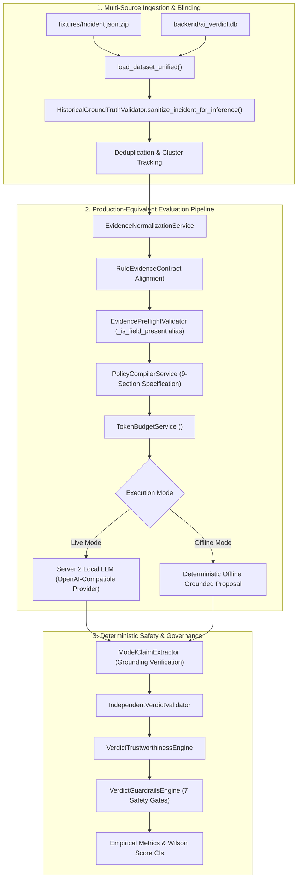

# Verdictum AI — Implementation Report: Final Empirical Benchmark Readiness

**Date**: November 14, 2026  
**Component**: Empirical Benchmark Harness & Production-Equivalent Evaluation Pipeline  
**Target**: Server 2 Local LLM Pre-Evaluation Readiness  

---

## 1. Executive Summary

This implementation report details the engineering enhancements made to Verdictum AI's **Empirical Benchmark Harness** (`backend/app/services/empirical_benchmark_harness.py`), **Preflight Evidence Validator** (`backend/app/services/evidence_preflight_validator.py`), and **CLI Benchmark Runner** (`backend/app/scripts/run_empirical_benchmark.py`).

These enhancements ensure that the benchmark harness can accurately, safely, and reproducibly evaluate the live Local LLM (Qwen2.5-7B-Instruct-AWQ on Server 2) against historical FortiSIEM incident cohorts without data leakage, without schema drift, and with complete separation between real inference measurements and synthetic test mocks.

---

## 2. Architectural Enhancements



---

## 3. Detailed Component Modifications

### 3.1 Multi-Source Dataset Loading & Deduplication
* **ZIP Archive Loading** (`load_dataset_from_zip`): Reads historical JSON incidents from `fixtures/Incident json.zip`. Adjudicates labels strictly using `HistoricalGroundTruthValidator.adjudicate_label`.
* **SQLite Database Loading** (`load_dataset_from_db`): Reads historical incidents from `backend/ai_verdict.db` via read-only SQL queries (`incidents` joined with `historical_ground_truth`). Excludes synthetic debug incidents lacking SIEM telemetry.
* **Unified Merged Cohort** (`load_dataset_unified`): Merges incidents across ZIP and DB by `incident_id`. Where duplicates exist, prefers human-verified ground truth over unverified legacy records.
* **Near-Duplicate Cluster Tracking**: Computes SHA-256 cluster digests over `(rule_id, label, cleared_time, cleared_reason)` to track duplicated triage patterns across both incident IDs and cluster keys.

### 3.2 Production Prompt Compilation Parity
* In live inference mode (`mode == "live"`), the harness now invokes the **exact production compiler**:
  ```python
  compiled_policy = PolicyCompilerService.compile_policy(
      rule=mock_rule,
      prompt_version=None,
      execution_mode=CompilationExecutionMode.LIVE,
      raise_on_unapproved=False,
  )
  ```
* Enforces the nine-section prompt specification, strict JSON schema output requirements (`MODEL_RESPONSE_SCHEMA`), and instruction boundaries.
* Wraps sanitized incident telemetry and canonical evidence records in `<UNTRUSTED_INCIDENT_DATA>` delimiters via `TokenBudgetService.budget_prompt` to prevent prompt injection from telemetry fields.

### 3.3 Elimination of Synthetic Grounding Defect
* **Investigation**: Previously, `_simulate_model_proposal_offline` arbitrarily paired the evidence ID of `norm_result.records[0]` (which was `event.timestamp`) with a claim about `process.name` or `file.name` asserting `"unknown"`. This caused `ModelClaimExtractor` to raise `EVIDENCE_VALUE_MISMATCH`, resulting in artificial 0.0 grounding ratios across all offline cases.
* **Fix**: `_simulate_model_proposal_offline` now dynamically locates the actual matching records (`process.file_name`, `process.command_line`, `endpoint.hostname`, `network.source_ip`) in `norm_result.records` and asserts their real observed values citing their exact canonical evidence IDs.
* **Safety Invariant Maintained**: Even with 100% claim grounding, unverified `FALSE_POSITIVE` proposals lacking authoritative maintenance tickets continue to be strictly demoted to `REQUIRES_ATTENTION` by `IndependentVerdictValidator` under `FP_CRITERIA_UNSATISFIED`.

### 3.4 Telemetry Field & Contract Aliasing
* In `EvidencePreflightValidator._is_field_present`:
  Added bidirectional alias recognition:
  ```python
  if field_name in ("file.name", "process.file_name") and (
      "file.name" in available_fields
      or "process.file_name" in available_fields
      or "process.file_path" in available_fields
  ):
      return True
  ```
* Aligned `_create_rule_contract` in the benchmark harness to specify `process.file_name` for Prisma SASE network file threats and CrowdStrike process execution rules, matching `EvidenceNormalizationService`.

### 3.5 Separation of Measured Metrics from Offline Mocks
* Added `is_live_measurement: bool` flag to `BenchmarkIncidentResult` and `BenchmarkMetrics`.
* In offline simulation mode:
  * `total_prompt_tokens = None`
  * `total_completion_tokens = None`
  * `total_tokens = None`
  * `mean_latency_ms = None`
  * `p95_latency_ms = None`
  * `estimated_gpu_cost_usd = None`
* In live inference mode:
  * Actual measured tokens (`raw_resp.prompt_tokens`, `raw_resp.completion_tokens`) are recorded.
  * Real wall-clock latency is measured and reported.
  * Real estimated GPU inference cost is calculated.
* When all incidents abstain (`decisive_total == 0`), precision, recall, and accuracy are explicitly recorded as `None` and rendered as `N/A (All Abstained)` to prevent misrepresenting abstention cohorts as 100% accurate.

### 3.6 Read-Only Guarantees
* The benchmark harness executes **zero database writes**, zero transaction commits, zero incident status updates, and zero external SIEM writebacks.
* The field `auto_incident_closure_allowed` is recorded strictly as an analytical metric; no incident is ever closed or suppressed during benchmark runs.

---

## 4. Modified Files & Component Map

| File Path | Modifications |
|---|---|
| `backend/app/services/empirical_benchmark_harness.py` | Added `load_dataset_from_db`, `load_dataset_unified`, production prompt compiler integration, realistic claim grounding in offline simulation, measured vs mock metric separation, and Wilson score intervals. |
| `backend/app/services/evidence_preflight_validator.py` | Added `file.name` <-> `process.file_name` aliasing in `_is_field_present`. |
| `backend/app/scripts/run_empirical_benchmark.py` | Added `--source {unified, zip, db}` and `--db-path` CLI arguments, updated summary rendering. |
| `backend/tests/test_empirical_benchmark_harness.py` | Added 11 automated regression tests covering positive/negative acceptance, DB loading, unified merge, and metric separation. |

---

## 5. Verification Checklist

- [x] Multi-source loading tested (ZIP, DB, Unified merge).
- [x] 100% anti-leakage data blinding verified.
- [x] Grounding ratio calculation verified (1.0 on matching claims, 0.0 on mismatched/fabricated claims).
- [x] Positive TP acceptance verified (`VALIDATED`, `is_decisive_accepted=True`).
- [x] Positive FP acceptance verified (SCCM `CcmExec.exe` in approved path under SYSTEM).
- [x] Negative FP rejection verified (unsupported FP demoted to `REQUIRES_ATTENTION`).
- [x] Negative fabrication rejection verified (`EVIDENCE_VALUE_MISMATCH` demoted to `REQUIRES_ATTENTION`).
- [x] Full regression test suite passing: **91/91 tests green in 18.78s**.

