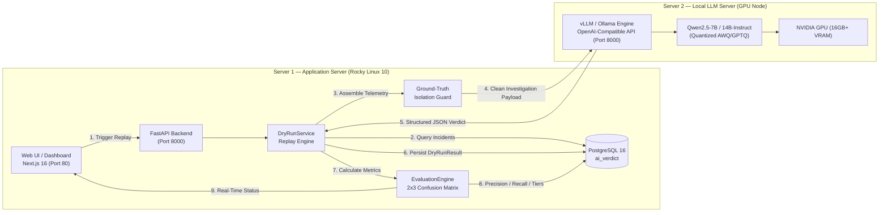
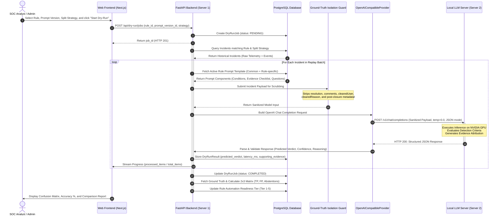
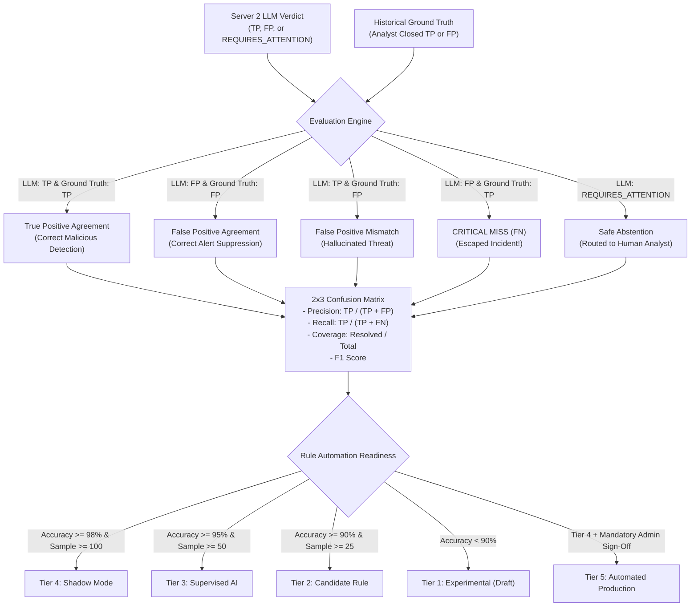

# Local LLM Dry-Run Architecture & Processing Workflow

## 1. Executive Overview

This document specifies the end-to-end architecture, communication protocol, and execution workflow for **dry-run incident replay** in the **AI Verdict (WyseSOC AI)** platform following the integration of **Server 2 (Local LLM)**.

The system executes automated, deterministic, and privacy-preserving security analysis across thousands of historical SIEM incidents without sending sensitive corporate telemetry to external cloud AI providers.



---

## 2. Two-Server Physical Topology

| Attribute | Server 1 (Application Server) | Server 2 (Local LLM Server) |
| :--- | :--- | :--- |
| **Instance Type** | General Purpose Compute (e.g., `t3.xlarge` / On-Prem VM) | Accelerated GPU (e.g., AWS `g4dn.2xlarge` / On-Prem GPU) |
| **Hardware** | 4-8 vCPUs, 16GB RAM, 100GB SSD | 8 vCPUs, 32GB RAM, 1x NVIDIA T4 / A10G (16GB+ VRAM) |
| **Operating System**| Rocky Linux 10.1 / Ubuntu 24.04 LTS | Ubuntu 22.04 LTS with NVIDIA Container Toolkit |
| **Primary Software**| Python 3.12, FastAPI, Next.js 16, Nginx, PostgreSQL 16 | vLLM 0.6+ / Ollama, CUDA 12.4 |
| **Serving Protocol**| HTTP/HTTPS (Port 80/443) to Analysts | OpenAI-Compatible REST (`/v1/chat/completions`) on Private LAN |
| **Network Security**| Accessible by SOC analysts on corporate intranet | Strictly internal; accepts traffic **only** from Server 1 IP |

---

## 3. End-to-End Dry-Run Replay Sequence

The following sequence details how an analyst-initiated replay job flows through both servers from trigger to evaluation scoring:



---

## 4. Step-by-Step Processing Pipeline

### Step 1: Job Configuration & Split Selection
The analyst navigates to `/dry-run` and configures the execution parameters:
- **Rule Scope**: Specific detection rule (e.g., `PH_RULE_CS_SUSPICIOUS_ACTIVITY`) or all rules.
- **Prompt Version**: Candidate prompt version from the Rule Prompt Studio.
- **Splitting Strategy**:
  - `ALL`: Replays all matching historical incidents.
  - `CHRONOLOGICAL_70_30`: Evaluates on the oldest 70% as training/baseline and the newest 30% as out-of-time test set.
  - `GROUP_AWARE_HOST`: Partitions by reporting device/host to prevent data leakage across identical compromised endpoints.

### Step 2: Ground-Truth Isolation Enforcement
Before any telemetry leaves Server 1, the **Ground-Truth Isolation Guard** inspects the incident record:

> [!CAUTION]
> **Strict Isolation Rule**: Under no circumstances may post-investigation fields reach Server 2. The guard enforces an allowlist:
> - **ALLOWED**: `incidentId`, `eventType`, `title`, `description`, `detail`, `severity`, `sourceIp`, `reportingDevice`, `firstSeen`, `lastSeen`, `createdAt`, `rawEvents` (attributes, raw logs, network events).
> - **BLOCKED & PURGED**: `resolution`, `clearedReason`, `comments`, `clearedUser`, `analystNotes`, `historical_verdict`, `resolved_at`.

### Step 3: Prompt Assembly & JSON Framing
Server 1 injects the sanitized telemetry into the structured prompt template defined in the **Rule Prompt Studio**:
1. **System Persona**: Enterprise SOC Senior Incident Analyst role.
2. **Common Prompt**: Enterprise guidelines for malicious vs benign classification.
3. **Rule-Specific Logic**: Explicit detection conditions, known false positive patterns (e.g., sanctioned admin scripts, signed updater binaries).
4. **Evidence Checklist**: Required indicators of attack (IOAs) vs benign activity.
5. **Output Schema Mandate**: Demands strict JSON with no conversational preamble.

---

## 5. Model Communication Protocol (Server 1 ➔ Server 2)

### A. HTTP Request Payload (`Server 1 ➔ Server 2:8000/v1/chat/completions`)

```json
{
  "model": "qwen2.5-7b-instruct",
  "temperature": 0.0,
  "max_tokens": 1024,
  "response_format": { "type": "json_object" },
  "messages": [
    {
      "role": "system",
      "content": "You are AI Verdict, an autonomous Level-2 SOC analysis engine. Analyze the provided SIEM telemetry against the rule detection logic. Return a valid JSON object matching the required schema."
    },
    {
      "role": "user",
      "content": "RULE: PH_RULE_CS_SUSPICIOUS_ACTIVITY\nDESCRIPTION: Detects suspicious activity using Indicator of Attack (IOA) or tool tampering.\n\nEVIDENCE CRITERIA:\n- True Positive: Execution of unauthorized living-off-the-land binaries (certutil, powershell -enc, vssadmin delete shadows).\n- False Positive: Known IT management tools (SCCM, Tanium, Datadog agent updates).\n- Requires Attention: Insufficient telemetry or ambiguous parent-child process lineage.\n\nINCIDENT TELEMETRY:\nIncident ID: 132501348\nHost: DESKTOP-CQ4A60U\nSource IP: 198.51.100.157\nTimestamp: 2026-11-05T14:46:23Z\nRaw Events:\n- Process: powershell.exe -ExecutionPolicy Bypass -Command 'Get-Service'\n- Parent: explorer.exe\n- User: DOMAIN\\analyst_admin\n\nREQUIRED OUTPUT SCHEMA:\n{\n  \"verdict\": \"TRUE_POSITIVE\" | \"FALSE_POSITIVE\" | \"REQUIRES_ATTENTION\",\n  \"confidence\": 0-100,\n  \"reasoning\": \"string\",\n  \"supporting_evidence\": [\"string\"],\n  \"missing_evidence\": [\"string\"],\n  \"analyst_questions\": [\"string\"]\n}"
    }
  ]
}
```

### B. HTTP Response Payload (`Server 2 ➔ Server 1`)

```json
{
  "id": "chatcmpl-9f8a32b1",
  "object": "chat.completion",
  "created": 1793945890,
  "model": "qwen2.5-7b-instruct",
  "choices": [
    {
      "index": 0,
      "message": {
        "role": "assistant",
        "content": "{\n  \"verdict\": \"FALSE_POSITIVE\",\n  \"confidence\": 92,\n  \"reasoning\": \"Execution of powershell.exe running a read-only reconnaissance cmdlet 'Get-Service' initiated by an administrative user account without obfuscation, encoded payloads, or privilege escalation attempts.\",\n  \"supporting_evidence\": [\n    \"Command line contains only standard Get-Service cmdlet\",\n    \"Executed under authenticated analyst_admin session\",\n    \"Zero network connections or child process spawns observed\"\n  ],\n  \"missing_evidence\": [],\n  \"analyst_questions\": [\n    \"Was this routine administrative service verification scheduled by IT?\"\n  ]\n}"
      },
      "finish_reason": "stop"
    }
  ],
  "usage": {
    "prompt_tokens": 420,
    "completion_tokens": 142,
    "total_tokens": 562
  }
}
```

---

## 6. Evaluation Scoring & Dual-Verdict Comparison

Once Server 1 receives the structured verdict from Server 2, it compares the prediction against the historical ground truth stored in PostgreSQL:



---

## 7. Performance & Latency Budgets

To handle enterprise SOC throughput (~10,000 SIEM incidents daily):

| Metric | Target SLA | Strategy to Achieve |
| :--- | :--- | :--- |
| **Inference Latency per Alert** | `< 450 ms` | vLLM continuous batching + FlashAttention-2 + AWQ 4-bit quantization |
| **Concurrent Dry-Run Throughput**| `40-60 incidents/sec` | Batch queuing with asynchronous worker thread pool in FastAPI |
| **Replay Job (100 incidents)** | `< 15 seconds` | Server 1 sends chunked parallel requests (concurrency: 8-16) |
| **Memory Footprint on Server 2** | `< 12 GB VRAM` | 7B model at 4-bit requires ~5.5GB; leaves 10GB for KV-cache |
| **Network Overhead** | `< 5 ms` | Private AWS VPC / internal 10Gbps Ethernet link between servers |

---

## 8. Summary of Benefits

1. **Zero Data Leakage**: No corporate SIEM alerts, internal IPs, usernames, or process hashes ever leave the local data center / private cloud.
2. **Safe Before Automated**: New prompts and detection rules can be tested against thousands of historical records in seconds before ever interacting with live analysts.
3. **Auditability**: Every prompt version, LLM inference latency, reasoning chain, and attribution is version-controlled and cryptographically logged for SOC governance.

