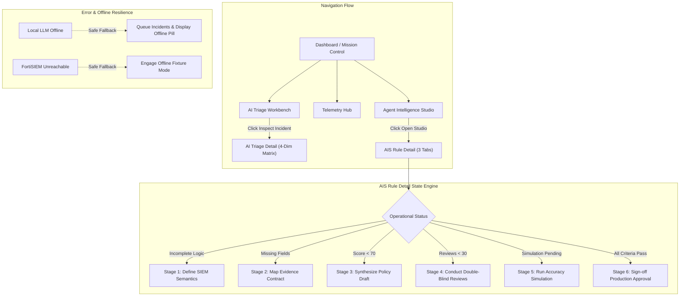

# VERDICTUM AI — COMPACT UI/UX REDESIGN 1.0
# 05. Proposed Wireframes & Target Layouts

**Document Version:** 1.0.0  
**Phase:** Phase 4 — Wireframes & Target Layout Specifications  
**System Baseline:** Verdictum Compact Design System v1.0 (VCDS 1.0)  
**Format:** Structured ASCII Layouts & Mermaid Interaction Flowcharts  

---

## 1. Overview of Wireframe Specifications

This document defines implementation-ready, viewport-aware target wireframes for the four priority pages and the shared shell:
1. **Shared Application Shell** (Header & Collapsible Sidebar)
2. **Agent Intelligence Studio — Rule Detail** (Solving the Critical Squeeze & Dead Space Defect)
3. **Agent Intelligence Studio — Rule Directory Table** (Solving the Clipped Action Defect)
4. **AI Triage Workbench** (Solving the Multi-Rule Chip Overload Defect)
5. **Telemetry Hub** (Solving the 5-Level Vertical Card Stack Defect)

---

## 2. Shared Application Shell Wireframe

### Expanded State (Default Desktop `≥ 1280px`):

```
+-------------------------------------------------------------------------------------------------------------------------+
| [LOGO] VERDICTUM AI | Search: [ Global Triage Search (Ctrl+K)              ] | [🛡️ Blind: OFF] [✨ Obsidian] [@analyst (SOC Lead)] [⏻] |
+---------------------+---------------------------------------------------------------------------------------------------+
| SOC OPERATIONS      | BREADCRUMB / VIEW TOOLBAR                                                                          |
| > Mission Control   +---------------------------------------------------------------------------------------------------+
| > Triage Workbench  | MAIN WORKSPACE CANVAS (Padding: 12px)                                                              |
| > Telemetry Hub     |                                                                                                   |
| > Human Review      |                                                                                                   |
| > Sentinel (Copilot)|                                                                                                   |
|                     |                                                                                                   |
| AGENT INTELLIGENCE  |                                                                                                   |
| > AI Studio (AIS)   |                                                                                                   |
| > Detection Intel   |                                                                                                   |
| > Agent Memory      |                                                                                                   |
|                     |                                                                                                   |
| VALIDATION & TRUST  |                                                                                                   |
| > Simulation Lab    |                                                                                                   |
| > Verdict Intel     |                                                                                                   |
|                     |                                                                                                   |
| PLATFORM CONTROL    |                                                                                                   |
| > Inference Control |                                                                                                   |
| > Configuration     |                                                                                                   |
| > Governance        |                                                                                                   |
| > Admin Guide       |                                                                                                   |
|---------------------|                                                                                                   |
| INFERENCE STATUS    |                                                                                                   |
| [● S2 Online: Qwen] |                                                                                                   |
| [Arch: S1+S2 vLLM ] |                                                                                                   |
+---------------------+---------------------------------------------------------------------------------------------------+
```

### Collapsed State (Tablet / Operator Preference `1024px`):

```
+-------------------------------------------------------------------------------------------------------------------------+
| [V] | Search: [ Quick Search...                        ] | [🛡️ ON] [✨] [@analyst] [⏻]                                   |
+---+---------------------------------------------------------------------------------------------------------------------+
| 📊| MAIN WORKSPACE CANVAS (Maximizes horizontal screen space for deep forensic tables)                                  |
| ⚠️|                                                                                                                     |
| ☁️|                                                                                                                     |
| 👤|                                                                                                                     |
| 💬|                                                                                                                     |
|---|                                                                                                                     |
| 🧠|                                                                                                                     |
| 📄|                                                                                                                     |
| ⚡|                                                                                                                     |
|---|                                                                                                                     |
| 🧪|                                                                                                                     |
| 📈|                                                                                                                     |
|---|                                                                                                                     |
| 🖥️|                                                                                                                     |
| ⚙️|                                                                                                                     |
| 🛡️|                                                                                                                     |
| 📖|                                                                                                                     |
|---|                                                                                                                     |
| ● |                                                                                                                     |
+---+---------------------------------------------------------------------------------------------------------------------+
```

---

## 3. Agent Intelligence Studio — Rule Detail Wireframe

### Target Layout (12-Column Responsive Grid):
- **Left 8 Columns (`lg:col-span-8`):** Rule Identity, Description, 6-Stage Guided Production Readiness Checklist, Consolidated Issues.
- **Right 4 Columns (`lg:col-span-4`):** Production Readiness Card, 4 Metric Tiles, Version Selector, Evidence Feasibility.

```
+-------------------------------------------------------------------------------------------------------------------------+
| [< Rules List]  RULE: FortiGate: High Volume Port Scan Detected from External IP      [ARCHETYPE: NETWORK_SCAN] [ACTIVE] |
|                 Active Policy: v1 (APPROVED) · SIEM Event: FGT_PORT_SCAN · Rule ID: 157803                              |
+-------------------------------------------------------------------------------------------------------------------------+
| ACTION TOOLBAR: [✨ Synthesize Draft] [🏆 Validate Quality] [⚡ Simulation] [💻 View Actual Prompt] [Version: v1 (Active) ▾] [Approve] |
+-------------------------------------------------------------------------------------------------------------------------+
| [ Tab 1: Overview (Default) ]    |    [ Tab 2: Analyst Review & Learning (35) ]    |    [ Tab 3: Advanced Config (9) ]  |
+----------------------------------------------------------------------+--------------------------------------------------+
| LEFT MAIN WORKSPACE (8 Columns - 66.6%)                              | RIGHT CONTEXT SIDEBAR (4 Columns - 33.3%)        |
|                                                                      |                                                  |
| 1. OPERATIONAL OBJECTIVE & CONTEXT                                   | 4. PRODUCTION READINESS GATING                   |
| +------------------------------------------------------------------+ | +----------------------------------------------+ |
| | Detects rapid multi-port connection attempts originating from an | | | STATUS: READY FOR PRODUCTION (Stage 6 of 6)  | |
| | external untrusted IP address targeting internal host ranges.    | | | Progress: [████████████████████] 100%        | |
| | Authoritative SIEM threshold: >= 100 connection attempts in 60s. | | +----------------------------------------------+ |
| +------------------------------------------------------------------+ |                                                  |
|                                                                      | 5. FOUR HERO METRICS TILES (2x2 Grid)            |
| 2. SMART NEXT ACTION DIRECTIVE                                       | +----------------------+-----------------------+ |
| +------------------------------------------------------------------+ | | Quality Score        | Analyst Reviews       | |
| | 💡 NEXT ACTION: Policy satisfies all 8 quality gates. Ready for  | | | 92 / 100 (G1-G8 Pass)| 35 / 30 (Pilot Met)   | |
| | production deployment approval.                                  | | +----------------------+-----------------------+ |
| | [ Proceed to Approval Modal → ]                                  | | | Empirical Accuracy | Enforcement State     | |
| +------------------------------------------------------------------+ | | 96.8% (Verified TP)  | ENFORCING (Pilot Mode)| |
|                                                                      | +----------------------+-----------------------+ |
| 3. GUIDED 6-STAGE PRODUCTION READINESS CHECKLIST (Accordion Cascade) |                                                  |
| +------------------------------------------------------------------+ | 6. EVIDENCE CONTRACT FEASIBILITY                 |
| | [✓] STAGE 1: Define SIEM Detection Semantics           [VERIFIED] | | +----------------------------------------------+ |
| |     Threshold: 100 events / 60s. Archetype: NETWORK_SCAN.        | | | Core Fields Mapped: 5 / 5 (100% Complete)    | |
| |     [Show Technical Verification Evidence ▾]                     | | | [src_ip, dst_ip, dst_port, proto, count]     | |
| +------------------------------------------------------------------+ | +----------------------------------------------+ |
| | [✓] STAGE 2: Verify Evidence Contract Mapping          [VERIFIED] | |                                                  |
| |     All mandatory SIEM telemetry fields mapped and verified.     | | 7. RECENT VERSION HISTORY (Compact List)       |
| +------------------------------------------------------------------+ | +----------------------------------------------+ |
| | [✓] STAGE 3: Validate Policy Contract (Quality Gates)  [VERIFIED] | | | ● v1 (ACTIVE) - Approved by @lead (Today)    | |
| |     Static Quality Score: 92/100 · 8 of 8 Gates Passed.          | | | ○ v0.2 (Draft) - Updated benign IP exclusion | |
| +------------------------------------------------------------------+ | | ○ v0.1 (Draft) - Initial template draft        | |
| | [✓] STAGE 4: Ground Truth Analyst Learning             [VERIFIED] | | +----------------------------------------------+ |
| |     35 double-blind verified determinations (28 TP / 7 FP).      |                                                    |
| +------------------------------------------------------------------+                                                    |
| | [✓] STAGE 5: Accuracy Simulation Replay Testing        [VERIFIED] |                                                    |
| |     Empirical Precision: 98.2% · Recall: 95.5% · Wilson: 96.1%.  |                                                    |
| +------------------------------------------------------------------+                                                    |
| | [✓] STAGE 6: Authorized Production Approval            [APPROVED] |                                                    |
| |     Governed approval signed by SOC Lead @admin on 2026-11-14.   |                                                    |
| +------------------------------------------------------------------+                                                    |
|                                                                      |                                                  |
| 8. CONSOLIDATED DIAGNOSTIC ISSUES ("What Needs Attention?")          |                                                  |
| +------------------------------------------------------------------+                                                    |
| | (No blocking issues detected. All criteria satisfied.)            |                                                    |
| +------------------------------------------------------------------+                                                    |
+----------------------------------------------------------------------+--------------------------------------------------+
```

---

## 4. AI Triage Workbench Wireframe

### Compact Rule Filter & Incident Table:

```
+-------------------------------------------------------------------------------------------------------------------------+
| AI TRIAGE WORKBENCH  | 1,240 Total Ingested · 892 AI Triaged (72%) · 48 Requires Attention        | [Sync Resolutions] [Pull] |
+-------------------------------------------------------------------------------------------------------------------------+
| SEARCH & FILTER TOOLBAR:                                                                                                |
| [🔍 Search ID, Source IP, Device, Rule...                       ] [All Severities ▾] [All Statuses ▾] [Reset Filters]   |
+-------------------------------------------------------------------------------------------------------------------------+
| CANONICAL RULE SCOPE DISAMBIGUATION BAR:                                                                                |
| ⚠️ Results span 14 distinct SIEM rules. Filter to exact rule: [ Filter by Exact Canonical Rule... ▾ ]                   |
| Quick Filters: [FGT_PORT_SCAN (420)] [AUTH_BRUTE_FORCE (310)] [MALWARE_BEACON (180)] [+11 more rules... ▾]             |
+-------------------------------------------------------------------------------------------------------------------------+
| INCIDENT TRIAGE TABLE (Fixed Row Height: 36px | Sticky Action Column)                                                   |
+---------+--------------------------------+----------+---------------+-------------------+---------+------------+--------+
| INC ID  | RULE / EVENT TYPE              | SEVERITY | SOURCE / DEV  | OCCURRED TIME     | EVENTS  | VERDICTS   | ACTION |
+---------+--------------------------------+----------+---------------+-------------------+---------+------------+--------+
| #165233 | FortiGate: High Volume Port... | CRITICAL | 192.0.2.105   | 2026-11-15 11:42  | 142 evt | FP (Analyst| Inspect|
|         | FGT_PORT_SCAN [a8f10b23]       |          | FGT-Edge-01   | (5 mins ago)      |         | FP (AI 94%)|    ↗   |
|---------+--------------------------------+----------+---------------+-------------------+---------+------------+--------+
| #165234 | Windows: Suspicious PowerShell | HIGH     | 198.51.100.12 | 2026-11-15 11:38  | 18 evt  | TP (Analyst| Inspect|
|         | WIN_PS_OBFUSC [b1298c41]       |          | WIN-SRV-DC01  | (9 mins ago)      |         | TP (AI 98%)|    ↗   |
|---------+--------------------------------+----------+---------------+-------------------+---------+------------+--------+
| #165235 | Cisco ASA: Multiple Failed SSH | MEDIUM   | 203.0.113.45  | 2026-11-15 11:30  | 55 evt  | Unlabeled  | [AI    |
|         | ASA_SSH_FAIL [c9011e55]        |          | ASA-FW-EXT    | (17 mins ago)     |         | (Pending)  | Verdict|
+---------+--------------------------------+----------+---------------+-------------------+---------+------------+--------+
| Showing 1–15 of 1,240 incidents                                                [|<] [< Prev] Page 1 of 83 [Next >] [>|] |
+-------------------------------------------------------------------------------------------------------------------------+
```

---

## 5. Telemetry Hub Wireframe

### Compact Control Center & Ingestion Pipeline:

```
+-------------------------------------------------------------------------------------------------------------------------+
| TELEMETRY HUB | Sentinel Ingest Worker & Continuous Telemetry Pipeline · Server Ingestion Nexus                       |
+-------------------------------------------------------------------------------------------------------------------------+
| FOUR COMPACT KPI TILES:                                                                                                 |
| +-----------------------+-----------------------+-----------------------+---------------------------------------------+ |
| | Sentinel Poller       | Ingested Alerts       | AI Verdicts Rate      | LLM Queue Backlog                           | |
| | ● ACTIVE (3m Sync)    | 1,240 total (+42 today| 892 triaged (72%)     | 0 pending [Reconcile Queue]                 | |
| | Next Sync: 1m 45s     | Checkpoint: 1718290   | Local LLM: Online     | All incidents triaged                       | |
| +-----------------------+-----------------------+-----------------------+---------------------------------------------+ |
+-------------------------------------------------------------------------------------------------------------------------+
| DUAL-COLUMN INGESTION CONTROL CENTER:                                                                                   |
| +---------------------------------------------------+-----------------------------------------------------------------+ |
| | CONTINUOUS POLLER CONTROLS (Left 7 Cols)          | ON-DEMAND INGESTION (Right 5 Cols - Tabbed)                     | |
| |                                                   | [ Tab: Single Incident ID ]  |  [ Tab: ZIP Archive Upload ]     | |
| | Primary Actions:                                  |                                                                 | |
| | [⚡ Pull All Incidents Now ]                       | Target Incident ID:                                             | |
| | [⏸ Pause Continuous Sync   ]                       | [ 171005                                           ] [Pull ↗]   | |
| | [↻ Force Sync Cycle Now    ]                       | Sample Fixture IDs: [#171005] [#157803] [#165233]               | |
| |                                                   | [ ] Force re-fetch from FortiSIEM if cached locally             | |
| | Polling Settings:                                 |                                                                 | |
| | [✓] Auto-evaluate with Local LLM                  | - Live FortiSIEM connection: ONLINE (198.51.100.20)             | |
| | Status: Healthy · Polling interval: 180 seconds   | - SanitizationGuard: Active (Ground Truth Isolated)             | |
| +---------------------------------------------------+-----------------------------------------------------------------+ |
+-------------------------------------------------------------------------------------------------------------------------+
| TABBED INGESTION HISTORY & AUDIT LOGS:                                                                                  |
| [ Ingestion Jobs History (18) ]  |  [ Verdictum Core Storage Chronological Timeline ]                                   | |
| +---------------------+--------------+-------------+------------+------------+-----------+----------------------------+ |
| | Filename            | Format       | Status      | Imported   | Duplicates | Errors    | Timestamp                  | |
| +---------------------+--------------+-------------+------------+------------+-----------+----------------------------+ |
| | Incident_json.zip   | ARCHIVE_ZIP  | COMPLETED   | 1,240      | 0          | 0         | 2026-11-15 09:30:12        | |
| | live_pull_batch_01  | FORTISIEM_API| COMPLETED   | 42         | 8          | 0         | 2026-11-15 11:30:00        | |
+---------------------+--------------+-------------+------------+------------+-----------+----------------------------+ |
+-------------------------------------------------------------------------------------------------------------------------+
```

---

## 6. Interaction Flow & State Transitions


