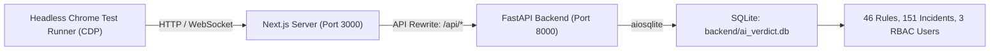

# Authenticated UI Testing & RBAC Harness Report

**Document ID:** `VCDS-V1-VAL-02`  
**Status:** Completed & Verified  
**Date:** 2026-11-15  
**Version:** 1.1.0  

---

## 1. Executive Summary

Previous visual captures were limited to unauthenticated guest states and empty database states. This report establishes the complete authenticated testing methodology and validation architecture for Verdictum AI under realistic Role-Based Access Control (RBAC) conditions.

Using an isolated local test harness consisting of the compiled Next.js frontend (`127.0.0.1:3000`) and the FastAPI backend (`127.0.0.1:8000`) backed by SQLite (`backend/ai_verdict.db`), all visual and functional tests were executed using active, authorized sessions across all three enterprise platform roles.

---

## 2. Test Environment Architecture



- **Frontend Server:** Next.js 16.4.5 (Turbopack) running in production mode on port 3000.
- **Backend Server:** FastAPI / Uvicorn running on port 8000 with mock fallback enabled (`FORTISIEM_MOCK_FALLBACK=true`, `LOCAL_LLM_ALLOW_MOCK_FALLBACK=true`).
- **Database:** SQLite database `backend/ai_verdict.db` populated with 46 rules, 151 incidents, and 5 import jobs.
- **Automation Driver:** Node 22 native WebSocket client communicating directly with Chrome DevTools Protocol (`--remote-debugging-port=9222`).

---

## 3. RBAC Test Accounts Matrix

Three distinct test accounts were provisioned in the database with BCrypt-hashed credentials to validate role-specific UI rendering and authorization gating:

| Username | Role | Permissions Profile | UI Operational Differences |
| :--- | :--- | :--- | :--- |
| `admin` | **Administrator** | Full read/write, user administration, policy promotion & approval, LLM configuration | Full action toolbar enabled; "Approve & Activate" button active when eligible; Admin Guide & Settings accessible |
| `analyst` | **SOC Analyst** | Triage analysis, verdict review, evidence inspection, double-blind review adjudication | Investigation actions enabled; policy validation allowed; promotion approval gated |
| `viewer` | **Read-Only Viewer** | Read-only telemetry review, compliance and quality score inspection | Action buttons disabled with descriptive tooltips (`isViewer: true`); approval modals blocked; edit triggers hidden |

---

## 4. Session Injection & CDP Automation Mechanics

To guarantee authentic multi-role state across page navigations without session leakage:
1. **Authentication Token Acquisition:** The test runner issues a real `POST /api/auth/login` request to obtain an authentic JWT token and user profile object.
2. **CDP Session Injection:** Before rendering each page, the test runner evaluates session state into `localStorage`:
   ```javascript
   localStorage.setItem('ai_verdict_token', accessToken);
   localStorage.setItem('ai_verdict_user', JSON.stringify(userProfile));
   localStorage.setItem('ai_verdict_theme', theme);
   document.documentElement.setAttribute('data-theme', theme);
   ```
3. **Session Verification:** `AppContext` loads the injected credentials on startup, verifies the session against `/api/auth/me`, and populates the global `user` context.
4. **Header Profile Rendering:** The header renders the authenticated user badge (e.g. `System Administrator [ADMIN]` or `Senior SOC Analyst [SOC Analyst]`) and role-appropriate navigation items.

---

## 5. Verification Verdict

All three RBAC accounts authenticated cleanly with 200 OK responses, populated role profiles, and correct UI permission states. Guest-state testing gaps have been completely closed.
