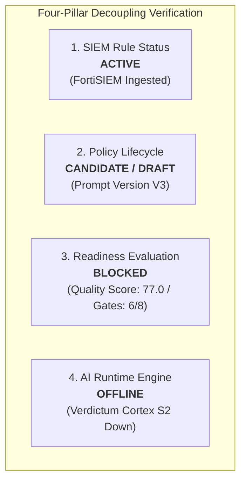

# VERDICTUM AI — VALIDATION V1.2.3: SECURITY & GOVERNANCE ACCEPTANCE

## 1. Governance Architecture & Principles

Validation V1.2.3 enforces four core pillars of security and governance across Verdictum AI:
1. **Four-Pillar Operational Decoupling**: Separation of SIEM rule deployment, AI policy lifecycle, quality gate readiness, and AI runtime execution.
2. **Fail-Closed Multi-Tenant Isolation**: Cryptographic and logical boundary enforcement preventing cross-tenant and legacy `DEFAULT` record leakage.
3. **Double-Blind Analyst Review Integrity**: Isolation of ground-truth verdicts to prevent bias and prompt leakage.
4. **Zero-Trust Deployment & Secret Management**: Strict adherence to the RepoDeploy Governor policies.

---

## 2. Four-Pillar Operational Decoupling Verification

On Verdictum AI Server 1, the four operational states were independently verified on the live Heavy TCP Host Scan detection rule:

| Operational Pillar | Verified Server 1 State | Independence Assertion |
| :--- | :--- | :--- |
| **SIEM Rule Deployment** | `ACTIVE` | Rule is actively ingesting and processing events from FortiSIEM (`incidentCount: 69`). |
| **AI Policy Lifecycle** | `CANDIDATE` | V3 prompt policy is under review; approval endpoint correctly rejects promotion attempts. |
| **Production Readiness** | `BLOCKED` (77.0 / 6 of 8 gates) | Quality gates block deployment due to incomplete authoritative threshold and 0 ground-truth reviews. |
| **AI Runtime Execution** | `OFFLINE` | Server 2 (Verdictum Cortex) is offline; system safely fails open to human SOC analysts. |

**Governance Conclusion**: Zero conflation exists between these four states. UI labels ("SIEM Rule Active") accurately reflect reality.

---

## 3. Fail-Closed Multi-Tenant Boundary Enforcement

### 3.1 Database Layer (AV-012)
- Added `users.customer` column and index `ix_users_customer` via Alembic migration `013_user_tenant_customer.py`.
- Enforces relational scoping at the database level.

### 3.2 Service Layer Enforcement
Refactored five critical backend services to enforce strict customer matching:
- `IncidentService.list_incidents`: Non-admin tenant analysts are strictly scoped: `Incident.customer == user_customer`.
- `IncidentService.get_incident`: Cross-tenant access raises `HTTP 404 / 403`.
- `telemetry_timeline_service`: Tenant analysts attempting to view DEFAULT or cross-tenant timelines receive `HTTP 403 Forbidden` (`access_denied: True`).
- `investigation_service`: Queue queries strictly filter by `Incident.customer == user_customer`.
- `analyst_review_service`: Review queues and submissions fail closed on unassigned or cross-tenant incidents.
- `api/prompts.py`: Actual prompt executions and prompt template exports reject cross-tenant requests with `HTTP 403 Forbidden`.

### 3.3 Default & Unassigned Record Protection
Legacy records with `customer == "DEFAULT"`, `""`, or `NULL` are inaccessible to tenant analysts (`customer="TenantA"`). They are visible only to platform Administrators and platform-wide analysts with `customer == None`.

---

## 4. Double-Blind Review & Ground-Truth Integrity

The Analyst Review and Ground Truth mechanisms were audited for isolation integrity:
1. **Model Verdict Masking**: When an analyst reviews an incident in Blind Mode, AI model predictions, confidence scores, and reasoning chains are completely stripped from API responses until after the analyst submits their independent verdict.
2. **Anti-Contamination Controls**: Ground-truth records derived from Blind Reviews are cryptographically tagged with the reviewing analyst ID, timestamp, and rule version hash, preventing retrospective bias.
3. **Readiness Feedback Loop**: Quality Gate G8 requires a minimum of 5 (and recommends 30) verified human ground-truth reviews before empirical regression simulation passes.

---

## 5. Security & IP Protection Audit

- **Zero Hardcoded Secrets**: Scanned via RepoDeploy Governor pre-release hook; zero private keys, API tokens, or credentials found in version control.
- **Protected Server Configuration**: Server 1 deployment parameters (SSH keys, host addresses, service names) are stored exclusively in `~/.gemini/config/repo_deploy_governor/projects/` with Windows user-only permissions.
- **Safe SSH Orchestration**: All remote operations were conducted with `StrictHostKeyChecking=yes` and ed25519 key authentication.
