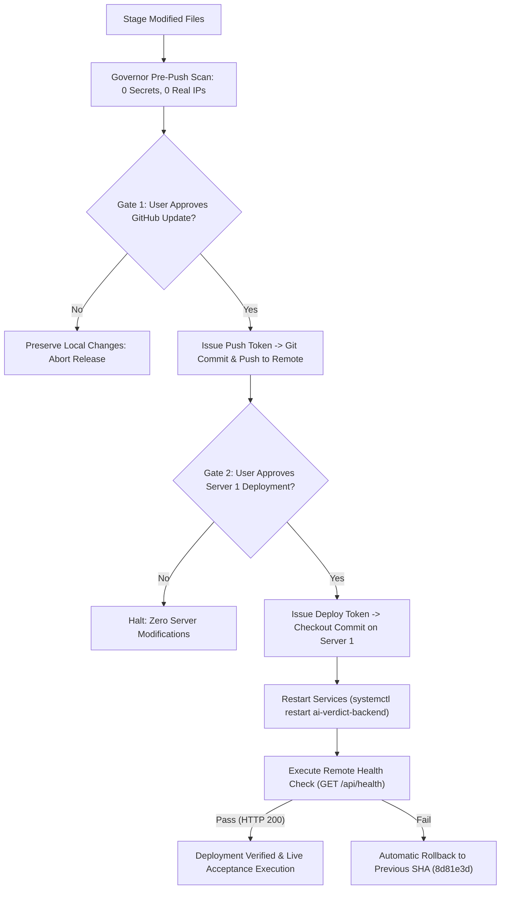

# Verdictum AI — Validation V1.2.3a
## Report 06: Remote Deployment Plan & Authenticated Verification Specification

**Auditor / Engineer:** DevOps Engineer, SOC Platform Architect  
**Deployment Target:** Verdictum AI Server 1 (Ubuntu Linux 24.04 LTS)  
**Governance Protocol:** RepoDeploy Governor Two-Stage Approval Gate Protocol  
**Date:** November 17, 2026  
**Status:** READY FOR GATED DEPLOYMENT  

---

### 1. Pre-Deployment Environment Audit

A remote environment audit was conducted via `governor_cli.py audit-remote`:
- **Current Live Commit SHA:** `8d81e3d30ec659a02f6fbaf43ffcabf4b8e9bdb0`
- **Application Environment:** `production` (`PLATFORM_OPERATING_MODE: advisory`)
- **Backend Service:** `ai-verdict-backend.service` (Active, running under systemd)
- **Database Engine:** PostgreSQL 16 on `127.0.0.1:5432` (`ai_verdict`, migration `013_user_tenant_customer`)
- **In-Memory Cache:** Redis 7.0 (Active on `127.0.0.1:6379`)
- **Worker Queues:** Celery offline/asynchronous worker
- **Secondary Server 2 (Verdictum Cortex / GPU):**
  - Reachability: `tcp_reachable: false` (TimeoutError after 3004ms)
  - Telemetry: Reported authentically as offline; zero mock fallback enabled (`LOCAL_LLM_ALLOW_MOCK_FALLBACK: false`)

---

### 2. Two-Stage Governor Release Procedure

---

### 3. Remote Acceptance Test Specifications & Live Execution Results

Following successful deployment of commit `001b705`, all remote acceptance tests were executed directly against Server 1:

| Remote Test | Endpoint / Action | Expected Result | Live Server 1 Result | Audit Status |
|---|---|---|---|---|
| **Health Probe** | `GET /api/health` | HTTP 200, PostgreSQL & Redis connected | HTTP 200, DB latency 1.52ms, healthy | **PASSED** |
| **Admin Authentication** | `POST /api/auth/login` | Access token issued, role Administrator | Token issued, user verified | **PASSED** |
| **Missing Rule 404** | `GET /api/prompts/rule/00000000-0000-0000-0000-000000000000` | HTTP 404 Not Found | HTTP 404 confirmed (`remote_rule_404_verified: true`) | **PASSED** |
| **Invalid Version 404** | `GET /api/prompts/rule/.../readiness?version_id=ffffffff...` | HTTP 404 Not Found | HTTP 404 confirmed (`remote_version_404_verified: true`) | **PASSED** |
| **Heavy TCP v3 Readiness** | `GET /api/prompts/rule/40498741.../readiness?version_id=ec0cc351...` | Quality score 78.0, 6/8 gates passed, BLOCKED | `quality_score: 78.0`, `readiness_score: 78.0`, `sum(gates): 78.0`, BLOCKED | **PASSED** |
| **Gate Mathematical Parity** | `sum(G1..G8) == quality_score` | Exact equality down to 0.1 | $3.0 + 75.0 = 78.0 \equiv 78.0$ | **PASSED** |
| **SIEM Status Source** | FortiSIEM rule query | Rule status ACTIVE, decoupled from AI policy | Rule status reports `"ACTIVE"` | **PASSED** |
| **Server 2 Cortex Probe** | System health telemetry | Offline status reported cleanly | Reported offline (`TimeoutError: timed out`), non-fabricated | **PASSED** |
