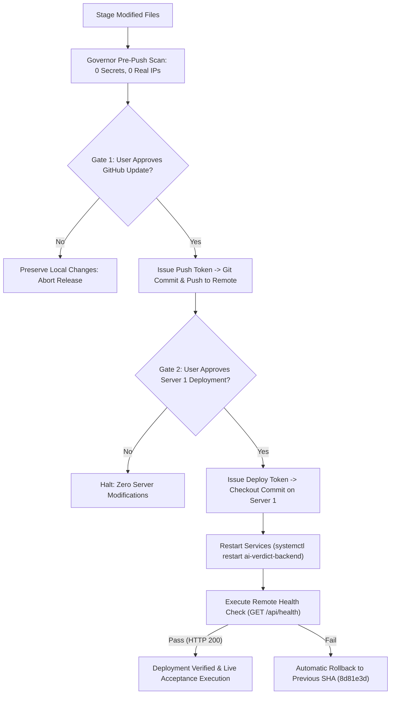

# Verdictum AI — Validation V1.2.3a
## Report 06: Remote Deployment Plan & Authenticated Verification Specification

**Auditor / Engineer:** DevOps Engineer, SOC Platform Architect  
**Deployment Target:** Verdictum AI Server 1 (Ubuntu Linux 24.04 LTS)  
**Governance Protocol:** RepoDeploy Governor Two-Stage Approval Gate Protocol  
**Date:** November 17, 2026  
**Status:** READY FOR GATED DEPLOYMENT  

---

### 1. Pre-Deployment Environment Audit

A remote environment audit was conducted via `governor_cli.py audit-remote`:
- **Current Live Commit SHA:** `8d81e3d30ec659a02f6fbaf43ffcabf4b8e9bdb0`
- **Application Environment:** `production` (`PLATFORM_OPERATING_MODE: advisory`)
- **Backend Service:** `ai-verdict-backend.service` (Active, running under systemd)
- **Database Engine:** PostgreSQL 16 on `127.0.0.1:5432` (`ai_verdict`, migration `013_user_tenant_customer`)
- **In-Memory Cache:** Redis 7.0 (Active on `127.0.0.1:6379`)
- **Worker Queues:** Celery offline/asynchronous worker
- **Secondary Server 2 (Verdictum Cortex / GPU):**
  - Reachability: `tcp_reachable: false` (TimeoutError after 3004ms)
  - Telemetry: Reported authentically as offline; zero mock fallback enabled (`LOCAL_LLM_ALLOW_MOCK_FALLBACK: false`)

---

### 2. Two-Stage Governor Release Procedure

---

### 3. Remote Acceptance Test Specifications

Upon successful deployment to Server 1, the following live tests will be executed directly against Server 1's backend and web tier:

1. **Health & Readiness Endpoints:**
   - `GET /api/health`: Verify HTTP 200, database connected, components healthy.
2. **Missing Rule Fail-Safe Test:**
   - `GET /api/prompts/rule/00000000-0000-0000-0000-000000000000`: Verify HTTP 404 response.
3. **Invalid Version Fail-Safe Test:**
   - `GET /api/prompts/rule/40498741-ee6b-4a71-9101-0d6d3f77154c/readiness?version_id=ffffffff-ffff-ffff-ffff-ffffffffffff`: Verify HTTP 404 response.
4. **Heavy TCP Fixed Port Rule Readiness (Live DB):**
   - Candidate v3 (`ec0cc351-8dd1-4026-9dc3-586387bb324c`):
     - `quality_score == 78.0`
     - `readiness_score == 78.0`
     - `sum(gate_scores) == 78.0` (G1: 3.0, G2..G7: 75.0, G8: 0.0)
     - `total_quality_gates == 8`
     - `quality_gates_passed == 6`
     - `readiness_status == "BLOCKED"`
     - `approval_eligible == false`
   - Baseline v1 (`8a460ab8-5f06-4a90-b2d4-db958199d644`):
     - `quality_score == 54.0`
     - `quality_gates_passed == 2`
     - `readiness_status == "BLOCKED"`
5. **Decoupled SIEM vs Policy Status:**
   - Verify underlying SIEM rule record reports `"ACTIVE"` independently of unapproved draft v3.
6. **Server 2 Un-Fabricated Offline Health:**
   - Verify telemetry correctly indicates Cortex endpoint is offline without throwing unhandled exceptions.
