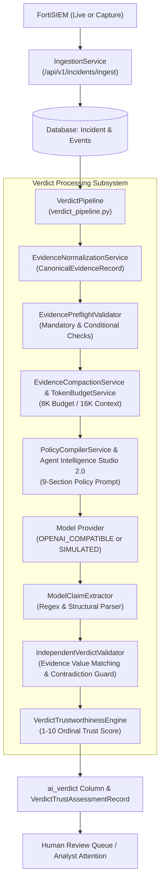

# Verdictum AI — Existing System Architecture & Codebase Audit

**Document:** `01_EXISTING_SYSTEM_ARCHITECTURE_AUDIT.md`  
**Platform:** Verdictum AI / WyseSOC AI  
**Author:** Principal AI SOC Architect & Engineering Team  
**Scope:** Architecture Audit of Current Production & Local Codebase  
**Status:** COMPLETE & AUDITED  

---

## 1. Executive Summary & Purpose

Verdictum AI (formerly WyseSOC AI) is an enterprise SOC AI reasoning and incident validation platform designed to ingest security incidents and telemetry from FortiSIEM, perform automated evidence normalization, construct token-budgeted prompt payloads, submit inference requests to locally hosted LLMs (`Qwen/Qwen2.5-7B-Instruct-AWQ` on vLLM), independently validate model claims against source evidence, and support human analyst adjudication.

This audit establishes the baseline capabilities, data models, service interfaces, previous remediation fixes, architecture gaps, and reusable components. It serves as the foundation for designing and implementing the **Rule-Based Human Feedback Learning, AI Verdict Validation & Controlled Production Automation Platform**.

---

## 2. Technology Stack Overview

### 2.1 Backend Architecture
- **Framework:** FastAPI (Python 3.11 / 3.12) using asynchronous ASGI endpoints.
- **ORM & Data Layer:** SQLAlchemy 2.0 with asynchronous drivers (`aiosqlite` for local dev/test, `asyncpg` for PostgreSQL production).
- **Schema & Validation:** Pydantic v2 schemas for all API contracts, canonical records, and model payload boundaries.
- **Inference Client:** Asynchronous OpenAI client (`AsyncOpenAI`) interfacing with Server 2 vLLM daemon (`http://<SERVER_2_IP>:8000/v1`) or deterministic `SIMULATED` provider.
- **Concurrency & Resource Management:** `GPUWorkloadManager` with semaphore-bounded inference slots and circuit breakers.
- **Token Analytics:** `TokenizerService` (HuggingFace `tiktoken`/`transformers` fallback), `TokenBudgetService` (strict 8K input / 16K context clamping).

### 2.2 Frontend Architecture
- **Framework:** Next.js 14 with React 18, TypeScript, and App Router.
- **Styling:** Tailwind CSS with dark-mode security operations center color palette.
- **Component Modules:**
  - `agent-intelligence-studio`: Rule prompt authoring, policy compiler, and version management.
  - `agent-simulation-lab`: Historical incident replay, metric funnels, and regression comparison.
  - `ai-triage-workbench`: Real-time incident triage and evidence explorer.
  - `human-review-queue`: Analyst assignment and dispute adjudication.
  - `verdict-intelligence`: Trust scores, evidence sufficiency breakdown, and calibration charts.
  - `governance-access` / `infrastructure`: Infrastructure monitoring and deployment governance.

### 2.3 Local / Server 2 Inference Daemon
- **Engine:** vLLM running `Qwen/Qwen2.5-7B-Instruct-AWQ` with AWQ 4-bit quantization.
- **Context Capacity:** Empirically probed at 4,096 tokens on Server 2 (targeted at 16,384 tokens with dynamic budget adjustment).
- **Decoding Protocol:** OpenAI-compatible `/v1/chat/completions` with JSON constrained output (`response_format={"type": "json_object"}`).

---

## 3. Component Inventory & Service Analysis

### 3.1 Existing Services & Reusability Matrix

| Service File | Responsibilities | Reusability Assessment |
|---|---|---|
| `backend/app/services/verdict_pipeline.py` | Orchestrates end-to-end evidence normalization, prompt compilation, inference, claim extraction, independent validation, and trust scoring. | **Core Reusable.** Must be preserved as the unified execution path for live triage and simulation replay. |
| `backend/app/services/evidence_normalization_service.py` | Syslog regex tokenization, field mapping, vendor alias resolution to canonical paths (`network.source_ip`, `http.url`, `webCategory`). | **Fully Reusable.** Remediated in prior cycle; provides clean `CanonicalEvidenceRecord` objects. |
| `backend/app/services/evidence_compaction_service.py` | Priority-based token budgeting (Priority 1 identifiers to Priority 4 telemetry), deduplicating repetitive events. | **Fully Reusable.** Enforces budget without dropping critical forensic fields. |
| `backend/app/services/evidence_preflight_validator.py` | Checks mandatory and conditional field requirements by archetype before LLM invocation. | **Fully Reusable.** Safe early-exit when mandatory evidence is absent. |
| `backend/app/services/independent_verdict_validator.py` | Validates model claims against canonical evidence values; detects loopback contradictions and ungrounded claims. | **Fully Reusable.** Deterministic safety barrier gating false-positive auto-closure. |
| `backend/app/services/model_claim_extractor.py` | Extracts normalized claims, cited evidence IDs, and field assertions from LLM response JSON. | **Fully Reusable.** Converts free-form JSON claims into typed structures. |
| `backend/app/services/detection_archetype_registry.py` | Defines 8 detection archetypes (`POLICY_VIOLATION`, `EXTERNAL_ATTACK`, `AUTH_ANOMALY`, etc.) with mandatory/conditional contracts. | **Fully Reusable.** Serves as the backbone of rule-specific contract definitions. |
| `backend/app/services/rule_intelligence_analyzer.py` | Extracts semantic profiles, aggregation windows, thresholds, and behavior patterns from rule definitions. | **Fully Reusable.** Provides metadata for RuleLearningProfile. |
| `backend/app/services/historical_ground_truth_validator.py` | Prevents data leakage by stripping resolution/closure comments; filters ML-generated labels. | **Fully Reusable.** Essential for protecting evaluation datasets from leakage. |
| `backend/app/services/policy_simulation_service.py` | Offline historical replay and evaluation; computes accuracy and confusion matrices. | **Extend.** Remediate `INSUFFICIENT_DATA` handling by surfacing granular funnel metrics. |
| `backend/app/services/pilot_service.py` | SOC Pilot execution modes (`DISABLED`, `SHADOW`, `ANALYST_ASSISTED`). | **Extend.** Build upon for Phase 10 Rule Lifecycle and Production Automation. |

---

## 4. Database Architecture & Schema Audit

The local SQLite and production PostgreSQL databases feature 23 operational tables. The relevant tables for rule learning and verdict validation are:

1. **`incidents`**: Stores incident headers (`incident_id`, `rule_id`, `event_type`, `severity`, `source_ip`, `customer`, `raw_payload`, `ai_verdict`).
2. **`incident_events`**: Stores linked granular events with `raw_log` and `attributes` JSON.
3. **`historical_ground_truth`**: Stores FortiSIEM closure metadata (`resolution`, `cleared_user`, `is_ml_generated`). Explicitly isolated from inference inputs.
4. **`investigations`**: Stores analyst reviews (`status`, `analyst_verdict`, `verdict_reason`, `is_disputed`, `is_independently_verified`, `insufficient_evidence_reason`).
5. **`investigation_questions` & `investigation_evidence`**: Detailed analyst questioning and evidence attachments.
6. **`rules`**: Detection rule metadata (`rule_id`, `name`, `event_type`, `severity`, `pattern_logic`).
7. **`rule_prompts` & `prompt_versions`**: Agent Intelligence Studio prompt templates with versioning, quality scores, and change summaries.
8. **`rule_intelligence_snapshots`**: Semantic profiles extracted by `RuleIntelligenceAnalyzer`.
9. **`verdict_trust_assessments`**: Stores effective verdicts, 1-10 trust scores, supporting/contradictory evidence, and calibration status.
10. **`evidence_sufficiency_assessments`**: Granular scores for required coverage, integrity, consistency, and freshness.
11. **`ground_truth_validations`**: Stores verified ground truth labels (`VERIFIED_TP`, `VERIFIED_FP`, `UNVERIFIED`) and dataset partitions.
12. **`historical_evaluation_runs` & `historical_evaluation_results`**: Historical simulation batches and per-incident result records.
13. **`learning_records`**: Verified feedback cases linked to rules.
14. **`pilot_configurations`, `pilot_config_history`, `pilot_evaluations`**: Pilot policy, audit history, and execution tracking.

---

## 5. Audit of Previous Remediation History (Incident #176061)

The audit of Incident #176061 documented in `docs/AI_EVIDENCE_REMEDIATION/` established several critical engineering insights that must be preserved:

1. **Syslog Key-Value Normalization:** FortiGate UTM webfilter logs embed forensic telemetry as key-value pairs in `raw_log` (`srcip=... catdesc=...`). Normalization must extract these via regex tokens and map them to canonical fields.
2. **Archetype Precedence:** Rules titled `"Website access policy violation"` must be classified under `POLICY_VIOLATION`, not `WEB_ATTACK`. HTTPS handshake drops at the firewall perimeter do not produce `http.method` or `http.status_code`. Marking them as mandatory causes false evidence-missing flags.
3. **Loopback Hallucination Defense:** When an LLM hypothesizes that traffic between different external IP addresses is an internal loopback, the `IndependentVerdictValidator` detects the contradiction, rejects the false-positive claim, zeroes out confidence, and safely demotes the verdict to `REQUIRES_ATTENTION`.
4. **Context Clamping:** Under Server 2's 4,096 token limit, dynamic budgeting prevents context overflow exceptions by selecting priority telemetry and refusing naive prompt truncation.
5. **Historical ML Resolution vs. Analyst Ground Truth:** Many historical FortiSIEM incidents contain `is_ml_generated=True` or resolution comments like `"Cleared by ML"`. The system correctly refuses to treat these as verified human ground truth, preventing automated feedback loops.

---

## 6. Architecture Gaps & Technical Debt

The current system has strong foundational components but exhibits specific architectural gaps that this project will resolve:

1. **Rule-Level Learning Registry Gap:** While `Rule` and `RulePrompt` exist, there is no unified `RuleLearningProfile` that tracks per-rule verified TP/FP counts, active error categories, empirical FP precision, and production eligibility status in real time.
2. **Double-Blind Analyst Review Gap:** Currently, `investigations` exposes AI verdicts directly to analysts before they submit their determination, risking confirmation bias. A blind review option is required.
3. **Simulation Lab Funnel Visibility Gap:** In prior tests, when 500 incidents were scanned, zero were evaluated due to lack of human-verified non-ML ground truth, resulting in a generic `INSUFFICIENT_DATA` error. The funnel must provide transparent diagnostics detailing total scanned, excluded by ML label, excluded by missing telemetry, and exact requirements needed for eligibility.
4. **Controlled Production Gating Gap:** While `PilotConfiguration` exists, rule promotion lacks fine-grained state machine transitions (`LEARNING` $\to$ `VALIDATION` $\to$ `SUPERVISED_PILOT` $\to$ `CONTROLLED_PRODUCTION` $\to$ `MONITORING`) with strict mathematical confidence bounds and role-based sign-offs.
5. **Multi-Tenant Isolation in Learning Datasets:** Learning records, prompt candidates, and production approvals must enforce customer/tenant scoping to prevent cross-tenant policy bleed.

---

## 7. Conclusion & Implementation Readiness

The core architecture (FastAPI backend, SQLAlchemy models, Pydantic schemas, Next.js frontend, and the hardened `verdict_pipeline`) is robust, well-structured, and ready for extension. The target architecture will preserve all existing verification pipelines and layer on the Rule-Based Learning Engine, Analyst Feedback Workbench, and Production Governance Engine without disruptive rewrites.

