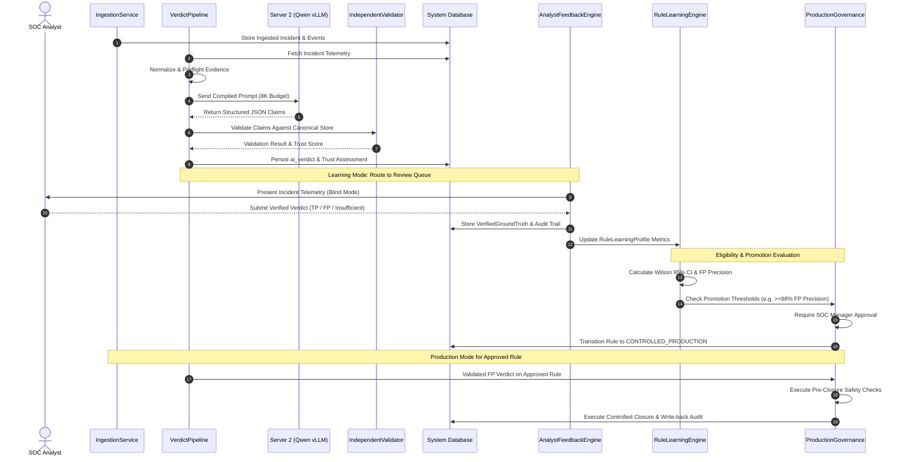

# Verdictum AI — Target System Architecture

**Document:** `03_TARGET_SYSTEM_ARCHITECTURE.md`  
**Platform:** Verdictum AI / WyseSOC AI  
**Scope:** Target Modular Architecture Specification  
**Status:** DRAFTED & VERIFIED  

---

## 1. Architectural Philosophy & Principles

The target system architecture transforms Verdictum AI from an advisory triage assistant into an enterprise-grade, rule-based, continuously evaluated AI SOC platform. 

The architecture adheres to four non-negotiable core principles:
1. **Evidence-Grounded Determinism:** No model output is trusted on confidence alone; every claim must be validated against normalized canonical telemetry.
2. **Independent Human Feedback:** Analysts provide unbiased determinations that create verified ground truth, separated from historical SIEM automated resolutions.
3. **Rule-Level Statistical Governance:** Quality is measured per detection rule and tenant, requiring statistical confidence intervals before any production automation.
4. **Fail-Closed Production Safety:** Automated incident closure is restricted to explicitly qualified rules with multi-barrier safety gates; any uncertainty defaults to human analyst review.

---

## 2. Four-Module Target Architecture

```mermaid
flowchart TD
    subgraph "Module A: AI Verdict Engine"
        A1["Ingestion & Raw Normalization\n(EvidenceNormalizationService)"] --> A2["Preflight Validation\n(EvidencePreflightValidator)"]
        A2 --> A3["Context Compaction & Prompt Compilation\n(TokenBudgetService / PolicyCompiler)"]
        A3 --> A4["Model Inference\n(Qwen2.5 on vLLM / Simulated)"]
        A4 --> A5["Claim Extraction & Grounding\n(ModelClaimExtractor)"]
        A5 --> A6["Independent Validation & Trust Scoring\n(IndependentVerdictValidator / TrustEngine)"]
    end

    subgraph "Module B: Analyst Feedback Engine"
        B1["Double-Blind Review Queue\n(HumanReviewQueue)"] --> B2["Analyst Determination\n(TP / FP / Insufficient)"]
        B2 --> B3["AI Verdict Comparison & Agreement\n(ReviewOrchestrator)"]
        B3 --> B4["Adjudication & Dispute Resolution\n(Senior Analyst Escalation)"]
        B4 --> B5["Immutable Ground Truth Store\n(VerifiedGroundTruth)"]
    end

    subgraph "Module C: Rule Learning & Evaluation Engine"
        C1["Rule Learning Registry\n(RuleLearningProfile)"] --> C2["Statistical Evaluator\n(EmpiricalAccuracyEvaluator)"]
        C2 --> C3["Error Categorization & Prompt Optimization\n(LearningService / PromptStudio)"]
        C3 --> C4["Simulation Lab & Historical Replay\n(PolicySimulationService)"]
        C4 --> C5["Production Eligibility Assessor\n(Wilson CI & Sample Thresholds)"]
    end

    subgraph "Module D: Production Governance Engine"
        D1["Lifecycle State Machine\n(LEARNING -> PILOT -> PRODUCTION)"] --> D2["Approval Gating & Sign-off\n(SOC Manager Approval)"]
        D2 --> D3["Safety Interlocks & Pre-Closure Check\n(PreClosureValidator)"]
        D3 --> D4["Controlled Auto-Closure\n(FortiSIEM Write-back Adapter)"]
        D4 --> D5["Continuous Drift Monitor & Auto-Suspension\n(PolicyLifecycleMonitor)"]
    end

    A6 --> B1
    B5 --> C1
    C5 --> D1
    D5 -.->|"Emergency Rollback"| D1
```

---

## 3. Module Breakdown & Responsibilities

### 3.1 Module A: AI Verdict Engine
The AI Verdict Engine is responsible for processing telemetry, constructing model prompts, and generating validated verdicts.
- **Components:**
  - `EvidenceNormalizationService`: Extracts syslog KV tokens and standardizes vendor logs into `CanonicalEvidenceRecord`.
  - `EvidencePreflightValidator`: Verifies presence of mandatory archetype fields before model invocation.
  - `EvidenceCompactionService` & `TokenBudgetService`: Compresses telemetry within an 8,192 token input budget targeting a 16,384 context limit.
  - `PolicyCompilerService`: Assembles the 9-section policy prompt containing rule context, detection criteria, and telemetry.
  - `ModelProvider` (`OPENAI_COMPATIBLE` / `SIMULATED`): Connects to local Qwen LLM via GPU manager with circuit breakers.
  - `ModelClaimExtractor`: Parses structured claims and cited evidence IDs from JSON responses.
  - `IndependentVerdictValidator`: Re-evaluates claims against canonical records; blocks loopback hallucinations.
  - `VerdictTrustworthinessEngine`: Generates 1–10 ordinal trust scores based on evidence sufficiency and claim grounding.

### 3.2 Module B: Analyst Feedback Engine
The Analyst Feedback Engine enables SOC analysts to perform independent evaluations, resolve disputes, and build reliable ground-truth datasets.
- **Components:**
  - `AnalystReviewQueue`: Displays pending incidents requiring human review. Supports double-blind evaluation mode where AI predictions remain masked until analyst input is saved.
  - `ReviewOrchestrator`: Compares the analyst determination against the AI verdict, categorizing outcomes (`AGREEMENT_TP`, `AGREEMENT_FP`, `FALSE_POSITIVE_OVERRIDE`, `MISSED_TRUE_POSITIVE`, `UNRESOLVED`).
  - `AdjudicationWorkflow`: Facilitates L2/Manager review of disputed or ambiguous incidents.
  - `VerifiedGroundTruthStore`: Stores verified labels in `ground_truth_validations`, strictly isolated from model-facing prompts to prevent data leakage.

### 3.3 Module C: Rule Learning and Evaluation Engine
The Rule Learning and Evaluation Engine analyzes rule performance, categorizes errors, manages candidate prompts, and calculates mathematical eligibility.
- **Components:**
  - `RuleLearningRegistry`: Manages `RuleLearningProfile` records containing rule-specific counters, reviewed cases, and lifecycle states.
  - `EmpiricalAccuracyEvaluator`: Calculates confusion matrices, TP recall, FP precision, and 95% Wilson confidence intervals.
  - `ErrorTaxonomyEngine`: Categorizes failure modes (`HALLUCINATION`, `CONTRADICTION`, `MISSING_EVIDENCE`, `CONTEXT_OVERFLOW`, `THRESHOLD_MISINTERPRETATION`).
  - `PromptOptimizationService`: Proposes targeted prompt revisions in `PromptVersion` based on categorized error patterns.
  - `SimulationLabService`: Replays historical incidents against candidate prompts, displaying transparent funnel metrics (scanned, excluded, evaluated).
  - `ProductionEligibilityCalculator`: Verifies whether a rule meets all statistical and sample-coverage criteria for promotion.

### 3.4 Module D: Production Governance Engine
The Production Governance Engine enforces the rule lifecycle, manages approval gates, executes safe automatic closures, and monitors for drift.
- **Components:**
  - `RuleLifecycleManager`: Enforces transitions across `LEARNING`, `VALIDATION`, `SUPERVISED_PILOT`, `CONTROLLED_PRODUCTION`, `MONITORING`, and `SUSPENDED`.
  - `ProductionApprovalGate`: Requires dual-key SOC manager authorization for any rule state promotion.
  - `PreClosureSafetyInterlock`: Verifies that an incident is not assigned to an active human investigation, has not undergone subsequent telemetry changes, and possesses an untampered validation token.
  - `ControlledAutomationExecutor`: Executes idempotent FortiSIEM incident updates via `FortiSIEMService`, confirming write-back success before updating database state.
  - `DriftMonitor`: Continuously tracks production precision and automatically triggers suspension and rollback if a critical missed TP occurs.

---

## 4. Component Interaction Diagram

---

## 5. Technology Constraints & Infrastructure Footprint

1. **No External Microservices:** The entire platform operates within the unified FastAPI backend and Next.js frontend, avoiding unnecessary microservice overhead.
2. **Offline-Capable:** Fully functions without active internet access; gracefully degrades when FortiSIEM or Server 2 is offline using captured fixtures, database caches, and deterministic simulation providers.
3. **Dual Database Compatibility:** Schema and queries are compatible with both SQLite (`sqlite+aiosqlite` for offline dev/test) and PostgreSQL (`postgresql+asyncpg` for production).
4. **Tenant-Safe By Design:** Every query, dataset partition, learning profile, and governance gate includes explicit customer/tenant scoping.

