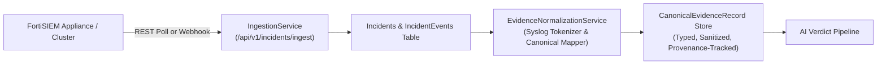
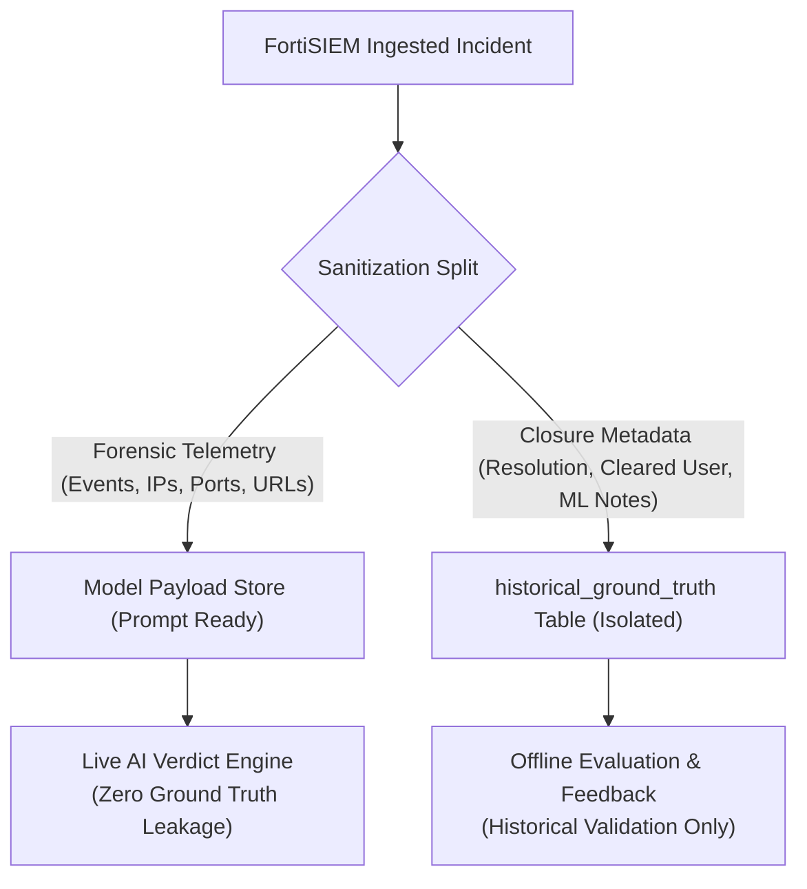

# Verdictum AI — FortiSIEM Ingestion & Evidence Integration Design

**Document:** `04_FORTISIEM_INGESTION_AND_EVIDENCE_DESIGN.md`  
**Platform:** Verdictum AI / WyseSOC AI  
**Scope:** FortiSIEM Ingestion, Syslog Parsing, Normalization, and Provenance  
**Status:** DRAFTED & VERIFIED  

---

## 1. Overview & Integration Methods

Verdictum AI integrates with FortiSIEM via two primary ingestion pipelines:
1. **Real-Time Webhook / REST Push (`POST /api/v1/incidents/ingest`):** FortiSIEM event-forwarding or incident notification rules push JSON payloads immediately upon incident trigger.
2. **Scheduled API Polling (`FortiSIEMService` / `FortiSIEMPollingScheduler`):** Asynchronous background polling against FortiSIEM REST endpoints (`/phoenix/rest/incident/query`) to synchronize new and updated incidents.

---

## 2. Incident & Event Data Structures

### 2.1 Incident Header (`Incident` Model)
FortiSIEM provides top-level attributes that map to the `Incident` database entity:
- `incident_id`: FortiSIEM numeric or UUID incident identifier (e.g., `176061`).
- `rule_id`: Foreign key linking to the detection rule definition in `rules`.
- `event_type`: SIEM event type string (e.g., `PH_RULE_WEB_POL_VIOLATION_SAME_SRC_SAME_DEST`).
- `title` & `description`: Rule title and incident overview.
- `severity` & `status_code`: Normalized severity (`CRITICAL`, `HIGH`, `MEDIUM`, `LOW`) and status integer.
- `customer`: Customer or tenant identifier for multi-tenant isolation.
- `source_ip` & `reporting_device`: Primary offender IP and emitting reporting hardware.
- `first_seen_epoch` & `last_seen_epoch`: Epoch millisecond timestamps defining the incident window.
- `raw_payload`: Complete, unmutated JSON payload received from the SIEM.

### 2.2 Linked Granular Events (`IncidentEvent` Model)
Underlying individual log events that triggered the incident are preserved in `incident_events`:
- `event_id`: Unique event transaction identifier.
- `event_receive_time`: Ingestion timestamp from FortiSIEM.
- `raw_log`: Full unparsed syslog/CEF string (e.g., `date=2026-11-12 time=14:30:00 devname="FGT-CORP-01" srcip=192.0.2.48 dstip=198.51.100.32 url="https://media4.giphy.com/" catdesc="Entertainment" action="blocked"`).
- `attributes`: Pre-parsed JSON dictionary provided by FortiSIEM parser (e.g., `{"Source IP": "192.0.2.48", "Destination IP": "198.51.100.32", "Web Site Category": "Entertainment"}`).

---

## 3. Canonical Field Normalization & Provenance

Heterogeneous log formats across FortiGate, Palo Alto, Cisco, CrowdStrike, and Windows Event Logs are transformed into standardized `CanonicalEvidenceRecord` structures:

### 3.1 Normalization Pipeline
1. **Syslog Key-Value Tokenizer:** Uses regex `(\w+)=(?:"([^"]*)"|(\S+))` to extract attributes embedded in raw text.
2. **Key Sanitization:** Converts attributes to lowercase and strips non-alphanumeric characters (e.g., `"Source IP"` $\to$ `"sourceip"`).
3. **Canonical Field Mapping:** Resolves attributes to canonical dot-notation paths:
   - `network.source_ip` $\leftarrow$ `["source_ip", "src_ip", "srcip", "sourceip", "src", "client_ip"]`
   - `network.destination_ip` $\leftarrow$ `["destination_ip", "dest_ip", "dstip", "destinationip", "dst", "server_ip"]`
   - `http.url` $\leftarrow$ `["url", "request_url", "uri", "http_url", "target_url"]`
   - `webCategory` $\leftarrow$ `["webcategory", "catdesc", "websitecategory", "urlcategory", "category"]`
   - `security.action` $\leftarrow$ `["action", "act", "disposition", "status"]`
   - `process.name` $\leftarrow$ `["process", "proc", "processname", "app", "image"]`
   - `process.command_line` $\leftarrow$ `["cmdline", "commandline", "processcmdline", "args"]`

### 3.2 Provenance Tracking
Every extracted field records its provenance tier:
- `DIRECT`: Exact match against standardized key in parsed payload.
- `ALIASED`: Resolved via vendor alias dictionary.
- `KEY_VALUE_EXTRACTED`: Parsed directly from unparsed syslog string in `raw_log`.
- `ENRICHED`: Inferred or supplemented by secondary context.

---

## 4. Separation of Operational Closure Metadata

### Critical Architectural Boundary
**FortiSIEM historical resolution, cleared user, cleared time, and machine learning comments must NEVER be mandatory inputs to the live AI verdict engine.**

1. **Inference Sanitization:** `HistoricalGroundTruthValidator.sanitize_incident_for_inference()` recursively strips 100% of closure-related fields (`resolution`, `clearedreason`, `cleareduser`, `comments`, `closurecomments`, `analystnotes`, `ismlgenerated`).
2. **Evaluation Ground Truth:** Closure metadata is persisted strictly in `historical_ground_truth` for offline comparison against historical human benchmarks.
3. **ML-Generated Exclusion:** Any historical resolution where `is_ml_generated=True` or `cleared_user` matches an automated actor (`"system"`, `"ml"`, `"siem"`) is flagged as `UNVERIFIED` and excluded from model evaluation sets.

---

## 5. Offline Handling & SIEM Degradation

When FortiSIEM is unavailable or offline:
1. **Fail-Closed Connectivity:** Network timeouts or HTTP errors do not hang the system; connection attempts abort cleanly within 5.0 seconds.
2. **Local Caching:** All previously ingested incidents and raw logs remain fully accessible in the local database.
3. **Capture Fixtures:** Offline development and testing utilize pre-captured test fixtures (`Incident` + `IncidentEvent` JSON) matching production FortiSIEM schemas.
4. **Write-back Protection:** Any attempted external write-back during FortiSIEM unavailability fails safely, preserves the incident in the database, and flags it for manual analyst review.

