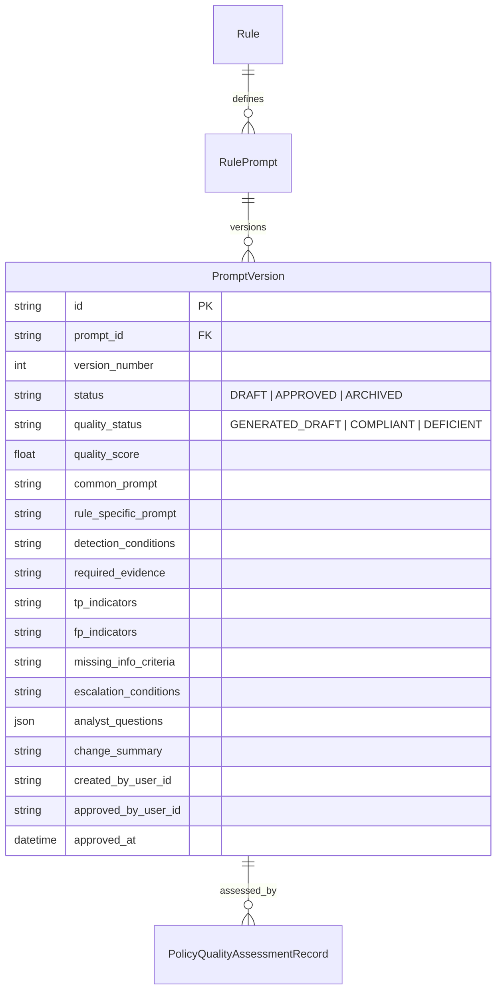

# Verdictum AI — Agent Intelligence Studio 2.0 Integration Design

**Document:** `05_AGENT_INTELLIGENCE_STUDIO_DESIGN.md`  
**Platform:** Verdictum AI / WyseSOC AI  
**Scope:** Agent Intelligence Studio 2.0, Rule Prompts, Policy Compilation & Versioning  
**Status:** DRAFTED & VERIFIED  

---

## 1. Overview & Studio Purpose

Agent Intelligence Studio 2.0 (AIS 2.0) is the central prompt authoring, policy compiler, and quality evaluation subsystem of Verdictum AI. It bridges human SOC domain knowledge and LLM reasoning by providing:
1. Rule-specific prompt template management with strict version control.
2. 9-section policy compilation structuring domain expectations, evidence schemas, and safety boundaries.
3. Automated prompt quality assessments and structural compliance scoring.
4. Token budgeting services ensuring prompt payloads fit within local inference capacity without truncation.

---

## 2. Rule Registration & Identity Management

### 2.1 Canonical Rule Identity
To prevent confusion arising from renamed SIEM rules:
- **Canonical Rule ID (`rule_id`):** An immutable string matching the SIEM event rule identifier (e.g., `PH_RULE_WEB_POL_VIOLATION_SAME_SRC_SAME_DEST` or UUID `9839fa49-40ac-4676-abcc-4c5581ae9e09`).
- **Display Name (`name`):** A human-readable label (e.g., `"Website access policy violation: Same Source and Same Destination"`).
- **Detection Archetype (`archetype`):** Standardized categorization linking the rule to mandatory evidence contracts (`POLICY_VIOLATION`, `EXTERNAL_ATTACK`, `AUTH_ANOMALY`, `DATA_EXFILTRATION`, `MALWARE_DEFENSE`, `SUSPICIOUS_EXECUTION`, `RECONNAISSANCE`, `CLOUD_AUDIT`).

---

## 3. Prompt Template Architecture & Versioning

Prompt definitions are stored in `rule_prompts` and versioned in `prompt_versions`:

### 3.1 Immutable Audit Trail
1. **No In-Place Overwrites:** Modifying a prompt creates a new version incrementing `version_number`.
2. **Provenance Retention:** Historical incident evaluations retain the exact `prompt_version_id` and `model_identifier` used during inference, ensuring full retrospective reproducibility.
3. **Approval Gating:** Prompts cannot be activated in production without achieving a compliant quality score and obtaining formal approval from an authorized SOC Manager.

---

## 4. 9-Section Unified Policy Compilation

The `PolicyCompilerService` compiles prompt templates and incident telemetry into a structured, unified prompt payload:

| Section | Name | Content & Purpose |
|---|---|---|
| **1** | System Role & Persona | Defines the persona: Principal SOC AI Analyst operating under strict evidential standards. |
| **2** | Core Safety Directives | Prohibits speculation, demands explicit evidence citations, and forbids assuming fact from rule title alone. |
| **3** | Detection Rule Context | Canonical Rule ID, Archetype, Description, and Severity. |
| **4** | Telemetry Evidence Schema | Defines expected canonical fields and differentiates mandatory vs conditional attributes. |
| **5** | True Positive Indicators | Known-malicious criteria, suspicious command flags, and unauthorized exfiltration indicators. |
| **6** | False Positive Indicators | Known-benign criteria, maintenance windows, authenticated proxies, and authorized administrative tools. |
| **7** | Missing Evidence & Escalation | Conditions requiring analyst escalation due to missing telemetry or inconclusive data. |
| **8** | Normalized Incident Evidence | Tabular summary of canonical evidence records with unique evidence IDs for citation. |
| **9** | Response Contract & JSON Schema | Strict JSON format enforcing `verdict`, `confidence`, `supporting_evidence`, and `claims`. |

---

## 5. Token Budgeting & Clamping Strategy

To prevent context overflow exceptions on Server 2 (probed at 4,096 tokens max context, targeting 16,384 tokens):
- **Dynamic Capacity Probing:** System probes `/v1/models` on startup to detect `max_model_len`.
- **Budget Allocations (4,096 limit):**
  - System Directives & Rule Policy: ~1,500 tokens.
  - Incident Evidence Telemetry: ~1,500 tokens.
  - Reserved Output Completion: 512 tokens.
  - Headroom & Safety Margin: ~500 tokens.
- **Fail-Closed Budget Guard:** If mandatory forensic telemetry exceeds available capacity after compaction, the pipeline safely abstains with `REQUIRES_ATTENTION` (`CONTEXT_WINDOW_EXCEEDED`), refusing to truncate mandatory security directives.

