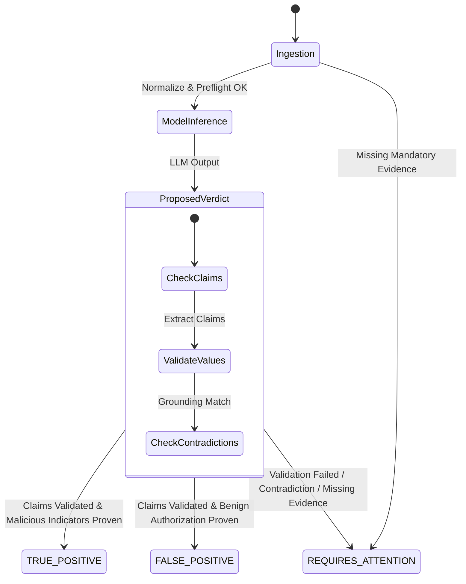

# Verdictum AI — AI Verdict & Evidence Validation Subsystem

**Document:** `06_AI_VERDICT_AND_EVIDENCE_VALIDATION.md`  
**Platform:** Verdictum AI / WyseSOC AI  
**Scope:** Verdict Definitions, Claim Extraction, Independent Validation & Contradiction Guardrails  
**Status:** DRAFTED & VERIFIED  

---

## 1. Tri-Verdict Model

Verdictum AI strictly limits model verdicts to three deterministic states:

1. **`TRUE_POSITIVE` (TP):** Telemetry definitively confirms malicious activity, policy breach, or unauthorized intrusion conforming to detection criteria.
2. **`FALSE_POSITIVE` (FP):** Telemetry definitively confirms legitimate activity, authorized maintenance, authenticated administrative operation, or benign tool behavior.
3. **`REQUIRES_ATTENTION` (RA):** Inconclusive telemetry, missing mandatory evidence, contradictory claims, model failure, or validation rejection requiring human analyst investigation.

---

## 2. Separation of Proposed vs. Effective Verdict

A fundamental safety requirement is the strict operational separation between the LLM's **Proposed Verdict** and the system's **Effective Verdict**:

| Layer | Component | Authority | Determinism |
|---|---|---|---|
| **Proposed Verdict** | `Qwen/Qwen2.5-7B-Instruct-AWQ` | Advisory Only | Probabilistic / Non-Deterministic |
| **Claim Extraction** | `ModelClaimExtractor` | Parser | Deterministic Regex & Typed Parsing |
| **Independent Validation** | `IndependentVerdictValidator` | Verification Gate | 100% Deterministic Code Logic |
| **Effective Verdict** | `VerdictTrustworthinessEngine` | Authoritative | Deterministic Arbitrator |

The LLM cannot authorize an action or close an incident. The **Effective Verdict** governs downstream routing and automation.

---

## 3. Claim Extraction & Evidence Value Matching

The `ModelClaimExtractor` inspects the JSON payload returned by the LLM and extracts every assertion:
- **Evidence Citation Verification:** Ensures cited evidence IDs (e.g., `EVID-01`, `EVID-02`) exist in the prompt's canonical evidence table. Citing non-existent evidence triggers `EVID_CITATION_NON_EXISTENT`.
- **Value Matcher:** Uses type-aware comparisons:
  - **IP Addresses:** Compares normalized IP strings (handles IPv4/IPv6, zero-padding, CIDR).
  - **Integers / Status Codes:** Matches string `"200"` against numeric `200`.
  - **URLs & Domains:** Normalizes trailing slashes, schemes, and case sensitivity.
  - **Action / Status:** Standardizes `"blocked"`, `"denied"`, `"dropped"`.

If the model claims `network.destination_ip == "203.0.113.1"` but the cited evidence shows `198.51.100.32`, the claim fails validation with `EVIDENCE_VALUE_MISMATCH`.

---

## 4. Contradiction & Hallucination Guardrails

The `IndependentVerdictValidator` enforces deterministic guardrails preventing dangerous hallucinations:

### 4.1 Loopback Claim on External Traffic
- **Scenario:** The LLM notes a rule title like `"Website access policy violation: Same Source and Same Destination"` and hypothesizes that internal loopback or proxy traffic occurred.
- **Guardrail:** The validator checks whether the source and destination IP addresses are identical or RFC 1918 internal addresses. If source is `192.0.2.48` and destination is external `198.51.100.32`, the claim is rejected as a contradiction (`LOOPBACK_CLAIMED_ON_EXTERNAL_TRAFFIC`).

### 4.2 Unsubstantiated False Positive Gate
- **Scenario:** The LLM proposes `FALSE_POSITIVE` claiming authorized maintenance, but no change ticket, authorized user credential, or maintenance schedule exists in telemetry.
- **Guardrail:** Any FP lacking affirmative evidence of authorization is rejected with `FP_WITHOUT_AFFIRMATIVE_AUTHORIZATION`.

### 4.3 Demotion & Trust Zeroing
When any contradiction or claim failure occurs:
1. Proposed verdict is demoted to `REQUIRES_ATTENTION`.
2. Confidence score is forced to `0.0%`.
3. Trust score is capped at `1/10`.
4. Detailed escalation reasons are recorded in `ai_verdict` and `verdict_trust_assessments`.
5. Incident is routed immediately to the human review queue.

