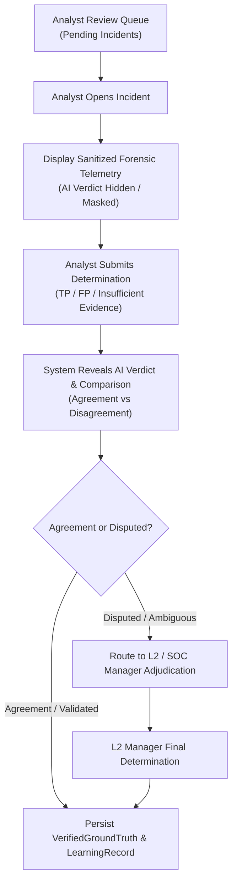

# Verdictum AI — Analyst Feedback & Human Review Workflow

**Document:** `07_ANALYST_FEEDBACK_WORKFLOW.md`  
**Platform:** Verdictum AI / WyseSOC AI  
**Scope:** Double-Blind Human Review, Ground Truth Creation & Adjudication  
**Status:** DRAFTED & VERIFIED  

---

## 1. Overview & Double-Blind Review Principle

Human analyst verification is the authoritative benchmark of Verdictum AI. To eliminate confirmation bias—where analysts passively accept the AI's proposed classification—the platform implements a **Double-Blind Review Workflow**.

---

## 2. Review Form Specifications

The analyst review interface provides:

1. **Independent Determination Controls:**
   - `TRUE_POSITIVE`: Malicious activity or confirmed security breach.
   - `FALSE_POSITIVE`: Benign, authorized, or misconfigured event.
   - `INSUFFICIENT_EVIDENCE`: Telemetry incomplete or sensor drop preventing definitive classification.
2. **Supporting Rationale & Evidence:**
   - `analyst_notes`: Detailed narrative explaining the determination.
   - `evidence_references`: Specific cited evidence IDs or event log lines.
   - `correction_reason`: Required when overturning an AI decision (`HALLUCINATION`, `MISSING_EVIDENCE_IGNORED`, `POLICY_EXCEPTION`, `BENIGN_ENVIRONMENT_SPECIFIC`).
3. **Review Metadata:**
   - `reviewer_id`: Authenticated user ID.
   - `reviewed_at`: UTC timestamp.
   - `blind_mode_active`: Boolean indicating whether AI verdict was hidden during submission.

---

## 3. Post-Review Comparison & Agreement Classification

Upon submission of the analyst's independent verdict, the interface reveals the original AI verdict and logs an explicit comparison record:

| Analyst Determination | AI Effective Verdict | Outcome Classification | Ground Truth Status |
|---|---|---|---|
| `TRUE_POSITIVE` | `TRUE_POSITIVE` | `AGREEMENT_TP` | `VERIFIED_TP` |
| `FALSE_POSITIVE` | `FALSE_POSITIVE` | `AGREEMENT_FP` | `VERIFIED_FP` |
| `FALSE_POSITIVE` | `TRUE_POSITIVE` | `AI_FALSE_ALARM` | `VERIFIED_FP` |
| `TRUE_POSITIVE` | `FALSE_POSITIVE` | `CRITICAL_MISSED_TP` | `VERIFIED_TP` (High-priority alert) |
| `INSUFFICIENT_EVIDENCE` | `TRUE_POSITIVE` / `FP` | `PREMATURE_AI_VERDICT` | `UNVERIFIED_INSUFFICIENT_DATA` |
| Disputed by Peer / L2 | Any | `DISPUTED` | `PENDING_ADJUDICATION` |

**Critical Ground Truth Rule:** Merely recording "Correct" or "Incorrect" is insufficient. The actual verified classification (`VERIFIED_TP` or `VERIFIED_FP`) must be stored alongside the specific rationale.

---

## 4. Senior Analyst / L2 Adjudication Workflow

When an incident involves high financial risk, critical severity, or conflicting determinations:
1. Incident status transitions to `AWAITING_ADJUDICATION`.
2. Escalated to the **SOC Manager / L2 Workbench**.
3. The Adjudicator reviews both initial analyst notes and AI claims.
4. Final adjudication produces an immutable `AdjudicationRecord`, updating `ground_truth_validations` while preserving the original analyst's submission history.

---

## 5. Append-Only Audit Integrity

To preserve compliance and forensic integrity:
- Prior review records are immutable; silent in-place overwrites are strictly blocked.
- Any correction or re-evaluation appends a new version with `updated_at`, `change_reason`, and `authenticated_user_id`.
- Historical training datasets maintain pointer references to specific review snapshot IDs.

