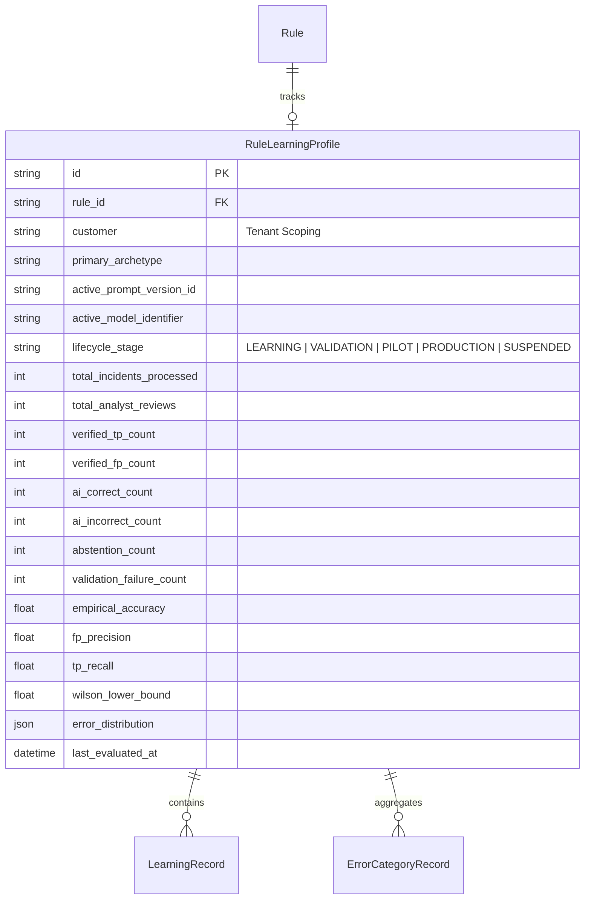
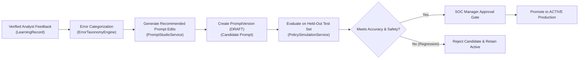

# Verdictum AI — Rule-Based Learning Engine Specification

**Document:** `08_RULE_LEARNING_ENGINE.md`  
**Platform:** Verdictum AI / WyseSOC AI  
**Scope:** Rule Learning Profiles, Feedback Categorization & Candidate Prompt Optimization  
**Status:** DRAFTED & VERIFIED  

---

## 1. Overview & Learning Boundary Principles

The Rule-Based Learning Engine enables detection rules to improve over time by systematically learning from verified SOC analyst feedback. 

### Critical Engineering Boundaries:
1. **No Autonomous Weight Updates:** The local LLM does not perform automated gradient descent or fine-tuning from analyst feedback.
2. **Four Distinct Improvement Mechanisms:**
   - **Mechanism 1 (Dataset Improvement):** Curating clean, verified, deduplicated evaluation benchmarks.
   - **Mechanism 2 (Prompt Improvement):** Refining rule-specific prompt directives, detection boundaries, and exceptions based on categorized error patterns.
   - **Mechanism 3 (Few-Shot Semantic Retrieval / RAG):** Feeding verified historical precedent cases into the prompt context.
   - **Mechanism 4 (Model Fine-Tuning):** Offline supervised fine-tuning (strictly out of scope for initial deployment).
3. **No Unapproved Prompt Overwrites:** Learning feedback generates **Candidate Prompts** (`DRAFT`). Candidate prompts must be validated through historical simulation before obtaining formal SOC Manager approval.

---

## 2. Rule Learning Profile Schema

Every detection rule maintains an isolated `RuleLearningProfile` scoped by rule ID and tenant:

---

## 3. Deduplication & Cluster Protection

In real enterprise SOC operations, a single port scan or network outage can generate thousands of nearly identical incidents within minutes. If counted individually, these correlated incidents artificially inflate evaluation metrics.

### Clustering Algorithm:
1. **Cluster Key Generation:** Computes a composite SHA-256 hash across `(customer, rule_id, source_ip, destination_ip, event_type, 1-hour time window)`.
2. **Single-Vote Policy:** Only one incident per unique cluster key is admitted into the statistical evaluation dataset. Subsequent incidents in the same cluster are marked as `CORRELATED_DUPLICATE` and excluded from accuracy calculations.

---

## 4. Error Categorization & Remediation Feedback Loop

When an analyst's verified determination contradicts the AI verdict, the error is classified into a structured taxonomy:

| Error Category | Root Cause Pattern | Automated Learning Recommendation |
|---|---|---|
| `HALLUCINATION` | LLM asserted an IP or status code not present in source telemetry. | Strengthen negative directives; enforce stricter evidence extraction regex. |
| `CONTRADICTION` | LLM claimed internal loopback on external IP traffic or claimed authorization without ticket. | Add explicit contradiction checks in `IndependentVerdictValidator`. |
| `POLICY_EXCEPTION_MISSED` | LLM classified authorized maintenance or known scanner as malicious TP. | Add vendor/IP to rule-specific benign indicators (`fp_indicators`). |
| `CONTEXT_OVERFLOW` | Telemetry was compacted or truncated due to token budget bounds. | Optimize evidence compaction rules; elevate priority of key forensic fields. |
| `THRESHOLD_MISINTERPRETATION` | Rule specifies >100 attempts, but model triggered on 10. | Clarify aggregation count logic in prompt section 3 & 4. |

---

## 5. Candidate Prompt Optimization Workflow

1. **Candidate Generation:** Prompt Studio generates a candidate prompt version addressing recorded errors.
2. **Simulation Replay:** The candidate is evaluated against held-out historical incidents.
3. **Regression Check:** If candidate accuracy or TP recall drops compared to the baseline, the candidate is blocked.
4. **Controlled Promotion:** If candidate improves accuracy without regression, it is submitted for human manager sign-off.

