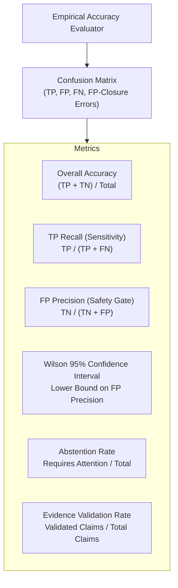

# Verdictum AI — Accuracy & Statistical Evaluation Engine

**Document:** `09_ACCURACY_AND_EVALUATION_ENGINE.md`  
**Platform:** Verdictum AI / WyseSOC AI  
**Scope:** Statistical Accuracy Metrics, Wilson Score Confidence Intervals & Holdout Evaluation  
**Status:** DRAFTED & VERIFIED  

---

## 1. Overview & Statistical Rigor

In automated SOC operations, naive accuracy metrics (e.g., overall accuracy) are dangerous. An overall accuracy of 90% in a heavily imbalanced environment (where 95% of incidents are benign false alarms) can mask a catastrophic 0% detection rate on actual True Positives. Furthermore, claiming a "100% FP accuracy" based on only 5 test samples is statistically invalid due to wide error margins.

The Accuracy & Statistical Evaluation Engine enforces:
1. Complete confusion matrices and class-specific metrics.
2. Wilson score 95% confidence intervals for small-sample protection.
3. Strict time-separated holdout partitions (`LOCKED_TEST`).
4. Minimum verified sample thresholds before any pilot or production promotion.

---

## 2. Comprehensive Metric Definitions

### 2.1 Confusion Matrix Formulations

| Metric | Mathematical Formula | SOC Operational Meaning |
|---|---|---|
| **True Positive (TP)** | $Count(Analyst=TP \land AI=TP)$ | Correctly confirmed malicious security incident. |
| **False Negative (FN / Missed TP)** | $Count(Analyst=TP \land AI=FP)$ | **CRITICAL FAILURE:** Real attack falsely classified as benign. |
| **False Positive (FP / False Alarm)** | $Count(Analyst=FP \land AI=TP)$ | Benign event incorrectly escalated as an attack. |
| **True Negative (TN / Correct FP)** | $Count(Analyst=FP \land AI=FP)$ | Correctly classified benign event eligible for closure. |
| **Abstention (RA)** | $Count(AI=REQUIRES\_ATTENTION)$ | Inconclusive cases safely escalated to analysts. |

### 2.2 Safety-Critical Metric Formulas
- **TP Recall (Detection Capability):**  
  $$\text{Recall}_{\text{TP}} = \frac{TP}{TP + FN}$$  
  *Measures the proportion of real attacks detected by the AI.*
- **FP Prediction Precision (Auto-Closure Safety):**  
  $$\text{Precision}_{\text{FP}} = \frac{TN}{TN + FN}$$  
  *Measures the probability that an event predicted as False Positive is truly benign. (Here $FN$ represents missed True Positives where AI predicted FP).*
- **False Positive Closure Error Rate:**  
  $$\text{Error}_{\text{FP}} = \frac{FN}{TN + FN} = 1 - \text{Precision}_{\text{FP}}$$  
  *Direct measure of catastrophic closure risk.*

---

## 3. Wilson Score 95% Confidence Interval

To prevent "the zero-failure fallacy" (where 5 correct predictions are treated as 100% certainty), the system calculates the lower bound of the Wilson Score Confidence Interval for FP prediction precision:

$$w^{-} = \frac{p + \frac{z^2}{2n} - z \sqrt{\frac{p(1-p)}{n} + \frac{z^2}{4n^2}}}{1 + \frac{z^2}{n}}$$

Where:
- $p$ is the observed sample precision ($\frac{TN}{TN + FN}$).
- $n$ is the total number of FP predictions ($TN + FN$).
- $z = 1.95996$ for a 95% confidence level.

### Empirical Example:
- **Case 1 ($n=5, 5/5$ correct, $100\%$ observed):**  
  $w^{-} = 56.6\%$. Despite observing zero failures, the statistical lower bound is only $56.6\%$. **BLOCKED FOR AUTOMATION.**
- **Case 2 ($n=50, 50/50$ correct, $100\%$ observed):**  
  $w^{-} = 92.9\%$. Strong confidence, eligible for supervised pilot.
- **Case 3 ($n=200, 198/200$ correct, $99.0\%$ observed):**  
  $w^{-} = 96.5\%$. Fully qualified for controlled production automation.

---

## 4. Minimum Verified Sample Thresholds

| Lifecycle Stage | Minimum Total Verified Incidents | Minimum Verified TPs | Minimum Verified FPs | Minimum FP Precision ($w^-$) |
|---|---|---|---|---|
| **LEARNING** | $0$ | $0$ | $0$ | N/A |
| **VALIDATION** | $\ge 15$ | $\ge 5$ | $\ge 5$ | $\ge 80.0\%$ |
| **SUPERVISED_PILOT** | $\ge 30$ | $\ge 10$ | $\ge 10$ | $\ge 90.0\%$ |
| **CONTROLLED_PRODUCTION** | $\ge 100$ | $\ge 25$ | $\ge 50$ | $\ge 96.0\%$ (Lower Bound) |

If a rule has 500 total historical incidents but only 4 human-verified reviews, its evaluation state is deterministically marked as `INSUFFICIENT_VERIFIED_DATA`, preventing premature promotion.

