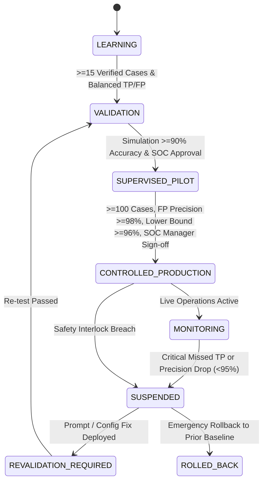

# Verdictum AI — Rule Lifecycle & Production Promotion Gating

**Document:** `10_RULE_LIFECYCLE_AND_PRODUCTION_PROMOTION.md`  
**Platform:** Verdictum AI / WyseSOC AI  
**Scope:** Rule Lifecycle States, Gating Criteria, Promotion Workflows & Governance  
**Status:** DRAFTED & VERIFIED  

---

## 1. Overview & Lifecycle Philosophy

Detection rules within Verdictum AI do not operate with uniform permissions. A newly introduced rule or untested prompt begins in an unprivileged learning state and must systematically advance through rigorous validation gates before qualifying for autonomous incident actions.



---

## 2. Five-Stage Lifecycle Definitions

### Stage 1: LEARNING
- **Operational Logic:** Ingestion and normalization active; AI generates proposed verdicts and claims; 100% of incidents route to the human review queue.
- **Automation Status:** **STRICTLY BLOCKED.** Zero automated closures; zero SIEM write-backs.
- **Primary Goal:** Accumulate unbiased, human-verified ground truth through double-blind reviews.

### Stage 2: VALIDATION
- **Operational Logic:** Candidate prompt templates in `PromptVersion` are benchmarked against historical evaluation runs (`HistoricalEvaluationRunRecord`).
- **Prerequisites:** At least 15 verified human reviews (minimum 5 TPs and 5 FPs).
- **Automation Status:** **STRICTLY BLOCKED.**

### Stage 3: SUPERVISED PILOT
- **Operational Logic:** AI generates verdicts in live operations; analysts receive pre-filled triage recommendations but must explicitly click "Confirm & Close" or "Reject".
- **Prerequisites:** Overall accuracy $\ge 90\%$, TP Recall $\ge 90\%$, verified sample size $\ge 30$, and zero unresolved contradiction guardrail failures.
- **Automation Status:** Semi-automated; requires explicit human confirmation click for every closure.

### Stage 4: CONTROLLED PRODUCTION
- **Operational Logic:** For incidents matching the explicitly approved rule, tenant, and archetype scope, validated False Positive decisions are eligible for autonomous closure.
- **Prerequisites:**
  1. Minimum 100 verified incidents (minimum 25 TPs and 50 FPs).
  2. Observed FP Prediction Precision $\ge 98.0\%$.
  3. Wilson 95% Confidence Lower Bound $\ge 96.0\%$.
  4. TP Recall $\ge 95.0\%$.
  5. Multi-signature SOC Manager and Platform Administrator cryptographic approval.
- **Automation Status:** **ENABLED** (strictly gated to validated False Positives).

### Stage 5: MONITORING
- **Operational Logic:** Continuous background evaluation during live production. 10% random sample of automated closures is routed to senior analysts for retrospective audit.
- **Telemetry Drift Detection:** Detects changes in firewall firmware, missing syslog fields, or anomalous increases in closure rates.

---

## 3. Auxiliary States & Emergency Handling

### SUSPENDED
- **Trigger:** Immediate automatic trigger upon detecting a single **Critical Missed TP** (where AI proposed FP on an actual confirmed attack) or if rolling 30-day FP precision falls below 95%.
- **Action:** Autonomous closure permissions revoked instantaneously (<100ms); rule reverts to 100% human review; emergency alert dispatched to SOC Manager.

### REVALIDATION_REQUIRED
- **Trigger:** Any update to rule logic, detection archetype, prompt template, or model version.
- **Action:** Production permissions suspended until candidate undergoes full historical replay in the Simulation Lab.

### ROLLED_BACK
- **Action:** Rule prompt and configuration restored to the previous verified stable snapshot ID.

---

## 4. Promotion Request & Sign-off Contract

Any promotion from `SUPERVISED_PILOT` to `CONTROLLED_PRODUCTION` requires formal API submission:
```json
{
  "rule_id": "PH_RULE_WEB_POL_VIOLATION_SAME_SRC_SAME_DEST",
  "customer": "Customer_A",
  "target_stage": "CONTROLLED_PRODUCTION",
  "prompt_version_id": "prompt-v2-sha256-abcdef",
  "model_identifier": "Qwen/Qwen2.5-7B-Instruct-AWQ",
  "evaluation_run_id": "eval-run-9839fa49",
  "metrics_summary": {
    "total_verified": 142,
    "tp_count": 38,
    "fp_count": 104,
    "fp_precision": 0.9904,
    "wilson_lower_bound_95": 0.9632,
    "tp_recall": 0.9737
  },
  "justification": "Completed 60-day supervised pilot with 0 missed true positives and >96% statistical lower bound.",
  "approver_user_id": "soc-manager-uuid"
}
```
Unauthorized promotion attempts return `403 Forbidden` and trigger a security audit event.

