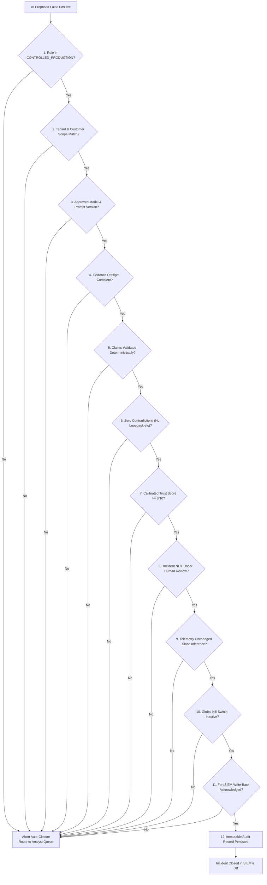

# Verdictum AI — Production Automation & Safety Controls

**Document:** `11_PRODUCTION_AUTOMATION_AND_SAFETY.md`  
**Platform:** Verdictum AI / WyseSOC AI  
**Scope:** Automated Incident Closure Safety Gates, Idempotency & FortiSIEM Write-Back  
**Status:** DRAFTED & VERIFIED  

---

## 1. Safety Principles & Default Inactive Stance

Autonomous modification of live security infrastructure is the most critical operational action in an enterprise SOC. A single improper closure of an active cyberattack can lead to an undetected data breach.

### Foundational Invariants:
1. **Disabled by Default:** The global setting `ALLOW_AUTO_INCIDENT_CLOSURE` defaults strictly to `false`.
2. **Never Close on LLM Output Alone:** Model inference produces a recommendation; only independent deterministic evidence validation can satisfy the closure condition.
3. **No Automated True Positive Closures:** True Positive incidents represent active attacks. The system NEVER automatically closes a True Positive; it escalates, notifies, and keeps the incident open.
4. **Fail-Closed on All Errors:** Network timeouts, schema mismatches, SIEM write-back errors, or validator rejections immediately cancel closure and preserve the incident for human triage.

---

## 2. 12-Point Safety Barrier Checklist for Automated Closure

Before any automated False Positive closure is transmitted to FortiSIEM, all 12 gates must pass cleanly:



1. **Rule Production Authorization:** Rule must be actively in `CONTROLLED_PRODUCTION` state.
2. **Customer / Tenant Matching:** Target incident customer matches approved profile tenant.
3. **Approved Model & Prompt:** Hash of active prompt matches approved production digest.
4. **Evidence Preflight Pass:** Mandatory canonical fields present and verified.
5. **Independent Claim Validation:** All model assertions matched against canonical evidence.
6. **Zero Contradictions:** No loopback hypotheses on external IPs; no ungrounded authorization claims.
7. **High Calibrated Trust:** Trust score must be $\ge 8/10$ with empirical precision $\ge 98\%$.
8. **No Active Human Review:** Investigation status is `PENDING_REVIEW` (not assigned to an analyst).
9. **Evidence Immutability Recheck:** Incident SHA-256 telemetry digest has not changed since inference.
10. **Global Safety Kill-Switch:** `AUTOMATION_ENABLED` is `true`.
11. **FortiSIEM Write-Back Confirmation:** FortiSIEM API returns HTTP 200 with matching update acknowledgment.
12. **Cryptographic Audit Log:** Complete audit entry recorded in `IncidentAutomationAudit`.

---

## 3. Idempotency & Concurrency Protection

To prevent duplicate closures and race conditions when multiple workers operate in parallel:
- **Distributed Locking:** Uses Redis or database distributed locks (`DistributedLock`) on `incident_id` during closure execution with a 30-second TTL.
- **Idempotency Key:** Every closure generates a unique SHA-256 idempotency key:
  $$\text{Key} = \text{SHA-256}(incident\_id + rule\_id + prompt\_version + closure\_epoch)$$
- **State Transition Check:** Closure SQL uses conditional updates (`UPDATE incidents SET status_code=2 WHERE id=:id AND status_code=1`), preventing double-execution.

---

## 4. FortiSIEM Write-Back Adapter

When closing an incident, `FortiSIEMService.update_incident_status` executes:
- **Endpoint:** `POST /phoenix/rest/incident/update`
- **Payload:**
  ```json
  {
    "incidentId": "176061",
    "status": "Closed",
    "resolution": "False Positive",
    "clearedReason": "Automated closure by Verdictum AI (Controlled Production Rule PH_RULE_WEB_POL_VIOLATION_SAME_SRC_SAME_DEST). Validated legitimate business asset access.",
    "comments": "Audit Reference: AUTO-CLS-9839fa49-f8905866. Evidence verified clean."
  }
  ```
- **Error Handling:** If FortiSIEM returns 5xx, timeout, or invalid session, the write-back is marked as `FAILED`, local database update is canceled, and the incident is flagged with `WRITEBACK_FAILED_ATTENTION_REQUIRED`.

