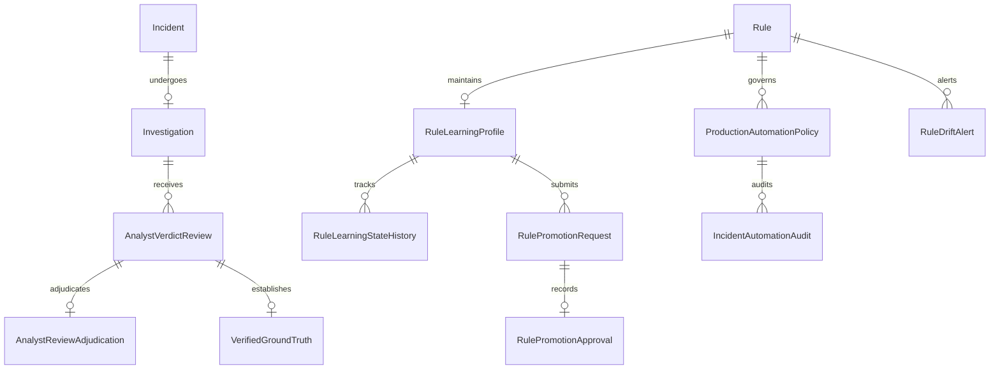

# Verdictum AI — Database & Data Model Architecture

**Document:** `12_DATABASE_AND_DATA_MODEL_DESIGN.md`  
**Platform:** Verdictum AI / WyseSOC AI  
**Scope:** Schema Architecture, Entity Relationships, Indices & Migrations  
**Status:** DRAFTED & VERIFIED  

---

## 1. Overview & Data Layer Strategy

The Verdictum AI data layer is designed for backward-compatible extension of the existing SQLAlchemy 2.0 schema, avoiding disruptive refactoring while adding first-class support for rule learning profiles, blind analyst reviews, verified ground truth, candidate prompt evaluations, and production governance.

### Architectural Reuse Map:
- **`incidents` & `incident_events`**: Preserved as authoritative raw telemetry repositories.
- **`rules` & `rule_intelligence_snapshots`**: Preserved for canonical rule identity and semantic definitions.
- **`rule_prompts` & `prompt_versions`**: Reused and extended for prompt templates and candidate versions.
- **`investigations`**: Extended to support double-blind review states and adjudication flags.
- **`ground_truth_validations` & `learning_records`**: Extended for verified ground truth and rule learning datasets.
- **`historical_evaluation_runs` & `historical_evaluation_results`**: Extended for Simulation Lab replay metrics.
- **`pilot_configurations` & `pilot_evaluations`**: Extended for production promotion and automation policies.

---

## 2. New & Extended Entity Specifications

### 2.1 `RuleLearningProfile` (`rule_learning_profiles`)
Maintains per-rule, per-tenant operational learning metrics and active lifecycle state.
- **`id`**: String(36), PK (UUIDv4).
- **`rule_id`**: String(36), FK $\to$ `rules.id`, indexed, nullable=False.
- **`customer`**: String(128), default="DEFAULT", indexed, nullable=False (Tenant isolation).
- **`lifecycle_stage`**: String(32), default="LEARNING", indexed (`LEARNING`, `VALIDATION`, `SUPERVISED_PILOT`, `CONTROLLED_PRODUCTION`, `MONITORING`, `SUSPENDED`).
- **`active_prompt_version_id`**: String(36), FK $\to$ `prompt_versions.id`, nullable=True.
- **`active_model_identifier`**: String(64), default="Qwen/Qwen2.5-7B-Instruct-AWQ".
- **`total_incidents_processed`**: Integer, default=0.
- **`total_analyst_reviews`**: Integer, default=0.
- **`verified_tp_count`**: Integer, default=0.
- **`verified_fp_count`**: Integer, default=0.
- **`ai_correct_count`**: Integer, default=0.
- **`ai_incorrect_count`**: Integer, default=0.
- **`abstention_count`**: Integer, default=0.
- **`validation_failure_count`**: Integer, default=0.
- **`empirical_accuracy`**: Float, nullable=True.
- **`fp_precision`**: Float, nullable=True.
- **`tp_recall`**: Float, nullable=True.
- **`wilson_lower_bound`**: Float, nullable=True.
- **`error_distribution`**: JSON, default=dict.
- **`created_at`** & **`updated_at`**: DateTime (UTC).
- **Constraints / Indices:** `UniqueConstraint("rule_id", "customer", name="uq_rule_customer_learning")`.

### 2.2 `RuleLearningStateHistory` (`rule_learning_state_history`)
Immutable audit log recording every transition between lifecycle states.
- **`id`**: String(36), PK.
- **`profile_id`**: String(36), FK $\to$ `rule_learning_profiles.id`, indexed.
- **`previous_stage`**: String(32), nullable=False.
- **`new_stage`**: String(32), nullable=False.
- **`transition_reason`**: Text, default="".
- **`triggered_by_user_id`**: String(36), FK $\to$ `users.id`, nullable=True.
- **`metrics_snapshot`**: JSON, default=dict.
- **`created_at`**: DateTime (UTC).

### 2.3 `AnalystVerdictReview` (`analyst_verdict_reviews`)
Stores individual analyst submissions with support for double-blind workflows.
- **`id`**: String(36), PK.
- **`incident_id`**: String(36), FK $\to$ `incidents.id`, indexed, nullable=False.
- **`investigation_id`**: String(36), FK $\to$ `investigations.id`, indexed, nullable=False.
- **`reviewer_id`**: String(36), FK $\to$ `users.id`, indexed, nullable=False.
- **`analyst_verdict`**: String(32), nullable=False (`TRUE_POSITIVE`, `FALSE_POSITIVE`, `INSUFFICIENT_EVIDENCE`).
- **`analyst_notes`**: Text, default="".
- **`correction_reason`**: String(64), nullable=True.
- **`evidence_references`**: JSON, default=list.
- **`blind_mode_active`**: Boolean, default=True.
- **`revealed_ai_verdict`**: String(32), nullable=True.
- **`comparison_outcome`**: String(64), nullable=True (`AGREEMENT_TP`, `AGREEMENT_FP`, `AI_FALSE_ALARM`, `CRITICAL_MISSED_TP`, `PREMATURE_AI_VERDICT`).
- **`review_version`**: Integer, default=1.
- **`created_at`**: DateTime (UTC).

### 2.4 `RulePromotionRequest` & `RulePromotionApproval`
Governs formal promotion requests and dual-key approval sign-offs.
- **`RulePromotionRequest` (`rule_promotion_requests`)**:
  - `id`: String(36), PK.
  - `profile_id`: String(36), FK $\to `rule_learning_profiles.id`.
  - `requested_stage`: String(32), nullable=False.
  - `requester_user_id`: String(36), FK $\to `users.id`.
  - `status`: String(32), default="PENDING" (`PENDING`, `APPROVED`, `REJECTED`, `CANCELED`).
  - `evaluation_run_id`: String(36), FK $\to `historical_evaluation_runs.id`.
  - `supporting_metrics`: JSON.
  - `justification`: Text.
  - `created_at`: DateTime (UTC).
- **`RulePromotionApproval` (`rule_promotion_approvals`)**:
  - `id`: String(36), PK.
  - `request_id`: String(36), FK $\to `rule_promotion_requests.id`, unique.
  - `approver_user_id`: String(36), FK $\to `users.id`.
  - `action`: String(32), nullable=False (`APPROVED`, `REJECTED`).
  - `decision_notes`: Text.
  - `approval_signature`: String(128).
  - `approved_at`: DateTime (UTC).

### 2.5 `ProductionAutomationPolicy` & `IncidentAutomationAudit`
Tracks production auto-closure permissions and full audit trails for SIEM actions.
- **`ProductionAutomationPolicy` (`production_automation_policies`)**:
  - `id`: String(36), PK.
  - `profile_id`: String(36), FK $\to `rule_learning_profiles.id`, unique.
  - `is_enabled`: Boolean, default=False.
  - `allowed_verdicts`: JSON, default=lambda: ["FALSE_POSITIVE"].
  - `min_trust_score`: Integer, default=8.
  - `min_fp_precision`: Float, default=0.98.
  - `daily_closure_limit`: Integer, default=50.
  - `emergency_disable`: Boolean, default=False.
- **`IncidentAutomationAudit` (`incident_automation_audits`)**:
  - `id`: String(36), PK.
  - `incident_id`: String(64), index=True.
  - `rule_id`: String(128), index=True.
  - `customer`: String(128).
  - `action_type`: String(64) (`AUTO_CLOSE_FP`, `ESCALATE_TP`, `ABSTAIN_RA`).
  - `siem_target`: String(64), default="FortiSIEM".
  - `siem_response_code`: Integer.
  - `siem_transaction_id`: String(128).
  - `execution_status`: String(32) (`SUCCESS`, `FAILED`, `SIMULATED`).
  - `safety_checks_passed`: JSON.
  - `executed_at`: DateTime (UTC).

---

## 3. Migration & Backward Compatibility Strategy

1. **Non-Destructive Additions:** All new models are introduced via non-destructive table creations and optional column additions.
2. **Zero Historical Invalidation:** Existing `incidents`, `rules`, and `investigations` rows remain completely intact.
3. **Automated Bootstrapping:** A lightweight initialization routine inspects existing `rules` and automatically generates initial `RuleLearningProfile` records in `LEARNING` mode for any rule lacking a profile.

