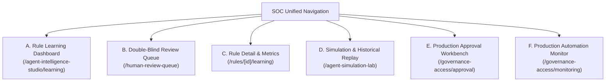

# Verdictum AI — Frontend UI/UX Architecture & Component Design

**Document:** `14_FRONTEND_UI_UX_DESIGN.md`  
**Platform:** Verdictum AI / WyseSOC AI  
**Scope:** Next.js UI Extension, Analyst Review Workbench & Learning Dashboard  
**Status:** DRAFTED & VERIFIED  

---

## 1. UI Design Principles & Design System

Verdictum AI adheres to the established Agent Intelligence Studio 2.0 visual language:
- **Theme:** High-density SOC dark theme with high-contrast evidential accents:
  - Emerald (`#10b981`): Validated False Positives / High Trust.
  - Rose (`#f43f5e`): Confirmed True Positives / Security Breaches.
  - Amber (`#f59e0b`): Requires Attention / Inconclusive / Escalation.
  - Slate (`#1e293b`): Neutral telemetry and background cards.
- **Density:** Compact, tabular layout prioritizing data density and rapid analyst scanning.
- **Accessibility:** Keyboard shortcuts (`1` for TP, `2` for FP, `3` for Requires Attention), high contrast text, screen reader accessibility.
- **Zero Disruption:** Preserves existing route structure under `/agent-intelligence-studio`, `/agent-simulation-lab`, `/ai-triage-workbench`, and `/human-review-queue`.

---

## 2. Six Core UI Modules

### Module A: Rule Learning Dashboard (`/agent-intelligence-studio/learning`)
- **Metric Badges:** Active Rules, In Learning Mode, In Supervised Pilot, In Controlled Production, Rules Suspended.
- **Learning Data Table:**
  - Rule Canonical ID & Display Name.
  - Archetype badge (`POLICY_VIOLATION`, `EXTERNAL_ATTACK`, etc.).
  - Total Incidents vs Verified Human Reviews.
  - Verified TP / FP Split.
  - Empirical FP Precision with 95% Wilson Lower Bound.
  - Automation Eligibility Pill (`Eligible (96.5% LB)`, `Ineligible (Insufficient Data)`, `Suspended`).
  - Active Prompt Version & Model ID.

### Module B: Analyst Review Queue (`/human-review-queue`)
- **Double-Blind Triage Layout:**
  - **Left Pane:** Canonical evidence table, raw syslog log viewer, key-value provenance tokens, and detection condition checklist.
  - **Right Pane:** Independent review card. By default, the AI verdict is masked with a "Blind Review Active" shield.
  - **Action Buttons:** Large high-contrast buttons: `True Positive (1)`, `False Positive (2)`, `Insufficient Evidence (3)`.
  - **Post-Submission Reveal:** Once the analyst clicks an option, the shield fades, revealing the original AI verdict, trust score, and agreement badge (`Agreement TP`, `FP Override`, etc.).

### Module C: Rule Detail Page (`/rules/[id]/learning`)
- **Header:** Canonical Rule ID, Archetype, Customer Scope, Lifecycle Stage.
- **Confusion Matrix Card:** Interactive $2 \times 2$ grid with breakdown of TP, FP, FN, and Abstentions.
- **Statistical Gauge:** Wilson Score 95% Confidence Interval visualization highlighting lower bound vs the 96% production threshold.
- **Error Distribution Breakdown:** Bar chart displaying error categories (`HALLUCINATION`, `CONTRADICTION`, `MISSING_EVIDENCE`, etc.).

### Module D: Learning & Simulation Lab (`/agent-simulation-lab`)
- **Funnel Diagnostics Widget:** Eliminates the opaque `INSUFFICIENT_DATA` message by displaying:
  $$\text{Scanned (500)} \to \text{Matched Rule (480)} \to \text{Human Verified (68)} \to \text{Eligible Holdout (50)} \to \text{Evaluated (50)}$$
- **Candidate Replay Comparator:** Side-by-side performance diff comparing Active Production Prompt vs Candidate Prompt.
- **Execution Mode Badges:** Distinguishes `REAL_LOCAL_LLM`, `REPLAY_CACHE`, and `SIMULATED_MOCK`.

### Module E: Production Approval Workbench (`/governance-access/approval`)
- **Promotion Checklist Card:** Displays green/red checkmarks for all 5 mandatory criteria:
  - Minimum 100 verified incidents.
  - Observed FP precision $\ge 98\%$.
  - Wilson 95% lower bound $\ge 96\%$.
  - TP recall $\ge 95\%$.
  - Zero critical missed TPs in last 30 days.
- **Dual-Key Approval Form:** Requester justification, reviewer signature input, and "Approve for Production" button (disabled if criteria fail).

### Module F: Production Monitoring (`/governance-access/monitoring`)
- **Real-Time Feed:** Live stream of automated False Positive closures.
- **Write-Back Status:** Displays FortiSIEM transaction IDs, response latencies, and confirmation badges.
- **Emergency Kill-Switch Banner:** Sticky red banner with "EMERGENCY SUSPEND ALL AUTOMATION" button requiring single-click confirmation.

