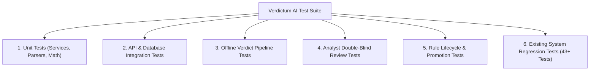

# Verdictum AI — Testing & Acceptance Master Plan

**Document:** `16_TESTING_AND_ACCEPTANCE_PLAN.md`  
**Platform:** Verdictum AI / WyseSOC AI  
**Scope:** Test Strategy, Offline Test Harness, Regression Verification & Acceptance Gates  
**Status:** DRAFTED & VERIFIED  

---

## 1. Testing Philosophy & Offline Harness Strategy

A core constraint of Verdictum AI is that both the demo FortiSIEM appliance and the GPU-backed LLM daemon (Server 2) may be offline during development and automated CI runs. Therefore, the testing architecture is designed to execute comprehensively in an **Offline Test Harness**:
- **Offline Incident Fixtures:** Real, sanitized FortiSIEM payloads and raw syslog events (including Incident #176061) stored as local test fixtures.
- **Deterministic Mock Model Provider (`SIMULATED`):** Evaluates prompts against configurable response generators, validating JSON compliance, claim grounding, and contradiction guardrails without external network dependencies.
- **In-Memory SQLite Database:** Rapid, isolated test execution using `sqlite+aiosqlite:///:memory:`.

---

## 2. Test Suite Categorization & Coverage Requirements

### 2.1 Test Matrix & Execution Environment

| Category | Suite Identifier | Target Scope | Offline Capable? | Mandatory Passing Target |
|---|---|---|---|---|
| **Unit Tests** | `test_evidence_normalization` | Key-value tokenizer, vendor alias mapping, canonical path resolution. | Yes | 100% (Green) |
| **Unit Tests** | `test_wilson_confidence_interval` | Wilson score 95% confidence bounds, small-sample protections. | Yes | 100% (Green) |
| **Unit Tests** | `test_model_claim_extractor` | JSON parsing, type-aware value comparison (IP, integer, URL). | Yes | 100% (Green) |
| **Pipeline Tests** | `test_verdict_pipeline_offline` | End-to-end pipeline with sanitized payloads, simulated provider, and validator. | Yes | 100% (Green) |
| **Guardrail Tests** | `test_loopback_contradiction_guard` | Rejection of loopback claims on external IPs; confidence zeroing. | Yes | 100% (Green) |
| **Analyst Tests** | `test_analyst_review_workflow` | Double-blind review submission, post-submission reveal, audit append. | Yes | 100% (Green) |
| **Adjudication Tests**| `test_adjudication_resolution` | L2 dispute resolution, ground truth immutability. | Yes | 100% (Green) |
| **Learning Tests** | `test_rule_learning_registry` | Profile metrics aggregation, error taxonomy categorization. | Yes | 100% (Green) |
| **Simulation Tests** | `test_simulation_funnel_diagnostics` | Transparent funnel reporting (scanned, excluded, evaluated). | Yes | 100% (Green) |
| **Governance Tests** | `test_production_promotion_gates` | Gating criteria enforcement; rejection of sub-threshold promotion. | Yes | 100% (Green) |
| **Safety Tests** | `test_auto_closure_safety_barriers` | 12-barrier checklist; fail-closed behavior on unverified claims. | Yes | 100% (Green) |
| **Multi-Tenant Tests**| `test_tenant_isolation_boundaries` | Cross-tenant data bleed prevention across profiles and approvals. | Yes | 100% (Green) |
| **Regression Tests** | `test_verdict_intelligence_validation`| Existing 43 unit tests covering trust scores, archetypes, and API. | Yes | 100% (Green) |
| **Frontend Tests** | Next.js build verification | Compilation of Next.js 14 App Router pages (`next build`). | Yes | 0 TypeScript Errors |

---

## 3. Mandatory Offline Test Scenarios

### Scenario 1: Telemetry Normalization & Missing Field Handling
- **Input:** Perimeter firewall drops HTTPS connection at TCP SYN. Emits `srcip`, `dstip`, `url`, `action="blocked"`, but no `http.method` or `http.status_code`.
- **Expected Outcome:** Normalized to `POLICY_VIOLATION`. Preflight validator marks HTTP method as conditional (`NOT_IN_SOURCE`). Pipeline does NOT flag missing evidence error.

### Scenario 2: Hallucinated Internal Loopback Defense
- **Input:** LLM claims traffic between `192.0.2.48` and external IP `198.51.100.32` is internal loopback, proposing `FALSE_POSITIVE` with 85% confidence.
- **Expected Outcome:** `IndependentVerdictValidator` detects contradiction, forces effective verdict to `REQUIRES_ATTENTION`, zeroes confidence (`0.0%`), and logs `LOOPBACK_CLAIMED_ON_EXTERNAL_TRAFFIC`.

### Scenario 3: Double-Blind Review Verification
- **Input:** Incident with AI proposed verdict `TRUE_POSITIVE`. Analyst submits independent determination `FALSE_POSITIVE` with rationale.
- **Expected Outcome:** Submission accepted; comparison recorded as `AI_FALSE_ALARM`; ground truth saved as `VERIFIED_FP`; rule profile increments `ai_incorrect_count` and updates FP precision.

### Scenario 4: Statistical Small-Sample Gating
- **Input:** Rule with 5 verified incidents (5/5 correct FP predictions, 100% sample precision). Promotion request submitted for `CONTROLLED_PRODUCTION`.
- **Expected Outcome:** Wilson 95% lower bound is $56.6\% < 96.0\%$. Promotion request is rejected with `INSUFFICIENT_SAMPLE_SIZE`.

### Scenario 5: Emergency Kill-Switch Interlock
- **Input:** Rule in `CONTROLLED_PRODUCTION` triggers auto-closure. `AUTOMATION_ENABLED` is set to `false`.
- **Expected Outcome:** Pre-closure safety check fails at Gate 10; write-back canceled; incident preserved in open analyst queue.

---

## 4. Acceptance Sign-off Criteria

1. **Test Green Gate:** All unit, integration, and offline pipeline tests pass with 100% green status.
2. **Regression Zero Defect Gate:** All existing 43 tests in `test_verdict_intelligence_validation.py` continue to pass without modification.
3. **Frontend Compilation Gate:** `npm run build` succeeds with zero TypeScript errors or broken imports.
4. **Security & Secrets Gate:** RepoDeploy Governor security scan confirms clean status with zero hardcoded credentials, unmasked IPs, or forbidden files.

