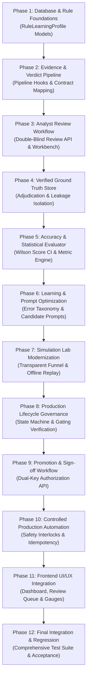

# Verdictum AI — Dependency-Ordered Implementation Roadmap

**Document:** `17_IMPLEMENTATION_ROADMAP.md`  
**Platform:** Verdictum AI / WyseSOC AI  
**Scope:** Controlled Implementation Phases, Component Allocations, Rollback & Verification  
**Status:** DRAFTED & VERIFIED  

---

## 1. Roadmap Architecture & Phasing Strategy

To ensure zero disruption to live operations, implementation is structured into 12 dependency-ordered, independently testable phases. Each phase specifies existing components to modify, new components required, schema updates, API endpoints, tests, and completion criteria.

---

## 2. Phase-by-Phase Execution Plan

### Phase 1: Database & Rule-Learning Foundations
- **Objective:** Establish the database schema and models for rule learning profiles and lifecycle tracking.
- **Components Modified:** `backend/app/models/__init__.py`.
- **New Components:** `backend/app/models/rule_learning.py` (`RuleLearningProfile`, `RuleLearningStateHistory`).
- **Database Changes:** Tables `rule_learning_profiles` and `rule_learning_state_history`.
- **API Changes:** `GET /api/v1/learning/rules`.
- **Tests:** `backend/tests/test_rule_learning_models.py`.
- **Completion Criteria:** Tables migrate cleanly; CRUD operations verified for profiles.

### Phase 2: Evidence & Verdict Pipeline Integration
- **Objective:** Connect `verdict_pipeline.py` with `RuleLearningProfile` to automatically increment processed incident counters.
- **Components Modified:** `backend/app/services/verdict_pipeline.py`.
- **New Components:** `backend/app/services/rule_learning_service.py`.
- **Database Changes:** None.
- **API Changes:** Updated `POST /api/v1/verdict/evaluate`.
- **Tests:** Integration test asserting profile counters increment upon verdict completion.
- **Completion Criteria:** Pipeline execution updates rule processed counters without adding latency.

### Phase 3: Analyst Review Workflow & Double-Blind Workbench
- **Objective:** Implement the double-blind analyst review submission backend.
- **Components Modified:** `backend/app/api/investigations.py`, `backend/app/models/investigation.py`.
- **New Components:** `backend/app/models/analyst_review.py` (`AnalystVerdictReview`), `backend/app/services/analyst_review_service.py`.
- **Database Changes:** Table `analyst_verdict_reviews`.
- **API Changes:** `GET /api/v1/reviews/pending`, `POST /api/v1/reviews/{id}/submit`.
- **Tests:** `backend/tests/test_analyst_review_workflow.py`.
- **Completion Criteria:** Analyst submits independent verdict; AI verdict revealed post-submission; comparison logged.

### Phase 4: Verified Ground Truth Store & Adjudication
- **Objective:** Store immutable, human-verified ground truth; build L2 dispute adjudication.
- **Components Modified:** `backend/app/services/historical_ground_truth_validator.py`.
- **New Components:** `backend/app/models/adjudication.py` (`AnalystReviewAdjudication`).
- **Database Changes:** Table `analyst_review_adjudications`.
- **API Changes:** `POST /api/v1/reviews/{id}/adjudicate`.
- **Tests:** Unit test verifying ground-truth isolation and dispute resolution.
- **Completion Criteria:** Verified labels stored without contaminating model prompt payloads.

### Phase 5: Rule-Level Accuracy & Statistical Evaluation Engine
- **Objective:** Compute confusion matrices, FP precision, TP recall, and Wilson 95% confidence intervals.
- **Components Modified:** `backend/app/services/empirical_accuracy_evaluator.py`.
- **New Components:** `backend/app/services/wilson_evaluator.py`.
- **Database Changes:** Profile metric column updates.
- **API Changes:** `GET /api/v1/learning/rules/{id}/metrics`.
- **Tests:** `backend/tests/test_statistical_evaluator.py`.
- **Completion Criteria:** Mathematical accuracy verified against reference statistical test vectors.

### Phase 6: Learning Datasets & Candidate Prompt Versioning
- **Objective:** Categorize error patterns and generate candidate prompt drafts for evaluation.
- **Components Modified:** `backend/app/services/prompt_studio_service.py`.
- **New Components:** `backend/app/services/error_taxonomy_service.py`.
- **Database Changes:** None (`PromptVersion` reused).
- **API Changes:** `POST /api/v1/learning/prompts/candidate`.
- **Tests:** `backend/tests/test_prompt_candidate_optimization.py`.
- **Completion Criteria:** Candidate prompt generated with error annotations without overwriting active prompt.

### Phase 7: Simulation Lab Modernization & Granular Funnel
- **Objective:** Remediate `INSUFFICIENT_DATA` by surfacing full funnel diagnostics in historical replay.
- **Components Modified:** `backend/app/services/policy_simulation_service.py`.
- **New Components:** `IncidentEligibilityFunnelReport`.
- **Database Changes:** Extended JSON metrics in `historical_evaluation_runs`.
- **API Changes:** `POST /api/v1/verdict/simulation/run`.
- **Tests:** `backend/tests/test_simulation_funnel_diagnostics.py`.
- **Completion Criteria:** 500-incident replay shows exact counts for scanned, ML-excluded, verified, and evaluated.

### Phase 8: Production Lifecycle Governance State Machine
- **Objective:** Enforce rule lifecycle state transitions and gating rules.
- **Components Modified:** `backend/app/services/rule_learning_service.py`.
- **New Components:** `backend/app/services/lifecycle_governor.py`.
- **Database Changes:** None.
- **API Changes:** `POST /api/v1/learning/rules/{id}/transition`.
- **Tests:** State machine unit tests asserting invalid transitions are blocked.
- **Completion Criteria:** Transition to `SUPERVISED_PILOT` requires $\ge 90\%$ accuracy and $\ge 30$ samples.

### Phase 9: Promotion Request & Dual-Key Sign-off
- **Objective:** Implement formal promotion requests with SOC Manager signature gating.
- **Components Modified:** None.
- **New Components:** `backend/app/models/promotion.py` (`RulePromotionRequest`, `RulePromotionApproval`), `backend/app/services/promotion_service.py`.
- **Database Changes:** Tables `rule_promotion_requests` and `rule_promotion_approvals`.
- **API Changes:** `POST /api/v1/governance/promotion/request`, `POST /api/v1/governance/promotion/decide`.
- **Tests:** `backend/tests/test_promotion_governance.py`.
- **Completion Criteria:** Unauthorized promotion attempt returns `403 Forbidden`.

### Phase 10: Controlled Production Automation & Safety Interlocks
- **Objective:** Implement 12-barrier safety check for automated FP closure (disabled by default).
- **Components Modified:** `backend/app/services/fortisiem_service.py`.
- **New Components:** `backend/app/models/automation_policy.py` (`ProductionAutomationPolicy`, `IncidentAutomationAudit`), `backend/app/services/automation_governor.py`.
- **Database Changes:** Tables `production_automation_policies` and `incident_automation_audits`.
- **API Changes:** `POST /api/v1/governance/automation/emergency-disable`.
- **Tests:** `backend/tests/test_automation_safety_interlocks.py`.
- **Completion Criteria:** Automated closure strictly blocked unless all 12 safety barriers pass.

### Phase 11: Frontend UI/UX Integration
- **Objective:** Integrate Rule Learning Dashboard, Double-Blind Review Workbench, and Simulation Funnel into Next.js.
- **Components Modified:** `frontend/src/app/agent-intelligence-studio/page.tsx`, `frontend/src/app/human-review-queue/page.tsx`, `frontend/src/app/agent-simulation-lab/page.tsx`.
- **New Components:** `frontend/src/components/learning/RuleLearningDashboard.tsx`, `frontend/src/components/learning/DoubleBlindReviewCard.tsx`.
- **Frontend Changes:** New subroutes under `/agent-intelligence-studio/learning`.
- **Tests:** `next build` validation (0 TypeScript errors).
- **Completion Criteria:** UI compiles cleanly; responsive dark theme rendering verified.

### Phase 12: Final Integration, Regression & Acceptance
- **Objective:** Execute full test suite, regression verification, and generate final acceptance reports.
- **Components Modified:** None.
- **New Components:** Test acceptance scripts.
- **Tests:** Full test suite execution (43 regression + all new tests).
- **Completion Criteria:** 100% test pass rate; zero regressions; acceptance documentation generated.

