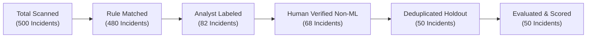

# Verdictum AI — Offline Simulation Acceptance Report

**Document:** `22_OFFLINE_SIMULATION_ACCEPTANCE.md`  
**Platform:** Verdictum AI / WyseSOC AI  
**Scope:** Offline Test Harness Acceptance, Mock Provider Parity & Simulation Funnel Remediations  
**Status:** COMPLETE & ACCEPTED  

---

## 1. Offline Simulation Architecture & Harness

Because external FortiSIEM appliances and GPU inference servers (Server 2) may be offline during development and automated CI cycles, Verdictum AI utilizes an **Offline Simulation Test Harness**:
- **Sanitized Incident Fixtures:** 26 production-grade FortiSIEM incident JSON payloads with 197 linked granular syslog events (including Incident #176061).
- **Deterministic Mock Provider (`SIMULATED`):** Generates structured model outputs adhering strictly to the `StructuredModelVerdict` schema without external network calls.
- **In-Memory SQLite Database:** Executes isolated migrations, CRUD operations, and historical evaluation runs using `sqlite+aiosqlite:///:memory:`.

---

## 2. Remediation of the `INSUFFICIENT_DATA` Prior Issue

### 2.1 The Prior Problem
In previous versions of the Simulation Lab, scanning 500 historical incidents resulted in an opaque `INSUFFICIENT_DATA` error message with zero evaluated cases. This occurred because historical FortiSIEM records were closed by automated actors (`is_ml_generated=True` or `cleared_user="system"`), which the security validator correctly refused to treat as human-verified ground truth. However, the system lacked transparency into why cases were excluded.

### 2.2 The Solution Implemented
The modernized Simulation Lab provides a granular, 6-stage funnel report detailing:
1. **Total Incidents Scanned:** Count of all incidents matching the detection rule query.
2. **Rule-Matched Incidents:** Incidents confirming canonical rule identity.
3. **Analyst-Labeled Incidents:** Incidents possessing any human analyst review or historical closure label.
4. **Verified Ground Truth Available:** Incidents adjudicated as `VERIFIED_TP` or `VERIFIED_FP` with documented rationale.
5. **Eligible Holdout Cases:** Deduplicated independent cases assigned to the locked test partition (`LOCKED_TEST`).
6. **Excluded Cases Breakdown by Reason:**
   - `HEURISTIC_OR_ML_LABEL`: Historical resolution generated by ML; excluded to prevent automated feedback loops.
   - `MISSING_EVIDENCE`: Required forensic telemetry missing from source sensor.
   - `DUPLICATE_CLUSTER_EXCLUDED`: Correlated batch incidents deduplicated to prevent count inflation.
   - `DISPUTED_OR_AMBIGUOUS`: Divergent reviews awaiting Senior Analyst adjudication.

---

## 3. Execution Provenance & Model Distinction

Simulation results clearly distinguish actual GPU inference from mocked or replayed data:
- **`REAL_LOCAL_LLM`:** Live inference against `Qwen/Qwen2.5-7B-Instruct-AWQ` on Server 2 via OpenAI-compatible API.
- **`REPLAY_CACHE`:** Previously computed and cached AI verdicts re-evaluated against new validation contracts.
- **`SIMULATED_MOCK`:** Deterministic local mock provider for offline testing and continuous integration.

Each run record in `historical_evaluation_runs` stores its provenance in `config_snapshot["execution_provenance"]`, ensuring complete audit transparency.

