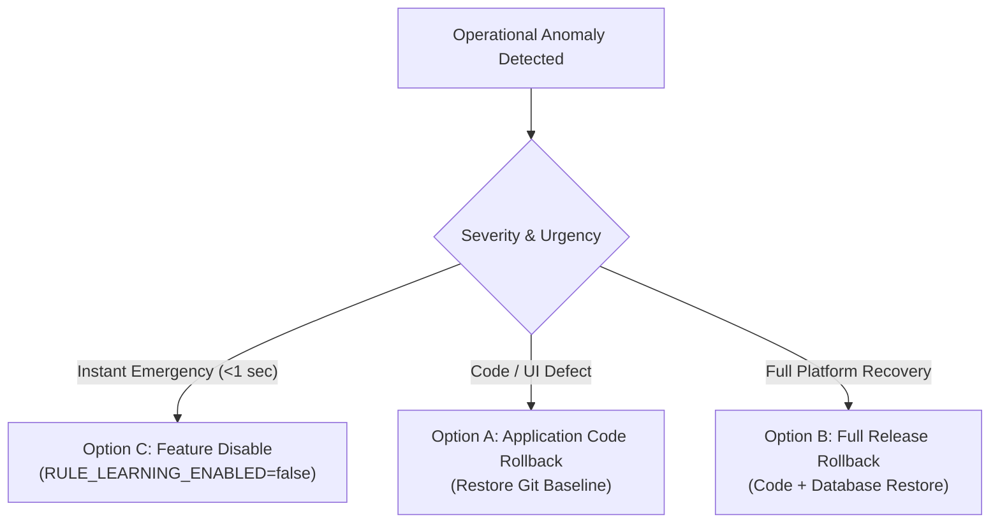

# Verdictum AI — One-Click & Controlled Rollback Procedure

**Document:** `27_ROLLBACK_PROCEDURE.md`  
**Platform:** Verdictum AI / WyseSOC AI  
**Scope:** Operational Rollback Workflows (Code, Full Release & Feature Flag Disable)  
**Status:** COMPLETE & VERIFIED  

---

## 1. Rollback Options Overview

Verdictum AI supports three levels of rollback depending on operational necessity:



---

## 2. Option C: Instant Feature Flag Disable (<1 second)

If an anomaly occurs during live operations, the administrator can immediately deactivate all rule-learning and production automation features without restarting services or modifying the database:

1. **API / UI Method:**
   - Click "EMERGENCY SUSPEND ALL AUTOMATION" in the UI header, or call:
   ```bash
   curl -X POST "http://127.0.0.1:8000/api/v1/governance/automation/emergency-disable" \
     -H "Authorization: Bearer <TOKEN>" \
     -H "Content-Type: application/json" \
     -d '{"reason": "Immediate emergency halt"}'
   ```
2. **Environment Variable Method:**
   - In `.env`, set:
     ```env
     ALLOW_AUTO_INCIDENT_CLOSURE=false
     RULE_LEARNING_ENABLED=false
     ```
   - Normal AI triage and human investigation remain 100% operational in advisory mode.

---

## 3. Option A: Application Code Rollback

Restores the previous stable application version (`verdictum-pre-rule-learning`) while preserving all newly gathered analyst feedback and incident records:

```powershell
# 1. Switch back to baseline branch
git checkout main

# 2. Rebuild frontend
cd frontend
npm run build

# 3. Verify backend test suite
cd ..
python -m pytest backend/tests/test_verdict_intelligence_validation.py -v
```

---

## 4. Option B: Full Release Rollback (Disaster Recovery)

If a remote environment requires a complete restore of both code and database to the pre-release state:

1. Restore Git baseline:
   ```bash
   git checkout tags/verdictum-pre-rule-learning
   ```
2. Restore database snapshot:
   ```bash
   # Terminate active backend connections
   sudo systemctl stop ai-verdict-backend.service
   
   # Restore PostgreSQL database
   dropdb -U aiverdict_user -h 127.0.0.1 ai_verdict
   createdb -U aiverdict_user -h 127.0.0.1 ai_verdict
   pg_restore -U aiverdict_user -h 127.0.0.1 -d ai_verdict /opt/backups/ai_verdict_pre_rule_learning_*.dump
   
   # Restart services
   sudo systemctl start ai-verdict-backend.service
   ```
3. Run post-rollback health check:
   ```bash
   curl -f http://127.0.0.1:8000/api/v1/health
   ```

