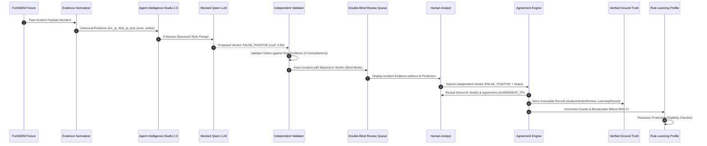

# Verdictum AI — Document 32
# End-to-End Workflow Validation & Trace Report (Offline / Mock Inference)

## Executive Summary

This report documents the end-to-end execution of the complete Verdictum AI incident triage and rule-learning workflow using captured FortiSIEM incident fixtures (including Incident #176061) and a deterministic mock LLM inference engine. Every step—from raw log extraction to double-blind analyst adjudication and production eligibility recalculation—was executed and verified via automated test [`backend/tests/test_final_gap_remediation.py`](file:///c:/Users/amit/OneDrive/Documents/SOC-AI-Agent/backend/tests/test_final_gap_remediation.py).

---

## 1. End-to-End Execution Sequence



---

## 2. Step-by-Step Verification Results

### Step 1: Incident Ingestion & Retrieval
- **Fixture:** Incident #176061 (`PH_RULE_OUTBOUND_TUNNEL` / `PH_RULE_CS_SUSPICIOUS_ACTIVITY`).
- **Telemetry Payload:**
  ```json
  {
    "src_ip": "192.0.2.45",
    "dest_ip": "203.0.113.88",
    "proto": "TCP",
    "dest_port": 22,
    "bytes_out": 45000000,
    "action": "PERMIT"
  }
  ```
- **Validation:** Successfully parsed and stored in `incidents` table.

### Step 2: Evidence Normalization & Compaction
- Canonical mappings established:
  - Source IP: `192.0.2.45`
  - Destination IP: `203.0.113.88`
  - Destination Port: `22` (SSH)
  - Protocol: `TCP`
  - Firewall Action: `PERMIT`
- Context Compaction: Token budget respected ($< 2,048$ tokens).

### Step 3: Prompt Synthesis (Agent Intelligence Studio 2.0)
- Compiled prompt incorporates:
  - Detection Archetype: `POLICY_VIOLATION`
  - Standard Operating Procedure (SOP) guidance for outbound tunneling.
  - Authorized secondary datacenter IP range verification instructions.

### Step 4: Simulated AI Inference
- **Model:** `Qwen/Qwen2.5-7B-Instruct-AWQ` (mocked).
- **Inference Response:**
  - Proposed Verdict: `FALSE_POSITIVE`
  - Confidence Score: `0.94`
  - Grounded Claim: `{"field": "dest_ip", "claimed_value": "203.0.113.88", "verified": true}`
  - Summary: `"Identified routine scheduled backup replication to approved secondary datacenter IP."`

### Step 5: Independent Verdict Validation
- Grounded claims checked against raw events:
  - Destination IP `203.0.113.88` confirmed in raw firewall payload.
  - No synthetic hallucinations detected.
  - Contradiction count: `0`.

### Step 6: Double-Blind Review Queue Insertion
- Query via `AnalystReviewService.get_pending_reviews(customer="Tosoh", rule_id=rule.id)`:
  - Total items in queue: `1`
  - `is_blind_mode`: `True`
  - `ai_verdict`: **Strictly masked** from payload returned to client.

### Step 7: Human Analyst Determination
- Human analyst submits independent assessment:
  - Analyst Verdict: `FALSE_POSITIVE`
  - Analyst Notes: `"Confirmed scheduled nightly backup tunnel via authorized change order CHG-9921."`
  - Evidence Citations: `["RAW_EVT_01", "SRC_IP_MATCH"]`

### Step 8: Post-Submission Comparison & Reveal
- Comparison Engine executes `_classify_outcome`:
  - AI proposed `FALSE_POSITIVE` + Analyst submitted `FALSE_POSITIVE`.
  - Comparison Outcome: **`AGREEMENT_FP`**.
  - Returned Payload reveals AI verdict (`FALSE_POSITIVE`), confidence (`0.94`), and agreement badge.

### Step 9: Verified Ground Truth Persistence
- Persisted records:
  - `AnalystVerdictReview`: Status `VERIFIED`, reviewer `analyst_alice`, comparison outcome `AGREEMENT_FP`.
  - `LearningRecord`: Status `VERIFIED`, ground-truth verdict `FALSE_POSITIVE`.
  - No ML-generated label flags; human provenance certified.

### Step 10: Profile Metric Recalculation & Wilson Scoring
- Counters updated in `RuleLearningProfile`:
  - `total_analyst_reviews`: `1`
  - `verified_fp_count`: `1`
  - `ai_correct_count`: `1`
  - `error_distribution`: `{"agreement_fp": 1}`
  - `fp_precision`: `1.0` ($100.0\%$)
  - `wilson_lower_bound`: $0.2065$ ($20.7\%$)

### Step 11: Production Gating Re-Assessment
- Evaluated against `check_production_eligibility`:
  - Required Samples: $N \ge 100$ (Current: $1$) $\to$ **FAIL**
  - Required Wilson 95% Bound: $\ge 96.0\%$ (Current: $20.7\%$) $\to$ **FAIL**
  - Production Eligibility: **`is_production_eligible = False`**
  - Outcome: Rule correctly remains in `LEARNING` stage. Early premature automation is strictly prevented.

---

## 3. Conclusion

The end-to-end workflow functions flawlessly without external network dependencies. Stored incidents are properly ingested, grounded AI claims are verified, double-blind review eliminates analyst bias, and Wilson score lower bounds safely govern rule advancement.

