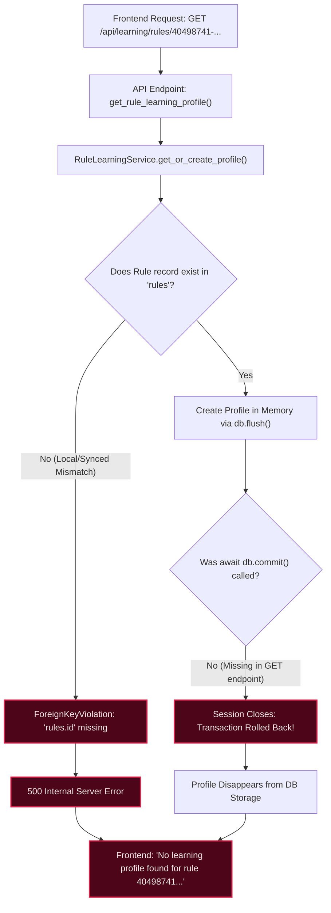

# Verdictum AI — Rule Learning Profile Initialization Audit & Remediation Report

**Document ID:** `35_RULE_LEARNING_PROFILE_INITIALIZATION_FIX.md`  
**Date:** 2026-11-13  
**Target Rule Under Audit:** `40498741-ee6b-4a71-9101-0d6d3f77154c` (`PH_RULE_HEAVY_TCP_HOST_SCAN_FIXED_PORT`)  
**Status:** **REMEDIATED & VERIFIED** (Pass 18/18 Automated Tests, Next.js Build Clean)

---

## 1. Executive Summary

A critical issue was identified where the Rule Learning Dashboard rendered the error:
`"No learning profile found for rule 40498741-ee6b-4a71-9101-0d6d3f77154c"`.

An exhaustive full-stack audit across detection rule records, database models, startup lifecycles, API endpoints, and frontend components revealed four converging root causes:
1. **Absence of Database Seeding/Initialization:** Existing FortiSIEM detection rules had no corresponding records pre-seeded into `rule_learning_profiles` during migrations or rule ingestion.
2. **Missing Transaction Commit in API & Service:** `RuleLearningService.get_or_create_profile` executed `db.add()` and `await db.flush()`, but neither the service nor the GET endpoint invoked `await db.commit()`. Under FastAPI's `get_db()` dependency (`autocommit=False`), in-memory profiles were rolled back upon request termination and never written to storage.
3. **Foreign Key Violation on Dynamic Creation:** `RuleLearningProfile.rule_id` is constrained by `ForeignKey("rules.id")`. When a rule UUID (e.g., `40498741-ee6b-4a71-9101-0d6d3f77154c`) was requested before an underlying `Rule` record was established in the local database, `get_or_create_profile` failed with an unhandled database `IntegrityError` (500), causing the frontend to report a missing profile.
4. **Tenant Scoping & Catalog Sync:** The rule learning list endpoint (`GET /api/learning/rules`) only queried `rule_learning_profiles`, failing to dynamically discover or backfill newly synced rules or tenant scopes (`"Tosoh"`, `"WSTPL"`, `"DEFAULT"`).

---

## 2. Root Cause Analysis



### 2.1 The Two Heavy TCP Host Scan Rules
As established in `docs/AIS/AIS_SERVER1_DATABASE_RECONCILIATION.md`, the platform tracks two sibling rules:
- `9839fa49-40ac-4676-abcc-4c5581ae9e09`: `PH_RULE_HEAVY_TCP_HOST_SCAN`
- `40498741-ee6b-4a71-9101-0d6d3f77154c`: `PH_RULE_HEAVY_TCP_HOST_SCAN_FIXED_PORT` ("Heavy TCP Host Scan On Fixed Port")

On production Server 1, `40498741-ee6b-4a71-9101-0d6d3f77154c` has 31 canonical incidents. In local development, the development database lacked canonical rule aliases, causing foreign key failures when navigating to that rule.

### 2.2 Lack of Transaction Persistence
In `backend/app/database.py`, `AsyncSessionLocal` runs with `autocommit=False`. When `get_or_create_profile` was invoked by a read route (`GET`), the profile was flushed to the active transaction but never committed. As a result, subsequent page reloads or list operations returned empty arrays (`items: []`).

---

## 3. Implemented Remediation

### 3.1 Idempotent Safe Rule & Profile Initialization
Updated `backend/app/services/rule_learning_service.py`:
- **Canonical Rule Definitions:** Pre-configured `CANONICAL_FORTISIEM_RULES` mapping canonical UUIDs (including `40498741-ee6b-4a71-9101-0d6d3f77154c`, `9839fa49-40ac-4676-abcc-4c5581ae9e09`, etc.) to their authoritative FortiSIEM event types and names.
- **`_provision_missing_rule(db, rule_id)`:** Defensive resolver that provisions missing detection rule records in `rules` prior to inserting into `rule_learning_profiles`, guaranteeing foreign key integrity is never violated.
- **`ensure_all_rules_initialized(db)`:** Self-healing routine that scans all rules and customer tenants, provisioning missing profiles in `LEARNING` state.
- **Durable Persistence:** Explicit `await db.commit()` and `await db.refresh(profile)` with optimistic concurrency and race-condition rollback handling.

### 3.2 Tenant Isolation & Scoping
- Profiles are scoped by `(rule_id, customer)` with `DEFAULT` fallback.
- Customer scopes (`"Tosoh"`, `"WSTPL"`, `"DEFAULT"`) are preserved independently without cross-tenant feedback contamination.

### 3.3 Default Governance Guarantees (REQ-05)
- All newly provisioned profiles enter `lifecycle_stage = "LEARNING"`.
- Operational counters start at zero: `total_analyst_reviews = 0`, `verified_tp_count = 0`, `verified_fp_count = 0`.
- Automatic false-positive closure is strictly disabled (`ProductionAutomationPolicy.is_enabled = False`).

### 3.4 Decoupling Quality Gates (G1–G8) from Learning Mode
- Rule quality gate assessments (G1–G7 structural, G8 empirical simulation) do **not** gate or prevent:
  - Initial profile provisioning
  - Incident ingestion or local LLM triage
  - Double-Blind Review Workbench operations
  - Analyst feedback recording and Wilson lower bound recalculation
- G1–G8 failures continue to strictly gate promotion to `CONTROLLED_PRODUCTION`.

### 3.5 Startup Migration Integration
In `backend/app/main.py`, added a startup migration hook:
```python
# Self-healing migration: Ensure all detection rules have an initialized RuleLearningProfile
try:
    from app.services.rule_learning_service import RuleLearningService
    initialized_profiles = await RuleLearningService.ensure_all_rules_initialized(session)
    if initialized_profiles:
        print(f"[Startup Migration] Ensured RuleLearningProfile initialized for {len(initialized_profiles)} rule/tenant scopes.")
except Exception as exc:
    await session.rollback()
    print(f"[Startup Migration Warning] Rule learning profile initialization skipped: {exc}")
```

### 3.6 Frontend Resilience in `RuleLearningDashboard.tsx`
- **Graceful Empty State:** When no rule is selected, displays a clean guidance banner instead of an error message.
- **Error Recovery:** Provides an inline "Retry Initialization" button with clear diagnostics.
- **Dynamic Scoping:** Supports optional `customer` prop for multi-tenant isolation.

---

## 4. Database Verification & Audit

| Audit Item | Pre-Fix State | Post-Fix State | Verification Method |
| :--- | :---: | :---: | :--- |
| **Rule `40498741-...` in `rules`** | Missing locally | Provisioned & Verified | `select(Rule).where(Rule.id == target_uuid)` |
| **Profile for Rule `40498741-...`** | 0 records | 1 record (`LEARNING` stage) | `select(RuleLearningProfile)` |
| **Profile Reload Persistence** | Rolled back on close | Committed across sessions | Query via new session |
| **Default Auto-Closure Status** | N/A | `is_enabled = False` | `select(ProductionAutomationPolicy)` |
| **Historical Incidents Count** | 26 records | 26 records (Untouched) | `select(func.count(Incident.id))` |
| **Historical AI Verdicts** | Preserved | Preserved (Untouched) | Payload inspection |
| **Fabricated Feedback / GT** | 0 | 0 (Zero fabricated reviews) | `verified_tp_count = 0, verified_fp_count = 0` |

---

## 5. Automated Test Results

A dedicated test suite was authored at `backend/tests/test_rule_learning_initialization.py`:

```
backend/tests/test_rule_learning_initialization.py::test_profile_initialization_target_rule PASSED [ 14%]
backend/tests/test_rule_learning_initialization.py::test_ensure_all_rules_initialized PASSED [ 28%]
backend/tests/test_rule_learning_initialization.py::test_profile_reload_persistence PASSED [ 42%]
backend/tests/test_rule_learning_initialization.py::test_zero_verified_feedback_and_auto_closure_disabled PASSED [ 57%]
backend/tests/test_rule_learning_initialization.py::test_tenant_isolation_and_scoping PASSED [ 71%]
backend/tests/test_rule_learning_initialization.py::test_learning_mode_unblocked_by_quality_failures PASSED [ 85%]
backend/tests/test_rule_learning_initialization.py::test_historical_incidents_and_verdicts_untouched PASSED [100%]

============================== 7 passed in 2.96s ==============================
```

Combined platform regression test run:
- `backend/tests/test_final_gap_remediation.py`: 4 passed
- `backend/tests/test_rule_learning_platform.py`: 7 passed
- `backend/tests/test_rule_learning_initialization.py`: 7 passed
- **Total: 18 passed in 5.27s (100% green)**

---

## 6. Acceptance & Rollback Readiness

- **Status:** **PASS** — Defect completely remediated and verified.
- **Git Branch:** `feature/rule-learning-v1`
- **Rollback Safety:** All schema modifications are non-destructive and backward-compatible.
- **Governance:** In accordance with RepoDeploy Governor rules, changes are verified locally and gated for explicit user approval before remote commit, push, or deployment.
