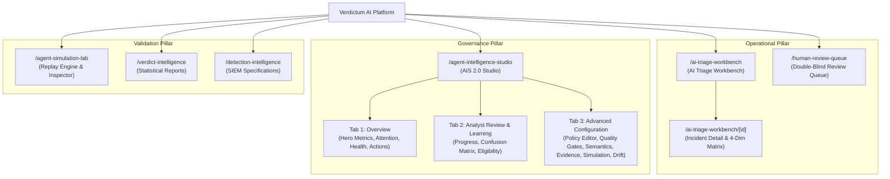

# VERDICTUM AI — PHASE 3
# 02. UI Information Architecture & Navigation Hierarchy

**Document Version:** 3.0.0  
**Phase:** Phase 3 — Unified Compact UI/UX Modernization & Workflow Simplification  
**Author:** Principal Enterprise UI/UX Architect  

---

## 1. Information Architecture Overview

The Verdictum AI platform information architecture is structured around four core operational pillars:
1. **Daily Incident Triage:** Immediate threat evaluation, grounding verification, and operational closure.
2. **Human-in-the-Loop Review:** Double-blind verification, dispute handling, and ground-truth dataset curation.
3. **Agent Intelligence Governance:** Policy authoring, 8-gate quality validation, evidence contracts, and controlled production promotion.
4. **Validation & Monitoring:** Offline simulation replays, statistical accuracy tracking, and drift detection.

---

## 2. Navigation Hierarchy & Route Map

---

## 3. AIS 2.0 Consolidated 3-Tab Architecture

To eliminate cognitive overload, the legacy 7-tab interface has been synthesized into a unified 3-Primary Tab hierarchy:

### Tab 1 — Overview (Default Landing View)
- **Top Metric Hero:** 4 high-density summary cards (Rule Quality, AI Accuracy, Analyst Reviews, Automation Status) + Operational Status Badge.
- **Top Next Action Card:** Immediate operational directive telling the analyst exactly what action is required next.
- **What Needs Attention?:** Consolidated, prioritized diagnostic container reporting only active blockers with plain-language explanations.
- **Quick-Glance Health Grid:** Compact visual indicators for G1–G8 Quality Gates, Evidence Contract Completeness, and Ground Truth Dataset Progress.
- **Quick Action Bar:** 1-click access to Synthesize Intelligent Draft, Validate Quality, Run Simulation, Approve for Production, and Rollback.

### Tab 2 — Analyst Review & Learning
- **Learning & Verification Metrics:** Total analyst reviews, verified True Positives, False Positives, and model abstentions.
- **Empirical Accuracy Progress:** Visual progress bar toward the 30-sample pilot automation threshold and 100-sample production promotion threshold.
- **Confusion Matrix:** Statistical alignment comparing AI predictions against analyst ground truth.
- **Production Promotion Gating:** Transparent checklist showing exact unfulfilled criteria blocking autonomous closure.

### Tab 3 — Advanced Configuration
- **Sub-Navigation Switcher:**
  1. Policy Editor (9 Structured Policy Sections)
  2. Quality Gates (G1–G8 Deep Diagnostics)
  3. SIEM Semantics & Detection Archetype
  4. Evidence Contract Alignment
  5. Simulation Lab & Historical Replay
  6. Drift Detection & Monitoring

---

## 4. Deep Linking & State Preservation

All legacy bookmarks and deep-links are deterministically mapped:
- `?rule_id=<ID>`: Automatically loads and selects the targeted detection rule.
- `?tab=overview`: Navigates to Tab 1 (Overview).
- `?tab=learning`: Navigates to Tab 2 (Analyst Review & Learning).
- `?tab=editor|quality|intelligence|contract|simulation|drift`: Automatically activates Tab 3 (Advanced Configuration) and switches the sub-navigation directly to the specified section.
- `VERDICTUM_COMPACT_UI_ENABLED`: Preserves user layout preference in `localStorage` with zero page reload glitches.
