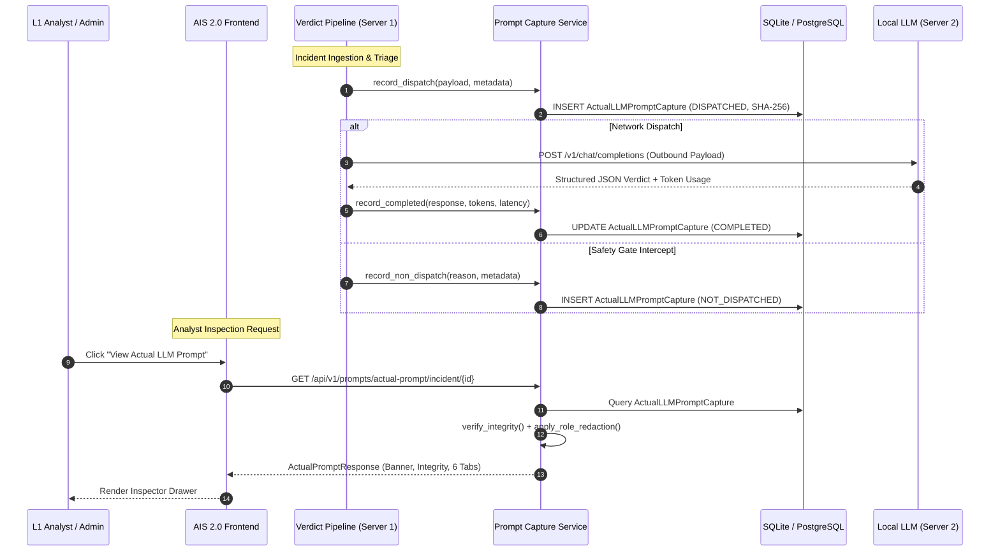

# 01 — Architecture Audit: Actual LLM Prompt Inspector

**Platform:** Verdictum AI — Agent Intelligence Studio 2.0  
**Feature:** View Actual LLM Prompt (Server 1 → Server 2 Outbound Request Inspector)  
**Date:** November 14, 2026  
**Status:** Complete & Verified  

---

## 1. Executive Summary

In Verdictum AI's dual-server architecture, **Server 1** hosts the core application, triage pipeline, policy compilation engine, and databases, while **Server 2** hosts the local GPU LLM (e.g. Qwen 2.5 7B Instruct AWQ served via vLLM / Ollama with strict structured JSON output).

Prior to this implementation:
1. Administrators and L1 SOC analysts could view the **draft or approved prompt policy** in Prompt Studio.
2. However, there was **no authoritative record of the exact payload** transmitted over HTTP from Server 1 to Server 2 at the provider boundary.
3. Analysts could not verify whether a returned verdict was influenced by specific incident telemetry, truncated tokens, omitted RAG precedents, or a mismatch in policy versioning.
4. Regenerating a prompt in the UI created a "draft preview" which did not represent historical execution truth.

The **Actual LLM Prompt Inspector** solves this by establishing a non-bypassable capture mechanism at the **model provider boundary** (`OPENAI_COMPATIBLE` and `SIMULATED`), recording immutable canonical outbound payloads with SHA-256 cryptographic digests, execution-linked metadata, and multi-point prompt integrity verification.

---

## 2. Component Inspection

### 2.1 Backend Pipeline (`verdict_pipeline.py`)
- **Compilation:** Calls `PolicyCompilerService.compile_policy` with 9 standardized policy sections plus Sections 10 and 11 for instruction boundaries and structured output schema.
- **Evidence Sanitization:** `build_sanitized_model_payload` extracts normalized incident telemetry, strips ground truth labels, and wraps telemetry inside `<UNTRUSTED_INCIDENT_DATA>` delimiters.
- **Provider Boundary:** Located in `_invoke_provider_with_guards(...)` and the provider implementations `OpenAICompatibleProvider.generate(...)` and `SimulatedProvider.generate(...)`.
- **Pre-Dispatch Capture Point:** Hooked directly before network serialization to ensure the payload recorded is identical to bytes dispatched.
- **Post-Dispatch Capture Point:** Hooked immediately upon receiving response or exception, recording latency, prompt tokens, completion tokens, raw response, and execution status (`COMPLETED` or `FAILED`).
- **Safety Gate Early Exits:** When safety gates trigger before LLM dispatch (e.g. `POLICY_NOT_APPROVED`, `POLICY_DRIFT_UNACKNOWLEDGED`, `INSUFFICIENT_EVIDENCE`), an explicit `NOT_DISPATCHED` capture record is generated to prevent claiming unverified dispatch.

### 2.2 Local LLM Provider (`openai_compatible.py` & `simulated.py`)
- **Transport:** HTTP POST to Server 2 endpoint `/v1/chat/completions`.
- **Payload Schema:** OpenAI-compatible messages array `[{"role": "system", "content": "..."}, {"role": "user", "content": "..."}]` with temperature, max_tokens, and response_format JSON schema.
- **Capture Hook:** Added `capture_callback` and `post_capture_callback` invocations inside the provider classes, passing canonical request payloads and raw response outputs.

### 2.3 Policy Governance & Integrity
- **Version Tracking:** Every verdict execution records `policy_version_id`, `policy_version_number`, and `policy_status`.
- **Provenance Verification:** Multi-point check verifies that:
  1. The SHA-256 hash of the canonical JSON representation matches `request_sha256`.
  2. The policy version is active and approved.
  3. `<UNTRUSTED_INCIDENT_DATA>` boundary delimiters are strictly present.
  4. Outbound telemetry matches the incident record.

### 2.4 Frontend Architecture
- **Agent Intelligence Studio 2.0:** Single-pane governance workbench (`/agent-intelligence-studio`).
- **Inspector Modal:** Standalone accessible drawer/modal (`ActualPromptInspectorModal.tsx`) providing:
  - 3 Distinct Banner States: `Captured Runtime Prompt`, `Historical Capture Unavailable`, `Preview Only`.
  - L1 Engineer Plain-Language Explanation with 5 highlights and `Prompt Integrity` badge (`Verified`, `Mismatch`, `Unverified`).
  - 6 Tabbed Perspectives: Execution Summary, System Prompt, Incident Payload, Historical Precedents, Output Contract, Technical Details.
  - Role-based redaction and export options (JSON / Markdown).

---

## 3. Data Flow Diagram

---

## 4. Key Architectural Guarantees

1. **No Silent Reconstitution:** Live preview endpoints are strictly tagged `PREVIEW_ONLY` and `UNVERIFIED`. Historical incidents lacking capture data return `HISTORICAL_CAPTURE_UNAVAILABLE`. A preview is NEVER masqueraded as a captured runtime prompt.
2. **Cryptographic Payload Integrity:** The SHA-256 digest is computed over sorted, whitespace-trimmed canonical JSON (`json.dumps(payload, sort_keys=True, separators=(',', ':'))`). Any database mutation causes an immediate `MISMATCH` integrity flag.
3. **Pipeline Non-Blocking:** All capture persistence is wrapped in defensive try/except blocks so that noncritical capture logging errors never crash incident triage or block verdict delivery.
4. **Zero Secret Leakage:** Authorization headers, bearer tokens, and internal server IPs are never stored in the capture record. Non-admin roles receive redacted security telemetry.
