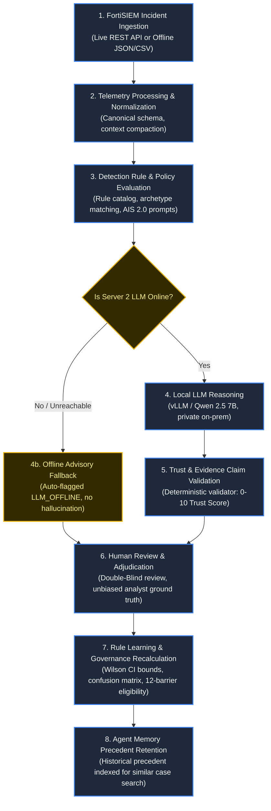

# How Verdictum AI Works — End-to-End Workflow Guide

This guide explains how security incidents flow through Verdictum AI from initial SIEM ingestion to evidence validation, local LLM reasoning, double-blind analyst adjudication, and statistical rule learning.

---

## 1. Visual Workflow Architecture

---

## 2. Stage-by-Stage Breakdown

### Stage 1: FortiSIEM Incident Ingestion
- **What happens:** The platform connects to the FortiSIEM XML/REST API or ingests uploaded JSON/CSV archives to retrieve raw security incidents. It extracts incident headers, reporting devices, timestamps, and tenant associations.
- **UI Page to Open:** [Telemetry Hub](file:///c:/Users/amit/OneDrive/Documents/SOC-AI-Agent/docs/admin-guide/SOC_OPERATIONS.md#3-telemetry-hub-telemetry-hub) (`/telemetry-hub`)
- **Offline Behavior:** Fully operational offline. If the live FortiSIEM API is unreachable, the system seamlessly ingests offline incident archives or loads database-persisted fixtures.
- **Incident #176061 Example:** Incident #176061 is pulled containing 45 raw events from firewall `FortiGate-Core-01` indicating high outbound SSH traffic on port 22.

---

### Stage 2: Telemetry Processing & Normalization
- **What happens:** Raw unstructured event payloads are parsed into canonical schema fields (`src_ip`, `dest_ip`, `dest_port`, `proto`, `action`, `process_name`, `user`). Repetitive log lines are compacted to optimize context budget.
- **UI Page to Open:** [Telemetry Hub](file:///c:/Users/amit/OneDrive/Documents/SOC-AI-Agent/docs/admin-guide/SOC_OPERATIONS.md#3-telemetry-hub-telemetry-hub) (`/telemetry-hub`)
- **Offline Behavior:** Runs deterministically on Server 1 CPU without external network or LLM dependencies.
- **Incident #176061 Example:** Events are parsed into canonical evidence: `src_ip=192.0.2.45`, `dest_ip=203.0.113.88`, `dest_port=22`, `proto=TCP`, `action=PERMIT`.

---

### Stage 3: Detection Rule & Policy Evaluation
- **What happens:** The engine maps the event signature to its registered Detection Rule and archetype (e.g. `POLICY_VIOLATION`, `BRUTE_FORCE`, `DATA_EXFILTRATION`). It fetches the active 9-section prompt template from Agent Intelligence Studio.
- **UI Page to Open:** [Agent Intelligence Studio](file:///c:/Users/amit/OneDrive/Documents/SOC-AI-Agent/docs/admin-guide/AGENT_INTELLIGENCE.md#1-agent-intelligence-studio-agent-intelligence-studio) (`/agent-intelligence-studio`)
- **Offline Behavior:** Fully operational offline; prompt templates and rule contracts are stored in the local database.
- **Incident #176061 Example:** Incident matches rule `PH_RULE_CS_SUSPICIOUS_ACTIVITY` and archetype `POLICY_VIOLATION`. Active Prompt Version 3 is selected.

---

### Stage 4: Local LLM Reasoning & Triage
- **What happens:** The compiled prompt is sent to the locally hosted Qwen 2.5 7B model running on Server 2 GPU. The model reviews evidence, checks SOP logic, and returns a proposed verdict (`TRUE_POSITIVE`, `FALSE_POSITIVE`, or `INCONCLUSIVE`) with confidence and reasoning.
- **UI Page to Open:** [AI Triage Workbench](file:///c:/Users/amit/OneDrive/Documents/SOC-AI-Agent/docs/admin-guide/SOC_OPERATIONS.md#2-ai-triage-workbench-ai-triage-workbench) (`/ai-triage-workbench`)
- **Offline Behavior:** If Server 2 GPU is offline or unreachable, the system automatically marks the incident as `LLM_OFFLINE_ADVISORY`, leaves the incident open, and routes it directly to the human analyst queue. No fabricated verdicts are produced.
- **Incident #176061 Example:** Qwen model analyzes the SSH transfer and proposes `FALSE_POSITIVE` (confidence 0.94), claiming the destination IP matches a scheduled nightly backup replication server.

---

### Stage 5: Trust & Evidence Claim Validation
- **What happens:** An independent deterministic non-LLM validation engine inspects every factual claim made by the AI model. It verifies IP addresses, file paths, ports, and timestamps against raw telemetry. If any claim is contradicted or unsubstantiated, the trust score is penalized.
- **UI Page to Open:** [Verdict Intelligence](file:///c:/Users/amit/OneDrive/Documents/SOC-AI-Agent/docs/admin-guide/VALIDATION_AND_TRUST.md#2-verdict-intelligence-verdict-intelligence) (`/verdict-intelligence`)
- **Offline Behavior:** Runs 100% deterministically on Server 1.
- **Incident #176061 Example:** The validator verifies that destination IP `203.0.113.88` exists in raw firewall events. Contradictions: 0. Trust Score calculated as 9/10 (Strong Support).

---

### Stage 6: Human Analyst Review & Adjudication
- **What happens:** The incident enters the Human Review Queue. In **Double-Blind Review Mode**, the AI's proposed verdict is masked to prevent confirmation bias. The SOC analyst independently reviews evidence and records their determination (`TRUE_POSITIVE`, `FALSE_POSITIVE`, or `INCONCLUSIVE`). Upon submission, the AI verdict is revealed and agreement is scored.
- **UI Page to Open:** [Human Review Queue](file:///c:/Users/amit/OneDrive/Documents/SOC-AI-Agent/docs/admin-guide/SOC_OPERATIONS.md#4-human-review-queue-human-review-queue) (`/human-review-queue`)
- **Offline Behavior:** Operational offline; analysts can review and resolve incidents without external connectivity.
- **Incident #176061 Example:** Analyst Alice independently reviews Incident #176061 without seeing the AI prediction. Alice verifies change order `CHG-9921` for offsite backup and submits `FALSE_POSITIVE`. The system reveals AI prediction (`FALSE_POSITIVE`), records `AGREEMENT_FP`, and logs verified ground truth.

---

### Stage 7: Rule Learning & Governance Recalculation
- **What happens:** The verified human adjudication updates the rule's statistical profile in real time. The system updates the confusion matrix (TP, FP, FN, FP), recalculates empirical accuracy, and evaluates the Wilson score 95% confidence lower bound.
- **UI Page to Open:** [Agent Intelligence Studio](file:///c:/Users/amit/OneDrive/Documents/SOC-AI-Agent/docs/admin-guide/AGENT_INTELLIGENCE.md#1-agent-intelligence-studio-agent-intelligence-studio) (`/agent-intelligence-studio`, Tab 7)
- **Offline Behavior:** Executes mathematical updates locally in the PostgreSQL/SQLite database.
- **Incident #176061 Example:** Verified FP count increments to 26; Wilson lower bound recalculates to 96.4%. Rule status evaluated against the 12-barrier production eligibility checklist.

---

### Stage 8: Agent Memory Precedent Retention
- **What happens:** The verified determination, analyst reasoning, and associated telemetry indicators are indexed in Agent Memory. When future incidents with similar source IPs or command lines arrive, the system surfaces this precedent to assist analysts.
- **UI Page to Open:** [Agent Memory](file:///c:/Users/amit/OneDrive/Documents/SOC-AI-Agent/docs/admin-guide/AGENT_INTELLIGENCE.md#3-agent-memory-agent-memory) (`/agent-memory`)
- **Offline Behavior:** Fully operational locally via database index.
- **Incident #176061 Example:** Incident #176061 is stored as precedent `PREC-176061` ("Scheduled Nightly Backup to Offsite Server").

---

## 3. System Behavior During LLM Outage

When Server 2 (the local Qwen 2.5 7B LLM cluster) is unreachable or powered down:

1. **No Incident Drops:** Incidents continue to ingest normally from FortiSIEM and Telemetry Hub.
2. **Deterministic Triage Available:** Heuristic and regex-based evidence parsing continues uninterrupted.
3. **Graceful Advisory Status:** The incident status displays `LLM_OFFLINE_ADVISORY`.
4. **Zero Unverified Closures:** Incidents are never auto-closed. All alerts route to the Human Review Queue.
5. **Clear Banner Alerts:** The UI displays a warning banner informing analysts that the AI copilot is temporarily offline while all human review tools remain 100% functional.
