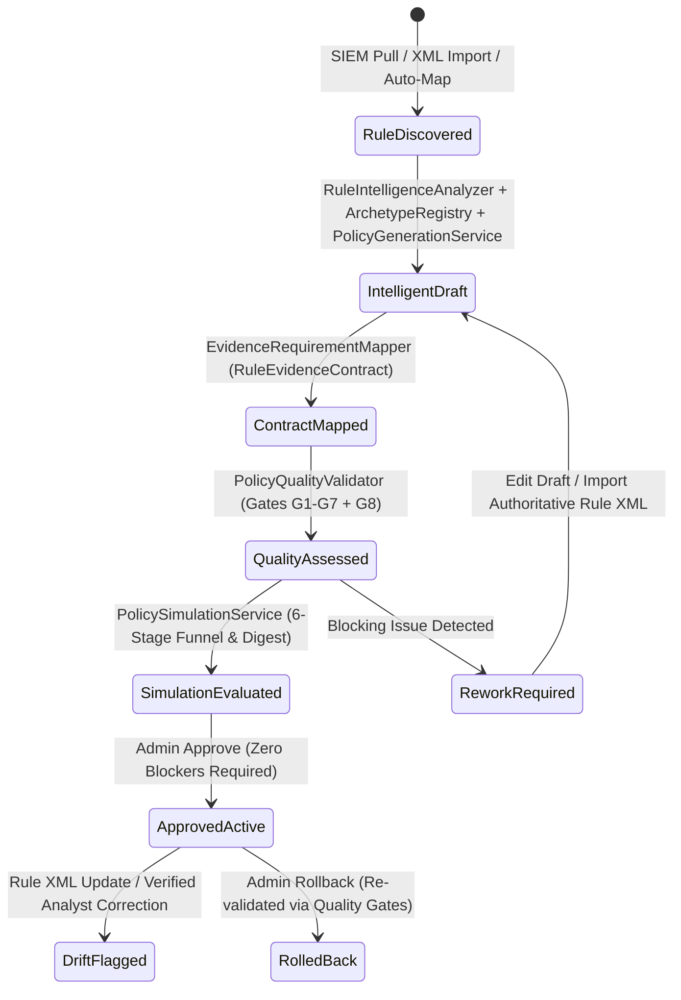

# Agent Intelligence Studio 2.0/2.1 — Policy Lifecycle & Governance

- **Updated At:** 2026-11-10T19:55:00+05:30
- **Repository Commit:** `0148142` (`0148142f3abd6dad87a903b90f7b25edb8d41def`)
- **Architecture Version:** `AIS 2.1 + Audit Remediation v2.2.1`
- **Primary Source Modules:** [`prompt_studio_service.py`](file:///c:/Users/amit/OneDrive/Documents/SOC-AI-Agent/backend/app/services/prompt_studio_service.py), [`policy_quality_validator.py`](file:///c:/Users/amit/OneDrive/Documents/SOC-AI-Agent/backend/app/services/policy_quality_validator.py), [`policy_simulation_service.py`](file:///c:/Users/amit/OneDrive/Documents/SOC-AI-Agent/backend/app/services/policy_simulation_service.py), [`policy_lifecycle_monitor.py`](file:///c:/Users/amit/OneDrive/Documents/SOC-AI-Agent/backend/app/services/policy_lifecycle_monitor.py), [`api/prompts.py`](file:///c:/Users/amit/OneDrive/Documents/SOC-AI-Agent/backend/app/api/prompts.py)

---

## 1. End-to-End Policy Lifecycle

---

## 2. Core Components & Remediated Safeguards

### 2.1 Authoritative vs. Observed Rule Semantics (`RuleIntelligenceAnalyzer`)
- Distinguishes authoritative FortiSIEM XML/JSON rule definitions (`AUTHORITATIVE_SIEM_DEFINITION`) from runtime incident telemetry heuristics (`AUTO_SYNCED_FROM_INCIDENT`).
- Prevents observed byte/count values (e.g., `sentBytes64 = 2130499380`) from being misclassified as a rule trigger threshold.
- Classifies rules across 12 versioned behavioral archetypes (`DetectionArchetypeRegistry`) such as `NETWORK_EXFILTRATION`, `PROCESS_EXECUTION`, `MALWARE_EXECUTION`, `NETWORK_SCAN`, and `AUTHENTICATION`.

### 2.2 Machine-Verifiable Evidence Contracts (`EvidenceRequirementMapper` & `EvidenceContractService`)
- Maps archetype core telemetry and observed attributes into `RuleEvidenceContract` objects split across `CORE` (`critical`), `CONDITIONAL`, `OPTIONAL`, and `UNAVAILABLE`.
- Contract `status` strictly tracks `PromptVersion.status` (`APPROVED` vs `DRAFT` / `UNVERIFIED`).
- `FortiSIEMService.pull_rule_and_register()` was remediated to **never** assign `active_version_id` to newly generated drafts (`DRAFT` isolation).

### 2.3 Nine-Section Policy Generation & Live/Simulation Compilation Parity
- Both live triage (`VerdictTriageAgent`) and dry-run replay (`DryRunService`, `PolicySimulationService`) compile prompts through [`PolicyCompilerService`](file:///c:/Users/amit/OneDrive/Documents/SOC-AI-Agent/backend/app/services/policy_compiler_service.py), emitting all 9 ordered policy sections plus a deterministic SHA-256 `compilation_digest`.

### 2.4 Version-Aware Historical Simulation & 6-Stage Funnel (`PolicySimulationService`)
- Evaluates only incidents matching the target `rule_id` (`rule_ids` set); non-matching incidents are tracked in `exclusions_detail` (`RULE_MISMATCH`) and strictly excluded from metrics and calibration sample counts.
- **Remediated Simulation Gaps:**
  - Removed hardcoded `historical_sample_count=total_cases` and `historical_accuracy=85.0`; replaced with `get_rule_calibration_stats(rule_id)` reading verified database runs/adjudications.
  - Compiles candidate `PromptVersion` (`policy_version_id`), computes and stores `policy_digest` on `HistoricalEvaluationRunRecord.config_snapshot`, applies candidate `tp_indicators`/`fp_indicators`/`missing_info_criteria` in heuristic mode (`_simulate_model_output`), and honors `provider_type == "OPENAI_COMPATIBLE"`.

### 2.5 Approval, Rollback & Continuous Drift Monitoring
- **Approval (`PromptStudioService.approve_version`):** Queries the latest completed `HistoricalEvaluationRunRecord` matching the rule and candidate `PromptVersion.id` (with `policy_digest` check) and executes `PolicyQualityValidator.validate_policy_quality(..., simulation_results=sim_results)`. Critical G8 regressions (`REGRESSION_DETECTED` / `critical_false_negatives > 0`) **block** approval alongside G1–G7 structural blockers. Upon approval, archives previous versions, commits the active version, and schedules bounded background reevaluation for deferred incidents via `BackgroundTasks`.
- **Rollback (`PromptStudioService.rollback_version`):** Re-evaluates the rollback candidate against G1–G7 quality gates before creating an approved rollback revision, preventing reactivation of legacy unsafe policies.
- **Drift Monitor (`PolicyLifecycleMonitor`):** Now actively wired into:
  1. `FortiSIEMService.import_authoritative_rule_definition()` on rule definition updates;
  2. `FortiSIEMService.pull_rule_and_register(..., force_refresh=True)` on live SIEM rule updates; and
  3. `LearningService.update_verification_status(..., "VERIFIED")` when verified analyst corrections diverge from AI verdicts (`ANALYST_FEEDBACK_VERIFIED`).
- **Real Summary Visibility (`/api/prompts/summary`):** Fixed hardcoded `simulation_status = "NOT_EVALUATED"` to report persisted `PolicyQualityAssessmentRecord` & `HistoricalEvaluationRunRecord` state cleanly.

