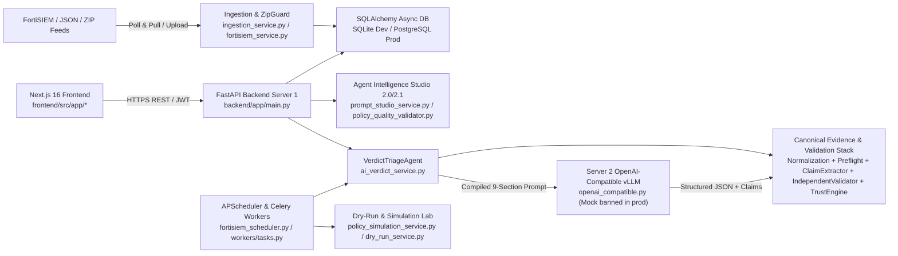

# AI Verdict — Verified System Architecture

- **Updated At:** 2026-11-10T19:55:00+05:30
- **Repository Commit:** `0148142` (`0148142f3abd6dad87a903b90f7b25edb8d41def`)
- **Architecture Version:** `AIS 2.1 + Audit Remediation v2.2.1`
- **Cross-References:**
  - [`docs/architecture/INCIDENT_TO_VERDICT_FLOW.md`](file:///c:/Users/amit/OneDrive/Documents/SOC-AI-Agent/docs/architecture/INCIDENT_TO_VERDICT_FLOW.md)
  - [`docs/architecture/AGENT_INTELLIGENCE_STUDIO.md`](file:///c:/Users/amit/OneDrive/Documents/SOC-AI-Agent/docs/architecture/AGENT_INTELLIGENCE_STUDIO.md)
  - [`docs/audits/CODEBASE_GAP_AUDIT.md`](file:///c:/Users/amit/OneDrive/Documents/SOC-AI-Agent/docs/audits/CODEBASE_GAP_AUDIT.md)
  - [`docs/FEATURE_IMPLEMENTATION_STATUS.md`](file:///c:/Users/amit/OneDrive/Documents/SOC-AI-Agent/docs/FEATURE_IMPLEMENTATION_STATUS.md)

> [!NOTE]
> **Runtime Verification Scope:** Backend API routing, ORM models, policy governance gates, evidence validation engines, simulation funnels, and SQLite integration paths are **verified via automated pytest suites**. Physical Server 2 GPU (`OPENAI_COMPATIBLE`), live FortiSIEM Supervisor REST endpoints, external PostgreSQL/Redis clusters, and headless browser UI interactions remain **unverified against live external appliances** in this dry-run sandbox.

---

## 1. High-Level Topology

AI Verdict separates persistent orchestration, governance, evidence validation, and SOC workflow (**Server 1: Control Plane & Database**) from stateless GPU LLM inference (**Server 2: vLLM OpenAI-Compatible Engine**).

---

## 2. Verified Subsystem Inventory

### 2.1 Frontend (`frontend/src/`)
- **Framework:** Next.js `16.4.5`, React `19.3.0`, TypeScript (verified cleanly via `npx tsc --noEmit`).
- **Central API Client:** [`frontend/src/lib/api.ts`](file:///c:/Users/amit/OneDrive/Documents/SOC-AI-Agent/frontend/src/lib/api.ts) targeting `/api` and `/api/v1/verdict-intelligence/*`.
- **Key Routes & Workspaces:**
  - Policy Governance & Studio: [`agent-intelligence-studio/page.tsx`](file:///c:/Users/amit/OneDrive/Documents/SOC-AI-Agent/frontend/src/app/agent-intelligence-studio/page.tsx), [`prompt-studio/page.tsx`](file:///c:/Users/amit/OneDrive/Documents/SOC-AI-Agent/frontend/src/app/prompt-studio/page.tsx)
  - Verdict Trust & Accuracy Analytics: [`verdict-intelligence/page.tsx`](file:///c:/Users/amit/OneDrive/Documents/SOC-AI-Agent/frontend/src/app/verdict-intelligence/page.tsx), [`evaluation-reports/page.tsx`](file:///c:/Users/amit/OneDrive/Documents/SOC-AI-Agent/frontend/src/app/evaluation-reports/page.tsx), [`agent-simulation-lab/page.tsx`](file:///c:/Users/amit/OneDrive/Documents/SOC-AI-Agent/frontend/src/app/agent-simulation-lab/page.tsx)
  - Triage & Analyst Queue: [`ai-triage-workbench/[id]/page.tsx`](file:///c:/Users/amit/OneDrive/Documents/SOC-AI-Agent/frontend/src/app/ai-triage-workbench/[id]/page.tsx), [`human-review-queue/page.tsx`](file:///c:/Users/amit/OneDrive/Documents/SOC-AI-Agent/frontend/src/app/human-review-queue/page.tsx), [`analyst-attention/page.tsx`](file:///c:/Users/amit/OneDrive/Documents/SOC-AI-Agent/frontend/src/app/analyst-attention/page.tsx), [`incidents/[id]/page.tsx`](file:///c:/Users/amit/OneDrive/Documents/SOC-AI-Agent/frontend/src/app/incidents/[id]/page.tsx)
  - Ingestion, Rules, & Operations: [`imports/page.tsx`](file:///c:/Users/amit/OneDrive/Documents/SOC-AI-Agent/frontend/src/app/imports/page.tsx), [`rules/page.tsx`](file:///c:/Users/amit/OneDrive/Documents/SOC-AI-Agent/frontend/src/app/rules/page.tsx), [`detection-intelligence/page.tsx`](file:///c:/Users/amit/OneDrive/Documents/SOC-AI-Agent/frontend/src/app/detection-intelligence/page.tsx), [`telemetry-hub/page.tsx`](file:///c:/Users/amit/OneDrive/Documents/SOC-AI-Agent/frontend/src/app/telemetry-hub/page.tsx), [`agent-memory/page.tsx`](file:///c:/Users/amit/OneDrive/Documents/SOC-AI-Agent/frontend/src/app/agent-memory/page.tsx), [`agent-configuration/page.tsx`](file:///c:/Users/amit/OneDrive/Documents/SOC-AI-Agent/frontend/src/app/agent-configuration/page.tsx), [`inference-control/page.tsx`](file:///c:/Users/amit/OneDrive/Documents/SOC-AI-Agent/frontend/src/app/inference-control/page.tsx), [`infrastructure/page.tsx`](file:///c:/Users/amit/OneDrive/Documents/SOC-AI-Agent/frontend/src/app/infrastructure/page.tsx), [`governance-access/page.tsx`](file:///c:/Users/amit/OneDrive/Documents/SOC-AI-Agent/frontend/src/app/governance-access/page.tsx), [`admin-guide/page.tsx`](file:///c:/Users/amit/OneDrive/Documents/SOC-AI-Agent/frontend/src/app/admin-guide/page.tsx), [`soc-chatbot/page.tsx`](file:///c:/Users/amit/OneDrive/Documents/SOC-AI-Agent/frontend/src/app/soc-chatbot/page.tsx).

### 2.2 Backend APIs (`backend/app/main.py` & `backend/app/api/`)
- FastAPI lifespan runs startup schema initialization/Alembic checks (`AUTO_MIGRATE_ON_STARTUP`) and mounts routers under `/api` (plus dual `/api/v1` mount for `verdict_intelligence.py` compatibility).
- Authentication & RBAC via [`backend/app/api/deps.py`](file:///c:/Users/amit/OneDrive/Documents/SOC-AI-Agent/backend/app/api/deps.py) and [`backend/app/utils/security.py`](file:///c:/Users/amit/OneDrive/Documents/SOC-AI-Agent/backend/app/utils/security.py) enforcing `get_current_active_user`, `require_analyst`, and `require_admin` (`Administrator` only for approvals/rollbacks/privileged actions).

### 2.3 Core Backend Engines & Nomenclature Wrappers
Ten small module files in `backend/app/services/` act intentionally as domain-aligned re-export shims (`agent_memory_engine.py`, `agent_policy_engine.py`, `detection_context_engine.py`, `evidence_integrity_guardrail.py`, `inference_health_monitor.py`, `review_orchestrator.py`, `sentinel_ingest_worker.py`, `validation_engine.py`, `verdict_evaluation_engine.py`, `verdict_triage_agent.py`) verified against `test_agentic_nomenclature.py`.

### 2.4 Data & Migrations (`backend/app/models/`, `backend/alembic/versions/`)
- Alembic migrations `001` through `006` define core tables (`incidents`, `incident_events`, `historical_ground_truth`, `rules`, `rule_prompts`, `prompt_versions`, `rule_intelligence_snapshots`, `policy_quality_assessments`, `policy_drift_events`, `bulk_quality_audit_jobs`, `verdict_trust_assessments`, `evidence_sufficiency_assessments`, `ground_truth_validations`, `historical_evaluation_runs`, `historical_evaluation_results`, `investigations`, `learning_records`, `audit_logs`, `token_usage_records`, `telemetry_timeline_records`).

